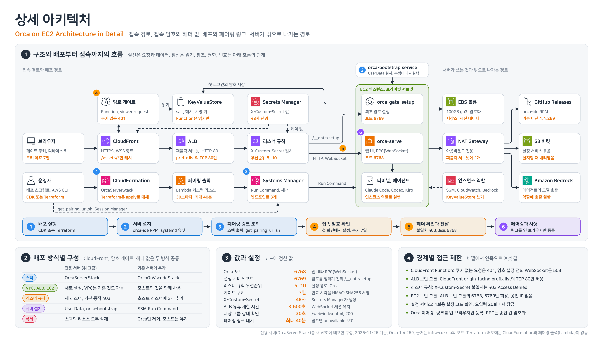

# Orca on EC2 - Secure Architecture


<a href="#english"></a>
<a href="#korean"></a>

Deploy the Orca headless server to a private EC2 instance behind CloudFront and an ALB with AWS CDK or Terraform | AWS CDK 또는 Terraform으로 Orca headless 서버를 CloudFront와 ALB 뒤의 Private EC2에 배포합니다

---

<a id="english"></a>

# English

## Overview

This project deploys the headless server (`orca-ide serve`) of [Orca](https://github.com/stablyai/orca), an orchestrator for AI coding agents, to a private EC2 instance with AWS CDK or Terraform. You open it from a browser over CloudFront HTTPS, and a browser is all you need. The structure and the security design follow [ec2_vscode](https://github.com/whchoi98/ec2_vscode).

<picture>
  <source media="(prefers-color-scheme: dark)" srcset="docs/infographic/build/05-architecture-en_16x9_dark.png">
  
</picture>

Access takes two steps. The CloudFront password gate asks for the access password, and then Orca pairing approves each browser as a device. The origin accepts only CloudFront: the ALB admits the CloudFront prefix list and a random `X-Custom-Secret` header, and the EC2 instance sits in a private subnet.

There are two deployment modes, and each one deploys with AWS CDK or with Terraform. One server takes one deployment from one tool.

| Mode | What it creates | AWS CDK | Terraform |
|---|---|---|---|
| Dedicated server | A new VPC, ALB and EC2 instance for Orca | `bash deploy_orca.sh` | `bash deploy_orca_tf.sh` |
| Add to an existing server | Orca on a VS Code server made with ec2_vscode. It shares the EC2 instance and the ALB of that server and adds one CloudFront distribution | `bash deploy_orca.sh --attach <host-stack>` | `bash deploy_orca_tf.sh --attach <host-stack>` |

### Documentation

| Document | Contents |
|---|---|
| [Deployment guide](docs/deployment.md) | What a deployment creates and how it is protected, the deployment menus, adding Orca to an existing server, deleting a deployment |
| [Deploy with Terraform](docs/terraform.md) | Terraform commands, differences from the CDK deployment, options and variables |
| [Access and operations](docs/usage.md) | Pairing link, access password, agents on the server, daily operations, upgrades, known limitations |
| [Configuration reference](docs/configuration.md) | Environment variables, stack parameters, CDK context, outputs, IAM role, password gate paths |
| [Architecture](docs/architecture.md) | Components by layer, diagrams, design decisions |
| [Upgrade runbook](docs/runbooks/upgrade-orca.md) | The steps to upgrade Orca on an existing server |
| [Development](docs/development.md) | Full project layout and the tests |

## Features

- **Two deployment modes** — A dedicated server with its own VPC, ALB and EC2 instance, or Orca added to a server that already runs behind CloudFront and an ALB.
- **Two deployment tools** — AWS CDK and Terraform create the same structure from the same edge function and server scripts.
- **Guided install in Claude Code** — The `install-orca` skill checks the tools and the account, asks for the choices and deploys after approval.
- **Password gate at the edge** — A CloudFront Function with a KeyValueStore checks the access password in front of the UI, the static assets and the WebSocket.
- **Password setup at first login** — When no password is given at deploy time, the first page sets it with a one-time setup code.
- **Origin that accepts only CloudFront** — The ALB is protected by the CloudFront prefix list and a random `X-Custom-Secret` header, and the EC2 instance sits in a private subnet.
- **Pairing link in the stack outputs** — The CDK deployment reads the link on the server and puts it in the stack outputs, and `--no-pairing-output` keeps it out. The Terraform deployment never puts the link in its outputs.
- **Upgrade without a reboot** — `upgrade_orca.sh` replaces the RPM after comparing it with the sha256 of the release and restarts only `orca-serve`.
- **Coding agents preinstalled** — The dedicated server comes with Claude Code, Codex and Kiro CLI and the permission to call Bedrock models.

## Prerequisites

- AWS CLI with the required permissions (CloudFormation, EC2, ELB, CloudFront, IAM, SSM, Secrets Manager, S3)
- Node.js 20 or later with npm (for the CDK deployment and `npm test`), Python 3, curl
- Terraform 1.5 or later, only for the Terraform deployment (checked with 1.14.7 only; the provider versions are pinned in `.terraform.lock.hcl`)
- `session-manager-plugin` (to read the pairing link and to connect through SSM)
- `jq` and Bash 4 or later (for the hooks and the harness tests)
- Claude Code, only for the guided install (`/install-orca`)

## Installation

### Guided Install in Claude Code

The `install-orca` skill walks through the first install in a Claude Code session. It needs Claude Code, the tools under [Prerequisites](#prerequisites) and the AWS credentials of the target account in the shell. Start Claude Code in the repository and type `/install-orca`. A choice that follows the command is not asked again.

```bash
git clone https://github.com/whchoi98/my-orca.git
cd my-orca
claude
```

```text
/install-orca                               # Ask for every choice
/install-orca terraform us-west-2           # Deploy with Terraform in us-west-2
/install-orca --attach VscodeServerStack    # Add Orca to an existing VS Code server
```

| Step | What the skill does | What you do |
|---|---|---|
| 1. Check | Runs `scripts/setup.sh`, shows the AWS account and looks for an existing deployment | Confirm the account |
| 2. Choose | Shows the defaults: dedicated server, AWS CDK, a new VPC, r6g.xlarge, the region from `AWS_REGION` or ap-northeast-2 | Accept them or say what to change |
| 3. Plan | Shows the command it will run and the billed resources. With Terraform it runs the plan first | Approve the plan |
| 4. Deploy and verify | Deploys with the pairing link masked, then reads the stack status and checks the password gate | Approve each deployment command when Claude Code asks |
| 5. First access | Explains how to get the pairing link | Run `bash get_pairing_url.sh` in your own terminal, open the link and set the password |

The skill does not ask for the access password and does not print the pairing link. You set the password on the first page and read the link in your own terminal. Changes to a deployed stack and upgrades go through `/deploy`.

### Manual Install

```bash
git clone https://github.com/whchoi98/my-orca.git
cd my-orca
bash scripts/setup.sh   # Check the local tools. No AWS resource is created or changed
bash deploy_orca.sh     # Numbered menus: region, VPC (new or existing), instance type, access password
```

`bash deploy_orca.sh --yes` deploys with the defaults (ap-northeast-2, r6g.xlarge, a new VPC, password set at first login). The deployment waits until the server installation finishes and then shows the pairing link. The menus, the requirements for an existing VPC and the `--attach` mode are in the [deployment guide](docs/deployment.md), and the Terraform commands are in [Deploy with Terraform](docs/terraform.md).

## Usage

<picture>
  <source media="(prefers-color-scheme: dark)" srcset="docs/infographic/build/03-first-access-en_16x9_dark.png">
  
</picture>

1. Open `PairingWebLink` from the deployment output in a browser. With a Terraform deployment, or when a server restart changed the link, read it with `bash get_pairing_url.sh`.
2. Set the access password on the first page, or log in when the password was given at deploy time.
3. The browser is paired and the Orca screen opens. After that, open only the CloudFront URL.

The pairing link is access to the server itself. Treat it like a password.

| Task | Command |
|---|---|
| Read the pairing link again | `bash get_pairing_url.sh` |
| Set or change the access password | `bash set_password.sh` |
| Reset a lost password (back to the first-login setup) | `bash set_password.sh --reset-ui` |
| Compare the installed Orca with the latest release | `bash upgrade_orca.sh --check` |
| Upgrade Orca on a stack added to an existing server | `bash upgrade_orca.sh` |
| Delete the deployment | `bash cleanup.sh` |

For a Terraform deployment add `--tf <dedicated|attach>` to `get_pairing_url.sh`, `set_password.sh` and `cleanup.sh`, and upgrade with `deploy_orca_tf.sh --orca-version`. Agent setup on the server, operations, the details of an upgrade and the known limitations are in [Access and operations](docs/usage.md).

## Configuration

The access password is never stored in a file. Enter it at a prompt or on the first page, or pass it once as an environment variable in front of the command. Only a salt, a salted hash and the cookie signing key are stored, in the CloudFront KeyValueStore.

| Variable | Description | Default |
|---|---|---|
| `ORCA_WEB_PASSWORD` | Access password for the deployment scripts, passed once in front of the command. Do not write it to `.env` or any other file | (none: prompt, or setup at first login) |
| `AWS_REGION` | Region used by every script. `--region` overrides it | ap-northeast-2 |
| `STACK_NAME` | Stack name used by every script. `--stack-name` overrides it | `OrcaServerStack` (`OrcaOnVscodeStack` with `--attach`) |

The other variables, stack parameters, CDK context, outputs and the IAM role are in the [configuration reference](docs/configuration.md). Terraform options and variables are in [Deploy with Terraform](docs/terraform.md#options-and-variables).

## Project Structure

```text
.
├── deploy_orca.sh        # CDK deployment
├── deploy_orca_tf.sh     # Terraform deployment
├── deploy_guide.sh       # Menus both deployment scripts share (not run directly)
├── upgrade_orca.sh       # Upgrade Orca on a stack added to an existing server
├── get_pairing_url.sh    # Read the pairing link
├── set_password.sh       # Set or change the access password
├── cleanup.sh            # Delete the deployment
├── infra-cdk/            # CDK project: stacks, edge function, Lambda handlers, server scripts, tests
├── infra-tf/             # Terraform configuration of the same structure
├── docs/                 # Guides, architecture, references, runbooks, figure sources
├── scripts/              # setup.sh (working environment), install-hooks.sh (git hooks)
├── tests/                # Harness tests
└── .claude/              # Claude Code settings, hooks, skills, commands, agents
```

The full tree is in [Development](docs/development.md#project-structure).

## Testing

```bash
npm test --prefix infra-cdk     # Project code: gate function, setup service, pairing output, host install, scripts
bash tests/run-all.sh           # Harness: hooks, settings, project structure, document pointers
bash infra-tf/run-tests.sh      # Terraform: formatting, validation, plan tests with a mock provider
```

The tests do not call AWS. What each suite checks is in [Development](docs/development.md#testing).

## API Documentation

The password gate adds the paths below in front of Orca. The status codes and the headers are in the [configuration reference](docs/configuration.md#password-gate-paths) and in [docs/api-reference.md](docs/api-reference.md), which is written in Korean.

| Path | Method | Handled by | Purpose |
|---|---|---|---|
| `/__gate/login` | POST | CloudFront Function | Checks the password and issues the `orca_gate` cookie |
| `/__gate/logout` | any | CloudFront Function | Clears the cookie and goes back to `/` |
| `/__gate/setup` | POST | Setup service on the server (port 6769) | Stores the first password with the one-time setup code, only while no password is set |
| `/__gate/health` | GET | Setup service on the server | Health check of the ALB target group. It is not routed from CloudFront |
| every other path | any | CloudFront Function, then Orca | Passed to Orca with a valid cookie. Without one the gate answers by itself (login page, or setup page before a password is set) |

## Contributing

1. Fork the repository.
2. Create a branch: `git checkout -b feat/short-description`.
3. Commit with Conventional Commits: `feat: add an option for the listener rule priority`, `fix: keep the spaces around the access password`.
4. Push the branch: `git push origin feat/short-description`.
5. Open a pull request that says what was changed and how it was checked.

Changes to AWS resources are deployed only after showing the diff and getting approval. Run `npm test --prefix infra-cdk`, `bash infra-tf/run-tests.sh` and `bash tests/run-all.sh` before asking for a review. Changes are recorded in [CHANGELOG.md](CHANGELOG.md).

## License

This project does not include a LICENSE file. No license has been chosen.

## Contact

- Maintainer: [WooHyung Choi (whchoi98)](https://github.com/whchoi98)
- Issues: [github.com/whchoi98/my-orca/issues](https://github.com/whchoi98/my-orca/issues)

---

<a id="korean"></a>

# 한국어

## 개요

이 프로젝트는 AI 코딩 에이전트 오케스트레이터인 [Orca](https://github.com/stablyai/orca)의 headless 서버(`orca-ide serve`)를 AWS CDK 또는 Terraform으로 Private EC2에 배포합니다. 브라우저에서 CloudFront HTTPS로 접속하고 브라우저만 있으면 됩니다. 구조와 보안 설계는 [ec2_vscode](https://github.com/whchoi98/ec2_vscode)를 따릅니다.

<picture>
  <source media="(prefers-color-scheme: dark)" srcset="docs/infographic/build/05-architecture_16x9_dark.png">
  
</picture>

접속은 두 단계입니다. CloudFront 암호 게이트가 접속 암호를 확인하고 그다음에 Orca 페어링이 브라우저마다 디바이스 승인을 합니다. 오리진은 CloudFront만 받습니다. ALB는 CloudFront prefix list와 랜덤 `X-Custom-Secret` 헤더만 통과시키고 EC2는 Private Subnet에 있습니다.

배포 방식은 두 가지이고 각각 AWS CDK나 Terraform으로 배포합니다. 한 서버에는 한 도구의 배포 하나만 붙입니다.

| 배포 방식 | 만드는 것 | AWS CDK | Terraform |
|---|---|---|---|
| 전용 서버 | Orca용 VPC, ALB, EC2를 새로 만듭니다 | `bash deploy_orca.sh` | `bash deploy_orca_tf.sh` |
| 기존 서버에 추가 | ec2_vscode로 만든 VS Code 서버에 Orca를 함께 설치합니다. 그 서버의 EC2와 ALB를 함께 쓰고 CloudFront 하나를 더합니다 | `bash deploy_orca.sh --attach <host-stack>` | `bash deploy_orca_tf.sh --attach <host-stack>` |

### 문서

| 문서 | 내용 |
|---|---|
| [배포 안내](docs/deployment.md#korean) | 배포가 만드는 것과 보호 방법, 배포 메뉴, 기존 서버에 Orca 추가, 배포 삭제 |
| [Terraform으로 배포](docs/terraform.md#korean) | Terraform 명령, CDK 배포와 다른 점, 옵션과 변수 |
| [접속과 운영](docs/usage.md#korean) | 페어링 링크, 접속 암호, 서버의 에이전트 설정, 운영, 업그레이드, 알려진 제약 |
| [환경 설정 참조](docs/configuration.md#korean) | 환경 변수, 스택 파라미터, CDK context, 출력, IAM 역할, 암호 게이트의 경로 |
| [아키텍처](docs/architecture.md#korean) | 층별 구성 요소, 그림, 설계 결정 |
| [업그레이드 런북](docs/runbooks/upgrade-orca.md#korean) | 기존 서버에 추가한 Orca를 올리는 순서 |
| [개발 안내](docs/development.md#korean) | 전체 프로젝트 구조와 테스트 |

## 주요 기능

- **두 가지 배포 방식** — Orca용 VPC, ALB, EC2를 새로 만드는 전용 서버와 이미 CloudFront와 ALB 뒤에서 운영 중인 서버에 Orca를 추가하는 방식을 제공합니다.
- **두 가지 배포 도구** — AWS CDK와 Terraform이 같은 엣지 함수와 서버 스크립트로 같은 구조를 만듭니다.
- **Claude Code에서 안내받는 설치** — `install-orca` 스킬이 도구와 계정을 확인하고 선택을 물은 뒤 승인을 받아 배포합니다.
- **엣지의 접속 암호 게이트** — CloudFront Function과 KeyValueStore가 UI, 정적 자산, WebSocket 앞에서 접속 암호를 확인합니다.
- **최초 로그인 암호 설정** — 배포 때 암호를 정하지 않으면 첫 화면에서 1회용 설정 코드로 암호를 정합니다.
- **CloudFront만 받는 오리진** — ALB는 CloudFront prefix list와 랜덤 `X-Custom-Secret` 헤더로 보호하고 EC2는 Private Subnet에 둡니다.
- **스택 출력의 페어링 링크** — CDK 배포는 서버에서 링크를 읽어 스택 출력에 넣고 `--no-pairing-output`을 주면 뺍니다. Terraform 배포는 링크를 출력에 넣지 않습니다.
- **재부팅 없는 업그레이드** — `upgrade_orca.sh`가 RPM을 릴리스의 sha256과 대조한 뒤 교체하고 `orca-serve`만 재시작합니다.
- **코딩 에이전트 사전 설치** — 전용 서버에는 Claude Code, Codex, Kiro CLI와 Bedrock 모델 호출 권한이 함께 준비됩니다.

## 사전 요구 사항

- AWS CLI와 필요한 권한 (CloudFormation, EC2, ELB, CloudFront, IAM, SSM, Secrets Manager, S3)
- Node.js 20 이상과 npm (CDK 배포와 `npm test`에 사용), Python 3, curl
- Terraform 1.5 이상 (Terraform으로 배포할 때만 필요. 1.14.7에서만 확인했고 provider 버전은 `.terraform.lock.hcl`에 고정)
- `session-manager-plugin` (페어링 링크 조회와 SSM 접속에 사용)
- `jq`와 Bash 4 이상 (훅과 하네스 테스트에 사용)
- Claude Code (안내받는 설치 `/install-orca`를 쓸 때만 필요)

## 설치 방법

### Claude Code에서 안내받는 설치

`install-orca` 스킬이 Claude Code 세션에서 처음 설치를 차례로 안내합니다. Claude Code와 [사전 요구 사항](#사전-요구-사항)의 도구가 있어야 하고 셸에 대상 계정의 AWS 자격 증명이 설정되어 있어야 합니다. 저장소에서 Claude Code를 실행하고 `/install-orca`를 입력합니다. 명령 뒤에 선택을 붙이면 그 항목은 묻지 않습니다.

```bash
git clone https://github.com/whchoi98/my-orca.git
cd my-orca
claude
```

```text
/install-orca                               # 모든 선택을 물어봄
/install-orca terraform us-west-2           # Terraform으로 us-west-2에 배포
/install-orca --attach VscodeServerStack    # 기존 VS Code 서버에 Orca 추가
```

| 단계 | 스킬이 하는 일 | 사용자가 하는 일 |
|---|---|---|
| 1. 준비 확인 | `scripts/setup.sh`를 실행하고 AWS 계정을 보여 주며 이미 배포한 것이 있는지 확인 | 계정이 맞는지 확인 |
| 2. 선택 | 기본값을 보여 줌: 전용 서버, AWS CDK, 새 VPC, r6g.xlarge, 리전은 `AWS_REGION` 또는 ap-northeast-2 | 그대로 진행하거나 바꿀 항목을 말함 |
| 3. 계획 | 실행할 명령과 과금되는 리소스를 보여 줌. Terraform은 계획을 먼저 실행 | 계획을 승인 |
| 4. 배포와 확인 | 페어링 링크를 가린 채 배포한 뒤 스택 상태와 암호 게이트의 응답을 확인 | Claude Code가 배포 명령의 승인을 물을 때마다 승인 |
| 5. 첫 접속 | 페어링 링크를 받는 방법을 안내 | 자기 터미널에서 `bash get_pairing_url.sh`를 실행하고 링크를 열어 암호를 정함 |

스킬은 접속 암호를 묻지 않고 페어링 링크를 출력하지 않습니다. 암호는 첫 화면에서 정하고 링크는 자기 터미널에서 받습니다. 이미 배포한 스택의 변경과 업그레이드는 `/deploy`로 합니다.

### 직접 설치

```bash
git clone https://github.com/whchoi98/my-orca.git
cd my-orca
bash scripts/setup.sh   # 로컬 도구 확인. AWS 리소스를 만들거나 바꾸지 않음
bash deploy_orca.sh     # 번호 메뉴: 리전, VPC(새로 만들기 또는 기존 VPC), 인스턴스 타입, 접속 암호
```

`bash deploy_orca.sh --yes`는 기본값(ap-northeast-2, r6g.xlarge, 새 VPC, 암호는 최초 로그인 때 설정)으로 배포합니다. 배포는 서버 설치가 끝날 때까지 기다린 뒤 페어링 링크를 보여 줍니다. 메뉴, 기존 VPC의 조건, `--attach` 방식은 [배포 안내](docs/deployment.md#korean)에, Terraform 명령은 [Terraform으로 배포](docs/terraform.md#korean)에 있습니다.

## 사용법

<picture>
  <source media="(prefers-color-scheme: dark)" srcset="docs/infographic/build/03-first-access_16x9_dark.png">
  
</picture>

1. 배포 출력의 `PairingWebLink`를 브라우저로 엽니다. Terraform 배포이거나 서버를 재시작해 링크가 바뀌었으면 `bash get_pairing_url.sh`로 받습니다.
2. 첫 화면에서 접속 암호를 정합니다. 배포 때 암호를 줬으면 로그인합니다.
3. 브라우저가 페어링되고 Orca 화면이 열립니다. 그 뒤로는 CloudFront 주소만 엽니다.

페어링 링크는 서버 접근 권한 그 자체입니다. 암호처럼 다룹니다.

| 할 일 | 명령 |
|---|---|
| 페어링 링크 다시 받기 | `bash get_pairing_url.sh` |
| 접속 암호 설정과 변경 | `bash set_password.sh` |
| 잊은 암호 초기화 (최초 로그인 설정으로 되돌림) | `bash set_password.sh --reset-ui` |
| 설치된 Orca와 최신 릴리스 비교 | `bash upgrade_orca.sh --check` |
| 기존 서버에 추가한 스택의 Orca 업그레이드 | `bash upgrade_orca.sh` |
| 배포 삭제 | `bash cleanup.sh` |

Terraform 배포는 `get_pairing_url.sh`, `set_password.sh`, `cleanup.sh`에 `--tf <dedicated|attach>`를 붙이고 업그레이드는 `deploy_orca_tf.sh --orca-version`으로 합니다. 서버의 에이전트 설정, 운영, 업그레이드의 자세한 내용, 알려진 제약은 [접속과 운영](docs/usage.md#korean)에 있습니다.

## 환경 설정

접속 암호는 어떤 파일에도 저장하지 않습니다. 프롬프트나 첫 화면에서 입력하거나 명령 앞에 환경 변수로 한 번만 넘깁니다. CloudFront KeyValueStore에는 salt, salt를 더한 해시, 쿠키 서명 키만 저장됩니다.

| 변수 | 설명 | 기본값 |
|---|---|---|
| `ORCA_WEB_PASSWORD` | 배포 스크립트가 읽는 접속 암호. 명령 앞에 한 번만 붙여 넘깁니다. `.env`나 다른 파일에 적지 않습니다 | (없음: 프롬프트 또는 최초 로그인 때 설정) |
| `AWS_REGION` | 모든 스크립트가 쓰는 리전. `--region`이 우선합니다 | ap-northeast-2 |
| `STACK_NAME` | 모든 스크립트가 쓰는 스택 이름. `--stack-name`이 우선합니다 | `OrcaServerStack` (`--attach`에서는 `OrcaOnVscodeStack`) |

나머지 변수, 스택 파라미터, CDK context, 출력, IAM 역할은 [환경 설정 참조](docs/configuration.md#korean)에, Terraform 옵션과 변수는 [Terraform으로 배포](docs/terraform.md#옵션과-변수)에 있습니다.

## 프로젝트 구조

```text
.
├── deploy_orca.sh        # CDK 배포
├── deploy_orca_tf.sh     # Terraform 배포
├── deploy_guide.sh       # 두 배포 스크립트가 함께 쓰는 메뉴 (직접 실행하지 않음)
├── upgrade_orca.sh       # 기존 서버에 추가한 스택의 Orca 업그레이드
├── get_pairing_url.sh    # 페어링 링크 조회
├── set_password.sh       # 접속 암호 설정과 변경
├── cleanup.sh            # 배포 삭제
├── infra-cdk/            # CDK 프로젝트: 스택, 엣지 함수, Lambda 핸들러, 서버 스크립트, 테스트
├── infra-tf/             # 같은 구조를 만드는 Terraform 구성
├── docs/                 # 안내 문서, 아키텍처, 참조, 런북, 그림의 소스
├── scripts/              # setup.sh (작업 환경), install-hooks.sh (git 훅)
├── tests/                # 하네스 테스트
└── .claude/              # Claude Code 설정, 훅, 스킬, 명령, 에이전트
```

전체 구조는 [개발 안내](docs/development.md#프로젝트-구조)에 있습니다.

## 테스트

```bash
npm test --prefix infra-cdk     # 프로젝트 코드: 게이트 함수, 설정 서비스, 페어링 출력, 호스트 설치, 스크립트
bash tests/run-all.sh           # 하네스: 훅, 설정, 프로젝트 구조, 문서의 포인터
bash infra-tf/run-tests.sh      # Terraform: 형식, 구성 검증, 가짜 provider로 하는 계획 테스트
```

테스트는 AWS를 호출하지 않습니다. 묶음마다 확인하는 내용은 [개발 안내](docs/development.md#테스트)에 있습니다.

## API 문서

암호 게이트는 Orca 앞에 아래 경로를 더합니다. 상태 코드와 헤더는 [환경 설정 참조](docs/configuration.md#암호-게이트의-경로)와 [docs/api-reference.md](docs/api-reference.md)에 있습니다.

| 경로 | 메서드 | 처리하는 곳 | 하는 일 |
|---|---|---|---|
| `/__gate/login` | POST | CloudFront Function | 암호를 확인하고 `orca_gate` 쿠키를 발급 |
| `/__gate/logout` | 모두 | CloudFront Function | 쿠키를 지우고 `/`로 보냄 |
| `/__gate/setup` | POST | 서버의 설정 서비스(포트 6769) | 암호가 없는 동안만 1회용 설정 코드로 첫 암호를 저장 |
| `/__gate/health` | GET | 서버의 설정 서비스 | ALB 대상 그룹의 상태 확인 경로. CloudFront에서는 이 경로로 가지 않음 |
| 그 밖의 모든 경로 | 모두 | CloudFront Function, 그다음 Orca | 쿠키가 유효하면 Orca로 전달. 없으면 게이트가 직접 응답 (로그인 페이지, 암호를 정하기 전에는 설정 페이지) |

## 기여 방법

1. 저장소를 Fork합니다.
2. 브랜치를 만듭니다: `git checkout -b feat/short-description`.
3. Conventional Commits 형식으로 커밋합니다: `feat: add an option for the listener rule priority`, `fix: keep the spaces around the access password`.
4. 브랜치를 Push합니다: `git push origin feat/short-description`.
5. 무엇을 바꿨고 어떻게 확인했는지 적어 Pull Request를 엽니다.

AWS 리소스의 변경은 차이를 보여 주고 승인을 받은 뒤에만 배포합니다. 검토를 요청하기 전에 `npm test --prefix infra-cdk`, `bash infra-tf/run-tests.sh`, `bash tests/run-all.sh`를 실행합니다. 변경 사항은 [CHANGELOG.md](CHANGELOG.md)에 기록합니다.

## 라이선스

이 프로젝트에는 LICENSE 파일이 없습니다. 라이선스를 아직 정하지 않았습니다.

## 연락처

- 관리자: [WooHyung Choi (whchoi98)](https://github.com/whchoi98)
- 이슈: [github.com/whchoi98/my-orca/issues](https://github.com/whchoi98/my-orca/issues)
