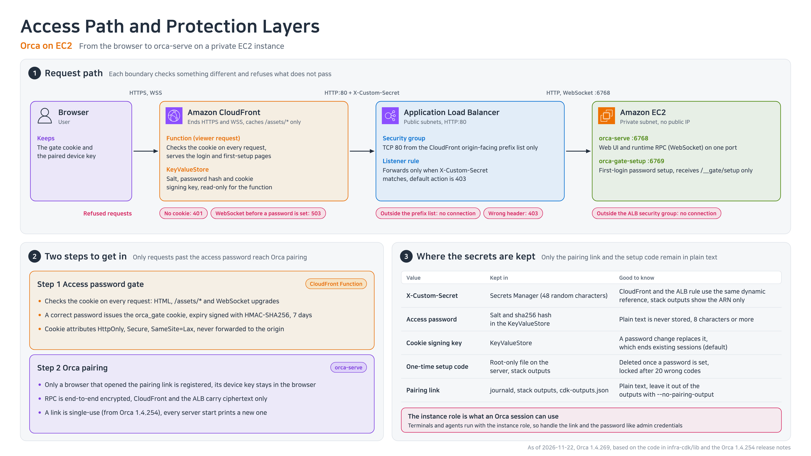
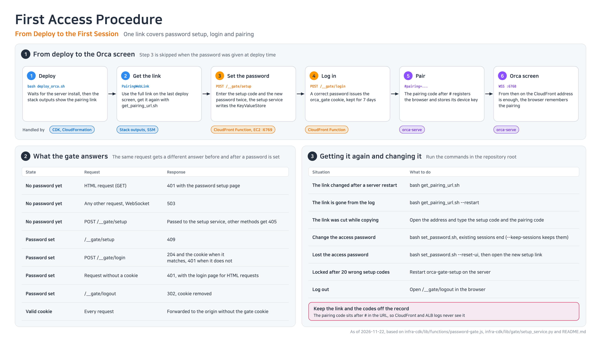
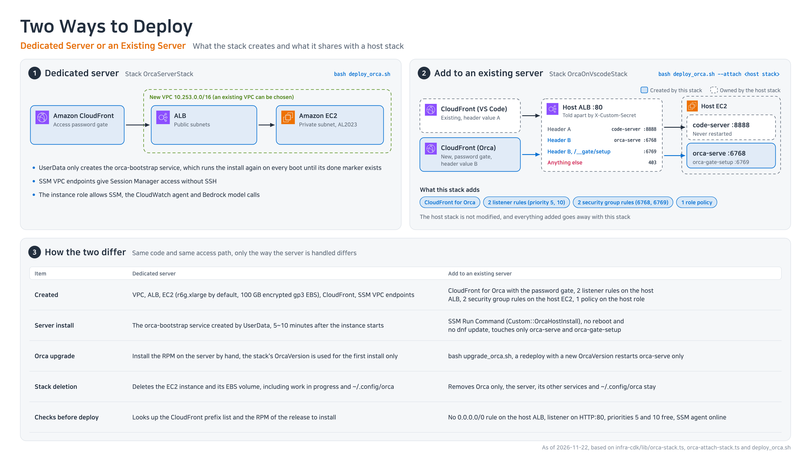
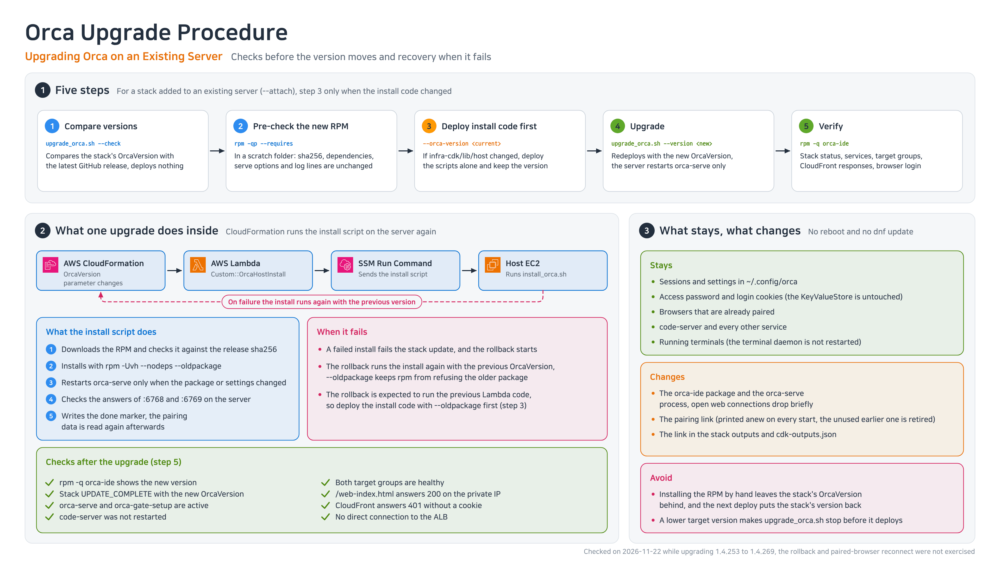
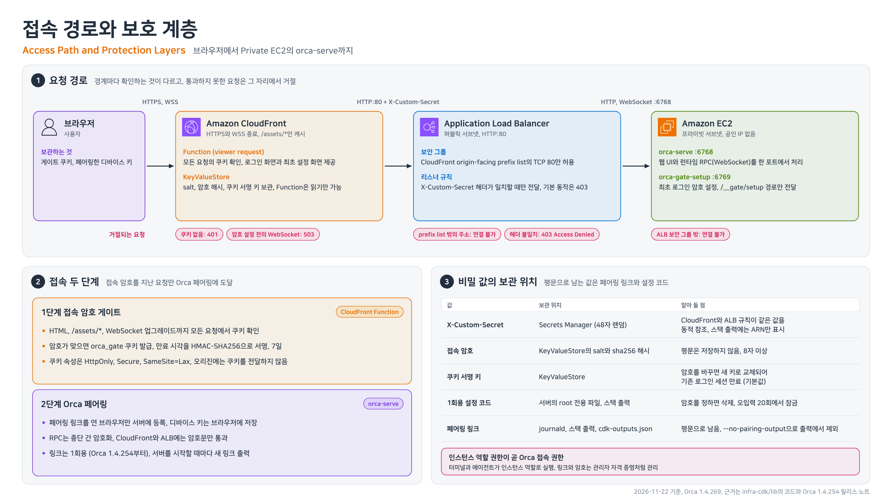
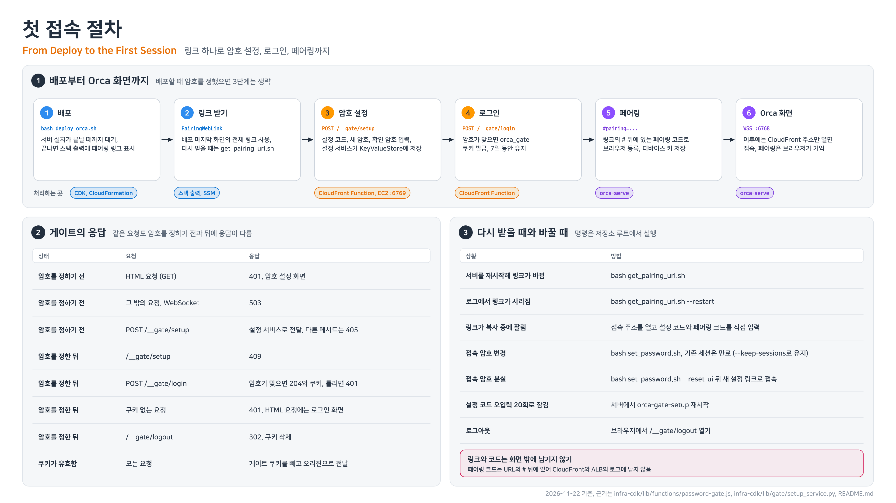
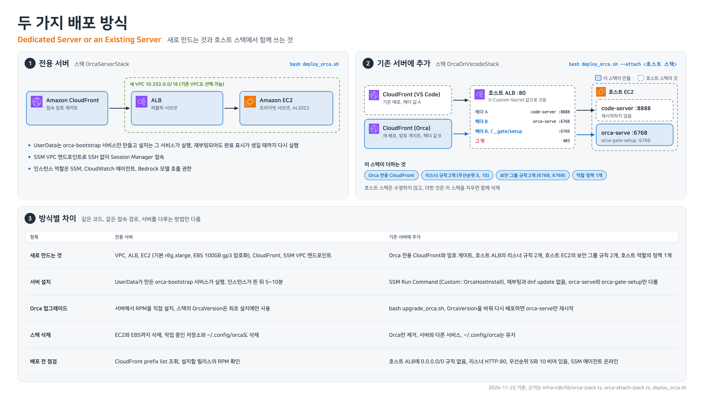
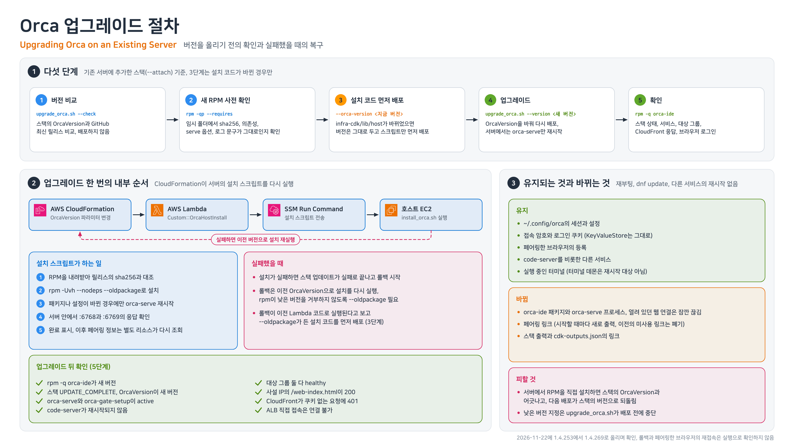

# Orca on EC2 - Secure Architecture


<a href="#english"></a>
<a href="#korean"></a>

Deploy the Orca headless server to a private EC2 instance behind CloudFront and an ALB with AWS CDK or Terraform | AWS CDK 또는 Terraform으로 Orca headless 서버를 CloudFront와 ALB 뒤의 Private EC2에 배포합니다

---

<a id="english"></a>

# English

## Overview

This project deploys the headless server (`orca-ide serve`) of [Orca](https://github.com/stablyai/orca), an orchestrator for AI coding agents, to a private EC2 instance with AWS CDK or Terraform. You open it from a browser over CloudFront HTTPS. The structure and the security design follow [ec2_vscode](https://github.com/whchoi98/ec2_vscode).

There are two ways to deploy.

- **Dedicated server** (`bash deploy_orca.sh`, stack `OrcaServerStack`): creates a new VPC, ALB and EC2 instance for Orca.
- **Add to an existing server** (`bash deploy_orca.sh --attach VscodeServerStack`, stack `OrcaOnVscodeStack`): installs Orca on a VS Code server created with ec2_vscode. See [Add Orca to an Existing Server](#add-orca-to-an-existing-server---attach).

Each mode can be deployed with AWS CDK (`deploy_orca.sh`, `infra-cdk/`) or with Terraform (`deploy_orca_tf.sh`, `infra-tf/`). Both tools create the same structure and use the same edge function and server scripts. One server takes one deployment from one tool. The commands above are the CDK ones, and the Terraform ones are under [Deploy with Terraform](#deploy-with-terraform).

The overall structure and its diagrams are in [docs/architecture.md](docs/architecture.md).

### Architecture

The figure shows the path of a request and what each boundary refuses. It follows the light or dark theme of GitHub, and opening the image shows it at full size. The sources of the figures in this document are in `docs/infographic/`, and `docs/infographic/build.sh` rebuilds them.

<picture>
  <source media="(prefers-color-scheme: dark)" srcset="docs/infographic/build/01-access-path-en_16x9_dark.png">
  
</picture>

```
User ──HTTPS/WSS──> CloudFront ──HTTP:80 + X-Custom-Secret──> ALB ──HTTP/WS:6768──> EC2 (private subnet)
                    [password gate]  (SG: CloudFront prefix list only)   (SG: ALB SG only)   orca-ide serve
                    CloudFront Function + KeyValueStore
```

Access takes two steps. First comes the CloudFront password gate, which plays the role of the code-server password page. Then Orca pairing approves each browser as a device.

One `orca-ide serve` process handles the web client (`/web-index.html`, HTTP) and the runtime RPC (WebSocket) on the same port, 6768. As with code-server, a browser is all you need.

### Components

| Component | Description |
|---|---|
| VPC | 10.253.0.0/16 (new) or an existing VPC |
| Public Subnet A/B | ALB, NAT Gateway |
| Private Subnet A/B | Orca server EC2 instance, SSM VPC endpoints |
| CloudFront | Terminates HTTPS and WSS, ALB origin, caches only `/assets/*` |
| CloudFront Function + KeyValueStore | Access password gate (login page, signed cookie) |
| ALB | Security group that allows only the CloudFront prefix list, `X-Custom-Secret` header check, 403 by default |
| EC2 | AL2023 ARM64 (r6g.xlarge by default), orca-ide, Claude Code, Codex, Kiro CLI |
| Secrets Manager | Value of the `X-Custom-Secret` header (48 random characters) |

### Security Features

- **Access password gate**: Orca has no password feature like code-server, so a CloudFront Function (viewer request) adds one. Without the cookie it shows a password page. With the right password it issues the `orca_gate` cookie (`HttpOnly; Secure; SameSite=Lax`, 7 days), whose expiry time is signed with HMAC. The check applies to HTML, to `/assets/*` and **to the WebSocket upgrade request**, so neither the UI nor the RPC socket opens without the password. The KeyValueStore holds only a salt, a hash and the cookie signing key, and neither the plain password nor the hash enters the CloudFormation template.
- **Password setup at first login**: If the password is skipped at deploy time, the first page becomes the password setup page (new password, confirmation and a show-password checkbox). A CloudFront Function can only read its KeyValueStore, so a small setup service on the EC2 instance (`orca-gate-setup`, port 6769, ALB path rule `/__gate/setup`) stores the password. A **one-time setup code** is required so that the first visitor cannot set the password. The stack output `PairingWebLink` and `get_pairing_url.sh` append the code after the `#` of the pairing link (opened without the code, the setup page shows a field for it). Once a password is set, the code is deleted and `/__gate/setup` is answered with 409 at the edge. The setup service locks after 20 wrong codes.
- **CloudFront prefix list**: The only inbound rule of the ALB security group is TCP 80 from `com.amazonaws.global.cloudfront.origin-facing`. The CDK listener uses `open: false`, so no 0.0.0.0/0 rule is created. The outbound rule of the ALB security group is limited to port 6768 of the EC2 security group.
- **X-Custom-Secret header**: The prefix list allows *every* CloudFront distribution, so the header keeps someone else's distribution from using this ALB as its origin. The value is a random string generated by Secrets Manager, and the CloudFront origin header and the ALB listener rule use the same dynamic reference (`{{resolve:secretsmanager:...}}`). Unlike a value built from the stack name and the account ID, it cannot be guessed, and it does not appear in the stack outputs. With the Terraform deployment Terraform generates the value, stores it in Secrets Manager as well and keeps it in its state file in plain text. Without the header or with a wrong value the ALB returns `403 Access Denied`.
- **Private subnet**: The EC2 instance has no public IP, and its only inbound rule is port 6768 from the ALB security group.
- **Orca pairing and E2EE**: Anyone can download the static files of the web UI, but using the server requires a pairing link (device token). A paired browser stores an Ed25519 key in IndexedDB, and RPC is end-to-end encrypted with the public key of the server, so only ciphertext passes through CloudFront and the ALB.
- **SSM VPC endpoints**: Access uses Session Manager, without SSH.
- **EBS encryption**: 100 GB gp3 with encryption enabled.

### Software Installed on the Dedicated Server

| Item | Version and location |
|---|---|
| Orca (`orca-ide`) | GitHub release RPM (latest at deploy time, `OrcaVersion` parameter) |
| Claude Code CLI | latest, native install (`~/.local/bin/claude`, updates itself without sudo) |
| Codex CLI | latest, user npm path (`~/.npm-global/bin/codex`) |
| Kiro CLI | latest (`/usr/local/bin`) |
| Node.js | 22 LTS (nodesource, fnm as fallback) |
| AWS CLI | v2 (latest) |
| Python3 + pip | boto3, click |
| Docker / uv / git / tmux | latest |
| Development Tools | gcc, make and others (for native npm modules on ARM64) |
| CloudWatch Agent / SSM Plugin | latest |
| ec2_vscode helpers | `~/ec2_vscode` (claude-code-setup, kiro-cli-setup, codex-cli-setup) |

> UserData creates only the install script (`/opt/orca-bootstrap/setup.sh`) and `orca-bootstrap.service`; the service performs the actual installation. Even when the instance reboots during the installation, for example because of an SSM patch, the service runs again on every boot until the completion marker (`/var/lib/orca-bootstrap/done`) exists.
> Check the progress with `sudo tail -f /var/log/user-data.log` or `systemctl status orca-bootstrap`.

### Why the Orca RPM Is Installed with `--nodeps` on Amazon Linux 2023

The `orca-ide` RPM requires `xdotool` and `xclip`, but the AL2023 repositories do not have them, so `dnf install ./orca-ide-*.rpm` fails. The two tools are used only for desktop control (`orca computer`) and for copying files to the clipboard, so the other dependencies (gtk3, nss, Xvfb and so on) are installed with `dnf` and the RPM is installed with `rpm -Uvh --nodeps`. From v1.4.269 the RPM also requires `/usr/bin/dbus-send`, so `dbus-tools` is installed as well. After that `dnf check` reports two missing dependencies, but installing other packages and `dnf upgrade` (including SSM patching) work normally.

## Features

- **Two deployment modes** — A stack that creates a VPC, an ALB and an EC2 instance for Orca, and a stack that adds Orca to a server already running behind CloudFront and an ALB.
- **Two deployment tools** — AWS CDK (`deploy_orca.sh`) and Terraform (`deploy_orca_tf.sh`) create the same structure and use the same edge function and server scripts.
- **Password gate at the edge** — A CloudFront Function with a KeyValueStore checks the access password in front of the UI, the static assets and the WebSocket.
- **Password setup at first login** — When no password is given at deploy time, the first page of a link that carries a one-time setup code sets it.
- **Origin that accepts only CloudFront** — The ALB is protected by the CloudFront prefix list and a random `X-Custom-Secret` header from Secrets Manager, and the EC2 instance sits in a private subnet.
- **Pairing link in the stack outputs** — With the CDK deployment a custom resource reads the link on the server and puts it in the stack outputs, and `--no-pairing-output` keeps it out. The Terraform deployment never puts the link in its outputs.
- **Upgrade without a reboot** — `upgrade_orca.sh` replaces the RPM after comparing it with the sha256 of the release and restarts only `orca-serve`; when an upgrade fails, CloudFormation rolls back by running the install again with the previous version (this path has not been exercised on a real failure). With Terraform, `deploy_orca_tf.sh --orca-version` upgrades in place in the same way, without a rollback.
- **Coding agents preinstalled** — The dedicated server comes with Claude Code, Codex and Kiro CLI and the permission to call Bedrock models.

## Prerequisites

- AWS CLI with the required permissions (CloudFormation, EC2, ELB, CloudFront, IAM, SSM, Secrets Manager, S3)
- Node.js 20 or later with npm (for the CDK deployment and `npm test`), Python 3, curl
- Terraform 1.5 or later, only for the Terraform deployment (checked with 1.14.7 only; the provider versions are pinned in `.terraform.lock.hcl`)
- `session-manager-plugin` (to read the pairing link and to connect through SSM)
- `jq` and Bash 4 or later (for the hooks and the harness tests)

## Installation

### 1. Prepare the Working Environment

```bash
bash scripts/setup.sh
```

The script checks the local tools and prepares the working files. It does not create or change AWS resources.

### 2. Deploy

```bash
bash deploy_orca.sh                 # Interactive: numbered menus for the region, the VPC (new or existing) and the instance type
bash deploy_orca.sh --yes           # Defaults: ap-northeast-2, r6g.xlarge, new VPC, password set at first login
ORCA_WEB_PASSWORD='...' bash deploy_orca.sh --yes   # Set the password too, without prompts
```

Without `--yes` the script asks with numbered menus, and a value given as an option is not asked again (`deploy_guide.sh`, shared with `deploy_orca_tf.sh`).

- **Region**: pick one of twelve regions or type a region code.
- **VPC**: create a new one (you can name it) or pick one from the list of VPCs in the account. For an existing VPC the script shows its subnets sorted the way CDK sorts them when it reads a VPC (public, private, isolated) and accepts the VPC only when it has public subnets in two or more Availability Zones for the ALB and a private subnet with a default route to a NAT gateway or a Transit Gateway for the server. When the VPC already has SSM endpoints, new ones are not created. A VPC given with `--vpc-id` is checked the same way before the deployment starts.
- **Instance type**: pick one of the fifteen types the stack accepts, shown with architecture, vCPU and memory. A type the region does not offer is marked and refused.
- **Access password**: type it now or press Enter to set it at the first login.

A dedicated server stack that is already deployed keeps its VPC and its instance type on a later run, and the script stops when another VPC is given, because a different VPC would replace the ALB and the server.

The deployment waits until the server installation finishes. A new stack takes about 5 to 10 more minutes after the instance starts, and then the **pairing link** appears in the stack outputs and on the last screen of the script.

```
OrcaServerStack.PairingWebLink = https://<cloudfront-domain>/web-index.html#pairing=orca%3A%2F%2Fpair%3Fcode%3D...&gate-setup=...
OrcaServerStack.GateSetupCode  = <one-time setup code>   ("none (access password already set)" once a password exists)
OrcaServerStack.PairingCode    = orca://pair?code=...
```

Open `PairingWebLink` in a browser. Use `get_pairing_url.sh` (see [Get the Pairing Link](#get-the-pairing-link)) only when the server was restarted and the link changed. To keep the link out of the outputs, deploy with `--no-pairing-output` (the reason is under [Pairing Link in the Stack Outputs](#pairing-link-in-the-stack-outputs)).

| Access password | Behavior |
|---|---|
| Entered at deploy time | Applied right after the deployment; the login page appears from the first visit |
| Skipped at deploy time | On the first visit (setup link) enter a new password and its confirmation; it is applied and you are logged in |
| Change | `bash set_password.sh` (by default every existing login session expires; `--keep-sessions` keeps them) |
| Lost | `bash set_password.sh --reset-ui`, then a new setup link from `get_pairing_url.sh` |
| Log out | `https://<cloudfront-domain>/__gate/logout` |

These commands deploy with CDK. To deploy with Terraform, run `deploy_orca_tf.sh` instead (see [Deploy with Terraform](#deploy-with-terraform)). That path does not put the pairing link in its outputs, so the link always comes from `get_pairing_url.sh`.

## Usage

### Get the Pairing Link

The figure shows the steps from the deployment to the Orca screen and what the password gate answers at each stage.

<picture>
  <source media="(prefers-color-scheme: dark)" srcset="docs/infographic/build/03-first-access-en_16x9_dark.png">
  
</picture>

Use `PairingWebLink` from the deployment output. To get it again, look at the stack outputs (`aws cloudformation describe-stacks`, the Outputs tab of the console, `cdk-outputs.json`) or read it from the server.

```bash
bash get_pairing_url.sh --region ap-northeast-2
# https://<cloudfront-domain>/web-index.html#pairing=orca%3A%2F%2Fpair%3Fcode%3D...
```

When you open the link in a browser, the access password page comes first.

- **If no password has been set yet**, the script prints an initial setup notice and a link that carries the setup code, and the first page asks for a new password and its confirmation (a checkbox shows or hides the password). The two values must match. Once the password is applied, you are logged in and pairing continues.
- **If a password is already set**, enter it on the login page. The same link reloads, the browser is paired and the Orca UI opens.

After that, open only the CloudFront URL (the cookie lasts 7 days and the pairing is stored in the browser).

A long link can lose the part after `#` while it is copied or clicked, which is common when it is opened from an editor terminal. In that case enter the values of item `[2]` in the `get_pairing_url.sh` output by hand.

1. Open the **access address**. With no password set, the setup page shows a **setup code** field, so enter the setup code, the new password and its confirmation.
2. When the Orca connection screen (**Connect to Orca**) appears, paste the **pairing code** (`orca://pair?code=...`) into the **Pairing URL or code** field and press **Connect**.

- The link is access to the server itself. Treat it like a password. From Orca v1.4.254 a link is single-use: once the browser that paired with it saves its own sign-in, the link no longer works (upstream release notes). An unused link is replaced by a new one when the server restarts.
- The token is in the URL `#fragment`, so it is not written to CloudFront or ALB logs, and it is removed from the address bar after pairing.
- `get_pairing_url.sh` uses an interactive SSM session, so the link is not left in the SSM command history.
- Recent browsers (with Ed25519 support) remember the pairing. Browsers without it keep the pairing only while the tab is open.
- If the link is no longer in journald, restart the service with `--restart` to print it again.

#### Pairing Link in the Stack Outputs

- **How it works**: A custom resource (`Custom::OrcaPairingInfo`, CDK Provider framework) runs `infra-cdk/lib/pairing/read_pairing.sh` on the server through SSM Run Command every 30 seconds. When the server installation is finished and `orca-serve` has printed the link, the resource receives the value as an attribute and the stack puts it in the outputs. On the server it only reads journald and the setup code file, and it does not change UserData, so adding it to an existing stack does not restart the instance.
- **Only the link of the running process** is reported, because from Orca v1.4.254 `orca-ide serve` prints a new link on every start and retires the unused link printed by the previous start (`orca-ide serve --help`).
- **When it is refreshed**: `deploy_orca.sh` reads it again on every deployment (`-c pairingRefresh=<time>`). If only the server was restarted without a deployment, the output holds the earlier value, so use `get_pairing_url.sh`.
- **If the installation fails or does not finish within 40 minutes**, the stack does not fail. The output holds `unavailable (<reason>) - run: bash get_pairing_url.sh --restart` instead, so that the instance to debug is not removed by a rollback.
- **Output values are ASCII English.** CloudFormation turns non-ASCII text in custom resource attributes into `?`, and `deploy_orca.sh` explains the values on screen in Korean.
- **Security**: The outputs are plain text. Anyone with `cloudformation:DescribeStacks` can see the link and, before a password is set, the setup code. The same values remain in the SSM Run Command history and in `cdk-outputs.json` (saved with mode 600). Lambda logs keep only the status. If several people share the account, turn it off with `bash deploy_orca.sh --no-pairing-output` (CDK context `pairingOutput=false`) and use only `get_pairing_url.sh`.

### Set Up the Agents on the Server

Agents run with the PATH and the credentials of the **server**. Connect through SSM and set them up.

```bash
aws ssm start-session --target <InstanceId> --region ap-northeast-2
sudo su - ec2-user

# Claude Code + Bedrock (reuses the ec2_vscode helpers)
bash ~/ec2_vscode/claude-code-setup/01-setup-bedrock-env.sh && source ~/.bashrc
# Codex / Kiro
bash ~/ec2_vscode/codex-cli-setup/01-setup-env.sh --yes
bash ~/ec2_vscode/kiro-cli-setup/01-setup-bedrock-env.sh
```

`orca-serve.service` does not read `~/.bashrc`. Agents started from an Orca terminal use the login shell environment. To make agents started directly by the Orca chat UI use Bedrock as well, put the environment variables (for example `CLAUDE_CODE_USE_BEDROCK=1`) in `/etc/orca/serve.env` and run `sudo systemctl restart orca-serve`.

### Add Orca to an Existing Server (`--attach`)

The figure compares the two deployment modes: what each stack creates, how the server is installed and upgraded, and what deleting the stack removes.

<picture>
  <source media="(prefers-color-scheme: dark)" srcset="docs/infographic/build/02-deploy-modes-en_16x9_dark.png">
  
</picture>

This mode installs Orca on a server that already runs behind CloudFront and an ALB, such as the `VscodeServerStack` of ec2_vscode. The EC2 instance and the ALB of the host stack are used as they are, and one more CloudFront distribution is added for Orca.

```
                ┌─ CloudFront (VS Code, existing) ── X-Custom-Secret = A ─┐
User ──HTTPS──> │                                                          ├─> host ALB :80 ──┬─ header A → EC2 :8888 code-server
                └─ CloudFront (Orca, new)       ── X-Custom-Secret = B ─┘  (SG: prefix list only) ├─ header B → EC2 :6768 orca-serve
                   [password gate]                                                                 └─ otherwise → 403 Access Denied
```

```bash
bash deploy_orca.sh --attach VscodeServerStack --yes
```

- **The host stack is not modified.** This stack adds two ALB listener rules (priority 5 and 10), two security group rules on the host EC2 instance (from the ALB security group to ports 6768 and 6769) and one policy on the host IAM role (read the setup service bundle, KeyValueStore). They all belong to this stack, so deleting it removes them.
- **Installation runs through SSM Run Command.** A custom resource (`Custom::OrcaHostInstall`) sends `infra-cdk/lib/host/install_orca.sh` and waits until it finishes. UserData is not used, so there is no reboot, no system update (`dnf update`) and no restart of other services. If the installation fails, the deployment fails and the error message carries the tail of the script output (the full output is in the SSM Run Command history).
- **Running it again is safe.** `orca-serve` restarts only when the package, the unit or the environment file changed. Deploying again with a different `--orca-version` upgrades to that version without a reboot (`bash upgrade_orca.sh` does this for you; see [Upgrade Orca](#upgrade-orca)).
- **Checks before the deployment** (done by `deploy_orca.sh`, which stops if any fails): the host ALB security group has no 0.0.0.0/0 rule, the listener is HTTP:80, rule priorities 5 and 10 are free, and the SSM agent of the host is online. The install script also stops without changing anything when another program uses port 6768 or 6769.
- **Deletion** (`bash cleanup.sh`): `infra-cdk/lib/host/uninstall_orca.sh` removes `orca-serve`, the setup service and the RPM, and turns the lingering it enabled back off. The server, other services and `~/.config/orca` (Orca sessions and settings) stay.
- **Permissions**: Orca terminals and agents run as `ec2-user` and use the files of the host and the **permissions of the instance role** as they are. If the role has broad permissions such as `AdministratorAccess`, a leaked pairing link or Orca access password is a leak of the account permissions. Treat the link and the password with the same care as the code-server password.

#### Host Stack Security Check (VscodeServerStack)

`--attach` is safe only when the host ALB accepts nothing but CloudFront. On 2026-11-08 the `VscodeServerStack` of this account (deployed in 2026-03) was checked and the problems below were fixed. A VS Code stack deployed in another account from the same code can have the same problems.

| Problem | Action |
|---|---|
| The ALB security group still had a `0.0.0.0/0:80` rule ("Allow from anyone on port 80"). The ec2_vscode code had been changed to `open: false`, but the deployment predated the change | Deleted the rule. Only the CloudFront prefix list rule remains |
| The `X-Custom-Secret` value was `<stack name>-secret-<account ID>`, which can be guessed, and it was exposed in plain text in the stack outputs | Replaced with a 48-character random value from Secrets Manager; the output is now an ARN (`OriginSecretArn`) |
| The AMI was an SSM parameter (latest AL2023), looked up again on every stack update. A newer AMI replaces the instance | Pinned to the current AMI ID |
| The code-server password was in plain text in the systemd unit file (readable by anyone) | Removed from the unit (the behavior is the same because `config.yaml` holds the same value); `config.yaml` is mode 600 |

The fixes were not synthesized again with CDK. **The deployed template was downloaded, only the needed parts were edited and the result was applied as a change set.** The code of the ec2_vscode repository changed after the deployment, so deploying it as is would mix in other changes. The change set was applied after confirming that the EC2 instance was not among the changes. The header value was replaced in two steps so that access was not interrupted. First the ALB rule accepted both the old and the new value and CloudFront was switched to the new one. After the CloudFront deployment finished, the old value was removed.

The code-server password is also in the EC2 user data (readable inside the instance through IMDS). To change the password, edit `~/.config/code-server/config.yaml` and run `sudo systemctl restart code-server`. A restart ends every terminal running inside code-server, including the Claude Code sessions in them, so do it when no work is in progress.

### Deploy with Terraform

`deploy_orca_tf.sh` creates the same structure from the Terraform configuration in `infra-tf/`: `infra-tf/dedicated` for a dedicated server and `infra-tf/attach` for an existing server. The edge function and the server scripts are the files the CDK stacks use (`infra-cdk/lib/functions/password-gate.js`, `infra-cdk/lib/gate/`, `infra-cdk/lib/host/`).

```bash
bash deploy_orca_tf.sh --attach VscodeServerStack --yes     # Add Orca to an existing server (infra-tf/attach)
bash deploy_orca_tf.sh --attach-instance <InstanceId> --attach-listener <listener-arn> --yes   # A server that CloudFormation did not create
bash deploy_orca_tf.sh                                      # Interactive: the same menus (region, VPC, instance type) for a dedicated server
bash deploy_orca_tf.sh --plan                               # Show the plan only: nothing is created and no input is saved
ORCA_WEB_PASSWORD='...' bash deploy_orca_tf.sh --yes        # Set the password too, without prompts
```

After the deployment the same scripts work with `--tf`.

```bash
bash get_pairing_url.sh --tf attach      # Pairing link (use dedicated for the dedicated server)
bash set_password.sh --tf attach         # Set or change the access password
bash cleanup.sh --tf attach              # Remove the deployment (terraform destroy)
```

- **One server, one deployment.** Before the first apply on an existing server the script stops when the host ALB already has a rule that forwards to a target group on port 6768, which is the case when the CDK stack is attached. On 2026-11-22 `bash deploy_orca_tf.sh --attach VscodeServerStack --plan` stopped this way on the server that runs `OrcaOnVscodeStack`.
- **Checks before the deployment**: the listener is HTTP:80, no security group of the host ALB has a rule open to the internet, the SSM agent of the host is online, and on the first apply the two rule priorities are free. `--orca-rule-priority` and `--gate-rule-priority` change the priorities.
- **Inputs are saved.** The script writes its inputs to `infra-tf/<dedicated|attach>/orca.auto.tfvars.json`, and an option left out on a later run keeps the saved value. This includes `--no-password-gate`, which `deploy_orca.sh` does not carry over. Without `--orca-version` the saved version stays, and when nothing is saved the latest GitHub release is used.
- **The plan comes first.** The script shows the `terraform plan` output and asks before it applies. `--plan` stops after the plan.
- **The pairing link is not an output.** A Terraform output would stay in the state file in plain text, so the link is read with `get_pairing_url.sh --tf`. The output of a Terraform deployment therefore has no link and no setup code to mask.
- **The state file holds the `X-Custom-Secret` value in plain text** (`terraform.tfstate` under `infra-tf/<dedicated|attach>/`). The script creates the state, plan and input files with umask 077, `.gitignore` and the commit check keep them out of commits, and `.claude/settings.json` denies reading the state file in a Claude Code session. This repository configures no backend, so the state is local. Use an encrypted remote backend when several people deploy.
- **Terraform can be used directly.** Put the variables in a `.tfvars` file or pass them with `-var`, then run the commands below. `infra-tf/attach` requires `host_instance_id` and `host_listener_arn`.

```bash
terraform -chdir=infra-tf/attach init
terraform -chdir=infra-tf/attach plan
terraform -chdir=infra-tf/attach apply
```

#### Differences from the CDK Deployment

| Item | CDK (`deploy_orca.sh`) | Terraform (`deploy_orca_tf.sh`) |
|---|---|---|
| Install on an existing server | Lambda custom resource `Custom::OrcaHostInstall` | The `local-exec` provisioner of `terraform_data.host_install` runs `infra-tf/scripts/ssm_run.sh`, which sends the script through SSM Run Command. The machine that runs Terraform needs the AWS CLI |
| Failed install | CloudFormation rolls back and runs the install again with the previous values | No rollback. The server stays where the script stopped, `terraform_data.host_install` is tainted and the next apply runs the install again |
| Uninstall | Delete of the custom resource | Destroy provisioner of `terraform_data.host_uninstall`. It runs on `terraform destroy` or when the instance changes, not on a version change |
| Pairing link | In the stack outputs unless `--no-pairing-output` is given | Never an output. Read it with `get_pairing_url.sh --tf` |
| `X-Custom-Secret` value | CloudFormation dynamic reference, not in the template | In the state file in plain text |
| Setup service bundle | CDK asset bucket | A bucket of its own (public access blocked, TLS only, content hash in the object key) |
| Resource names | Built from the stack name | Built from the `name` variable (2 to 24 lowercase letters, digits or hyphens): `<name>-alb`, `<name>-tg`, `<name>-gate-tg`, `<name>-orca-role-<region>` |
| Instance type of the dedicated server | Allowed list in the template. The menu shows that list | Any type (the menu has a custom entry). The AMI architecture is read from the type |
| Existing VPC for the dedicated server | `--vpc-id` or the menu. CDK picks the subnets | `--vpc-id` or the menu. The script picks one public subnet per Availability Zone and a private subnet (asked in the menu), or takes them from `--alb-subnets` and `--instance-subnet` |
| AMI, UserData and tags of an existing dedicated instance | The AMI is pinned in `cdk.context.json`, and a changed `OrcaVersion` restarts the instance | Changes are not applied (`ignore_changes`). This protects the volume and leaves tags that account automation adds to the instance alone. Rebuild with `terraform apply -replace=aws_instance.orca` |
| Options on a later run | The VPC and the instance type of a dedicated stack are kept. `--no-password-gate` and `--no-pairing-output` must be given again | Saved inputs are kept |
| Upgrade | `upgrade_orca.sh` | `deploy_orca_tf.sh --attach <host stack> --orca-version <version>` |

Checked on 2026-11-22 and 2026-11-23 with Terraform 1.14.7 (AWS provider 6.73.0, random 3.9.1 and archive 2.8.1, pinned in `.terraform.lock.hcl` with the hashes of four platforms): `terraform validate` on both configurations, `bash infra-tf/run-tests.sh`, and that the UserData of the dedicated server is byte for byte what the CDK stack produces. The dedicated server was deployed for real twice with `deploy_orca_tf.sh` and removed again with `cleanup.sh --tf dedicated`: once into a new VPC (55 resources) and once into an existing VPC (33 resources, with the subnets found by the script and the SSM endpoints of that VPC left alone). Each time the server finished its setup, both target groups became healthy, a login through CloudFront reached `orca-serve` (web client, assets and the WebSocket upgrade), direct access to the ALB did not connect, and nothing was left after the destroy. On the second deployment a new plan showed no changes. Not checked with a real deployment: the configuration for an existing server (`infra-tf/attach`). For it the read-only `terraform plan` against the real account (21 resources), `infra-tf/scripts/ssm_run.sh` with a harmless script over real SSM, and the timing of the install and uninstall resources with a local configuration of the same shape were checked: a version change runs only the install again, a failed install runs again on the next apply, and the uninstall runs only on destroy or when the instance changes. Terraform versions other than 1.14.7 were not tried (`required_version` is `>= 1.5.0`).

### Operations

```bash
sudo systemctl status orca-serve                 # Server status
sudo journalctl -u orca-serve -f                 # Logs ("Orca server ready" and "Web client URL" at start)
sudo systemctl restart orca-serve                # Restart (the terminal daemon stays because of KillMode=process)
sudo vi /etc/orca/serve.env                      # Change the pairing address or environment variables, then restart
```

**Pairing management**: Each client gets its own token, and the server can revoke it. When a desktop Orca is attached as a client, the menu is Shared Server Access under Remote Orca Servers in Settings.

### Upgrade Orca

The figure shows the five steps of an upgrade on a stack added to an existing server, what one upgrade does inside, and what stays and what changes. It shows the CDK deployment.

<picture>
  <source media="(prefers-color-scheme: dark)" srcset="docs/infographic/build/04-upgrade-flow-en_16x9_dark.png">
  
</picture>

The `orca-ide` RPM has no `dnf` repository, so it is not updated automatically. The upgrade method depends on the kind of stack and on the tool that deployed it.

#### Stack Added to an Existing Server (`--attach`, for example `OrcaOnVscodeStack`)

Upgrade with `upgrade_orca.sh`. It compares the `OrcaVersion` of the stack with the latest GitHub release and, when there is a newer version, deploys again with `deploy_orca.sh --attach <host stack> --orca-version <version> --yes`.

```bash
bash upgrade_orca.sh --check             # Compare the current version with the latest release only (no deployment)
bash upgrade_orca.sh                     # Upgrade to the latest release (asks for confirmation)
bash upgrade_orca.sh --yes               # Proceed without confirmation
bash upgrade_orca.sh --version 1.4.260   # Upgrade to the given version (the version is an example)
```

The options `--region` (default: `AWS_REGION` or ap-northeast-2) and `--stack-name` (default: `OrcaOnVscodeStack`) are available.

- **Upgrade steps**:
  - When `OrcaVersion` changes, `Custom::OrcaHostInstall` runs `infra-cdk/lib/host/install_orca.sh` again through SSM Run Command.
  - The script downloads the RPM, compares it with the sha256 of the release, installs it with `rpm -Uvh --nodeps --oldpackage` and restarts only `orca-serve`. When the download from github.com fails, it uses the API asset URL.
  - If the upgrade fails after the RPM is installed (for example the new `orca-serve` does not answer), CloudFormation runs the install script again with the previous version to roll back. `--oldpackage` lets that run install the lower version.
  - There is no reboot, no `dnf update` and no restart of other services such as code-server.
- **What is kept**: `~/.config/orca` (Orca sessions and settings), the access password and the pairing state. Only open Orca web connections drop briefly during the restart (the terminal daemon stays).
- **After the deployment**: the last screen of the CDK deployment shows the Orca version and how to connect.
  - It lists the full link, the access address, the setup code (only before an access password is set) and the pairing code.
  - The pairing values are read from the server again after the installation and the restart, so they are the values after the restart.
  - To see them again later, run `bash get_pairing_url.sh`.
- **What it does not do**:
  - `upgrade_orca.sh` does not go back to a lower version and stops before deploying. A lower version is installed only in the automatic rollback of a failed upgrade.
  - When you use `deploy_orca.sh` directly and leave out `--orca-version`, an existing stack keeps its earlier value and is not upgraded.
- **Do not use the manual installation below on the server of this stack.**
  - A manual installation changes only the server; the `OrcaVersion` of the stack stays at the old value.
  - If `infra-cdk/lib/host/*.sh` is then changed and deployed, the install resource runs again with the old version of the stack and the server goes back to that version.
- **When the install scripts change together with the version**: deploy the scripts first with the current version (`bash deploy_orca.sh --attach <host stack> --orca-version <current version> --yes`) and run `upgrade_orca.sh` afterwards. The rollback of a failed upgrade is expected to run the install script that was deployed before the upgrade, so a fix in the script should already be deployed when the upgrade starts. The procedure is in [docs/runbooks/upgrade-orca.md](docs/runbooks/upgrade-orca.md).

#### Dedicated Server Stack (`OrcaServerStack`)

The `OrcaVersion` of this stack is used only in UserData. Changing the value on an existing stack restarts the instance because UserData changes, but the installation does not run again. So install a new version on the server by hand.

```bash
V=1.4.260   # example
RPM="orca-ide-${V}.$(uname -m).rpm"
curl -fL -o /tmp/orca-ide.rpm "https://github.com/stablyai/orca/releases/download/v${V}/${RPM}" || {
    # When the github.com download returns 5xx: use the API asset URL
    URL=$(curl -fsSL "https://api.github.com/repos/stablyai/orca/releases/tags/v${V}" \
        | python3 -c 'import json,sys; n=sys.argv[1]; print(next(a["url"] for a in json.load(sys.stdin)["assets"] if a["name"] == n))' "$RPM")
    curl -fL -H 'Accept: application/octet-stream' -o /tmp/orca-ide.rpm "$URL"
}
sudo rpm -Uvh --nodeps /tmp/orca-ide.rpm && sudo systemctl restart orca-serve
```

The stack value stays at the old version. When the instance is replaced (for example by an AMI change), UserData installs that old version. From v1.4.269 the RPM also requires `/usr/bin/dbus-send`, so on a server created before that run `sudo dnf install -y dbus-tools` first.

#### Terraform Deployment

`upgrade_orca.sh` reads a CloudFormation stack and does not work on a Terraform deployment. On an existing server, apply again with the new version.

```bash
bash deploy_orca_tf.sh --attach VscodeServerStack --orca-version 1.4.260   # the version is an example
```

- The script checks that the release has the RPM for the architecture of the host, shows the plan and asks before it applies.
- Only `terraform_data.host_install` is replaced, which runs `infra-cdk/lib/host/install_orca.sh` again in place. The RPM is replaced and only `orca-serve` restarts. `infra-cdk/lib/host/uninstall_orca.sh` does not run on a version change.
- There is no rollback. When the install fails, the server stays where the script stopped and the next apply runs the install again. To go back, apply with the previous version: by the code, `--oldpackage` lets the script install the lower version. Neither a Terraform apply nor this way back was run on a real server.
- On a dedicated server a changed `orca_version` is not applied to the existing instance, so use the manual installation above.
- The steps and the checks are in [docs/runbooks/upgrade-orca.md](docs/runbooks/upgrade-orca.md).

### Known Limitations (as of Orca v1.4.269)

- `orca-ide pair` and the `--allow-public` and `--refuse-public` options are in the releases from v1.4.254.
  - `orca-ide pair` creates a new pairing code without restarting the server. The scripts of this project do not use it yet; they restart the server with `get_pairing_url.sh --restart` to get the link again.
  - `orca-ide serve` refuses connections from public addresses by default. This setup starts in the state that accepts every address because `--pairing-address` is a host name (the CloudFront domain), as the `Accepting connections from any address` line in the start log shows. The actual connections also arrive from the private addresses of the ALB, so `--allow-public` is not needed.
- (Checked on v1.4.253, not checked again on later versions) The unit created by `orca serve service install` adds `--no-pairing` and prints no pairing link. `--supervise` also hides the link when stdout is not a terminal (journald). So this stack writes its own system unit with `User=ec2-user` (`/etc/systemd/system/orca-serve.service`) without the two options, and systemd `Restart=on-failure` takes care of restarts.
- Upstream advises against exposing the Orca port directly to the internet. This setup hides the origin behind the CloudFront password gate, the header check and the prefix list. The password gate cannot limit the request rate at the edge, so use a password of 12 characters or more. To narrow access further, add AWS WAF (rate-based rule, IP allowlist) to CloudFront (WAF for CloudFront is created in us-east-1).

### Delete the Stack

```bash
bash cleanup.sh --region ap-northeast-2
# or
aws cloudformation delete-stack --stack-name OrcaServerStack --region ap-northeast-2
# Terraform deployment
bash cleanup.sh --tf attach              # or --tf dedicated
```

The stack contains a CloudFront distribution, so deletion can take 10 to 15 minutes. `OrcaServerStack` also deletes the EBS volume (repositories in progress, `~/.config/orca`). `OrcaOnVscodeStack` (`--attach`) removes only Orca from the host server and leaves the server and its data. When no stack name is given and `OrcaServerStack` does not exist, `cleanup.sh`, `get_pairing_url.sh` and `set_password.sh` use `OrcaOnVscodeStack`. `cleanup.sh --tf` runs `terraform destroy` and then removes the saved input file, so that a later deployment does not inherit the old values. One thing stays behind when a dedicated server stack that made its own VPC is deleted: the CloudWatch log group of the Lambda function CDK uses to restrict the default security group of the VPC (`/aws/lambda/<stack name>-CustomVpcRestrictDefaultSG...`). It is not part of the stack, so delete it by hand if you do not want it. A Terraform deployment leaves nothing behind (both checked with real deployments on 2026-11-23).

## Configuration

The access password is never stored in a file. Enter it at the prompt of `deploy_orca.sh`, `deploy_orca_tf.sh` or `set_password.sh`, or pass it once as an environment variable in front of the command. Only a salt, a salted hash and the cookie signing key are stored, in the CloudFront KeyValueStore.

### Environment Variables

| Variable | Description | Default |
|---|---|---|
| `ORCA_WEB_PASSWORD` | Access password for `deploy_orca.sh` and `deploy_orca_tf.sh`, passed once in front of the command for a deployment without prompts. Do not write it to `.env` or any other file | (none: prompt, or setup at first login) |
| `AWS_REGION` | Region used by every script. `--region` overrides it. With `--tf` the region comes from the Terraform outputs | ap-northeast-2 |
| `AWS_DEFAULT_REGION` | Region used when `AWS_REGION` is not set | ap-northeast-2 |
| `STACK_NAME` | Stack name used by every script. `--stack-name` overrides it. Not used with `--tf` | `OrcaServerStack` (`OrcaOnVscodeStack` with `--attach` and in `upgrade_orca.sh`) |
| `CLAUDE_NOTIFY_WEBHOOK` | Webhook URL for Claude Code notifications (optional, read by the notification hook) | (empty: no notification) |

### Stack Parameters

| Parameter | Description | Default |
|---|---|---|
| InstanceType | EC2 instance type (ARM64 Graviton recommended, some x86 types allowed) | r6g.xlarge |
| OrcaVersion | Orca release to install. An `--attach` stack upgrades to the new value when it changes (`upgrade_orca.sh`); the dedicated server stack uses it only for the first installation | Latest release at deploy time (template default 1.4.269) |
| CloudFrontPrefixListId | ID of the CloudFront origin-facing managed prefix list | (looked up by the deploy script) |
| VpcName | Name tag of the new VPC | orca-vpc |

### CDK Context

CDK context for `--attach`: `attachTo`, `hostInstanceId`, `hostVpcId`, `hostListenerArn`, `hostAlbDnsName`, `hostAlbSecurityGroupId`, `hostInstanceSecurityGroupId`, `hostRoleName` (all found in the host stack and passed by `deploy_orca.sh`), `hostUser` (default `ec2-user`), `orcaRulePriority` and `gateSetupRulePriority` (default 10 and 5).

CDK context for the dedicated server: `useExistingVpc=true` with `vpcId=<id>` (existing VPC), `vpcCidr` (CIDR of the new VPC), `skipVpcEndpoints=true`, `passwordGate=false` (no password gate, `deploy_orca.sh --no-password-gate`), `pairingOutput=false` (keeps the pairing link out of the outputs, `--no-pairing-output`), `pairingRefresh` (when the value changes, the link is read again during the deployment), `roleNameSuffix`, `stackName`.

### Terraform Options and Variables

The table lists the options of `deploy_orca_tf.sh` and the Terraform variables they set. The script saves the values in `infra-tf/<dedicated|attach>/orca.auto.tfvars.json`.

| Option | Terraform variable | Description | Default |
|---|---|---|---|
| `--attach <host-stack>` | `host_instance_id`, `host_listener_arn`, `host_label` | CloudFormation stack of the existing server (for example `VscodeServerStack`). The script finds its EC2 instance and its ALB listener | (dedicated server when no attach option is given) |
| `--attach-instance <id>` | `host_instance_id` | Instance ID of the existing server, given directly together with `--attach-listener` | |
| `--attach-listener <arn>` | `host_listener_arn` | ARN of the HTTP:80 listener of the ALB in front of the existing server | |
| `--host-instance-sg <sg-id>` | `host_instance_security_group_id` | Host security group that admits the ALB, needed when the host has more than one | the only security group of the host |
| `--host-alb-sg <sg-id>` | `host_alb_security_group_id` | ALB security group, needed when the ALB has more than one | the only security group of the ALB |
| `--orca-rule-priority <n>` | `orca_rule_priority` | Priority of the Orca listener rule on the existing server | 10 |
| `--gate-rule-priority <n>` | `gate_setup_rule_priority` | Priority of the `/__gate/setup` rule, a lower number than the Orca rule | 5 |
| `--region <region>` | `region` | Region of the deployment | saved value, else `AWS_REGION` or ap-northeast-2 |
| `--name <name>` | `name` | Deployment name and prefix of every resource name (2 to 24 lowercase letters, digits or hyphens) | `orca-server`, or `orca-on-vscode` on an existing server |
| `--instance-type <type>` | `instance_type` | EC2 instance type of the dedicated server | r6g.xlarge |
| `--orca-version <x.y.z>` | `orca_version` | Orca release to install | saved value, else the latest GitHub release (variable default 1.4.269) |
| `--vpc-id <vpc-id>` | `vpc_id` | Existing VPC for the dedicated server. Its subnets are checked before the deployment | new VPC 10.253.0.0/16 |
| `--alb-subnets <a,b>` | `alb_subnet_ids` | Two or more public subnets of the existing VPC in different Availability Zones | one public subnet per Availability Zone, found in the VPC |
| `--instance-subnet <id>` | `instance_subnet_id` | Private subnet of the existing VPC with a route out to the internet | the first private subnet found in the VPC |
| `--vpc-name <name>` | `vpc_name` | Name tag of the new VPC | orca-vpc |
| `--skip-vpc-endpoints` | `create_ssm_endpoints` (false) | Skip the SSM VPC endpoints. An existing VPC that already has them is detected, so the option is rarely needed | endpoints are created |
| `--no-password-gate`, `--password-gate` | `password_gate` | Leave out the CloudFront password gate, or create it again | gate on |
| `--plan` | | Show the plan and stop | |
| `--yes` | | Proceed without confirmation | |

Two variables have no script option: `host_user` (the account that runs `orca-serve`, default `ec2-user`) and `vpc_cidr` (CIDR of the new VPC, default 10.253.0.0/16).

Both configurations have the outputs `cloudfront_url`, `pairing_address`, `instance_id`, `alb_endpoint`, `origin_secret_arn`, `password_gate_store_arn`, `password_gate_setup_bundle`, `ssm_access`, `region`, `name` and `orca_version`. The dedicated server adds `private_ip`, `vpc_id` and `ec2_role_name`, and the existing server adds `host`. There is no pairing output.

### Outputs

The table lists the outputs of the CDK stacks. The Terraform outputs are under [Terraform Options and Variables](#terraform-options-and-variables).

| Output | Description |
|---|---|
| CloudFrontURL | URL of the Orca web client (HTTPS) |
| PairingWebLink | Full link to open in a browser (password setup or login, then pairing). Before a password is set it includes `&gate-setup=<setup code>` |
| GateSetupCode | One-time code for the password setup page at first login (gone once a password is set; later deployments show `none (...)`) |
| PairingCode | `orca://pair?code=...` to paste into the **Pairing URL or code** field of the Orca connection screen |
| PairingAddress | Address embedded in the pairing link (`wss://<cloudfront-domain>`) |
| InstanceId | EC2 instance ID (for SSM access) |
| PrivateIP | Private IP of the EC2 instance |
| PublicALBEndpoint | ALB DNS name (access from outside the CloudFront prefix list is blocked; the host ALB with `--attach`) |
| HostStack | (`--attach` only) Stack of the server Orca is installed on. Deleting this stack removes only Orca |
| OriginSecretArn | ARN of the Secrets Manager secret that holds the `X-Custom-Secret` value (the value itself is not an output) |
| PasswordGateStoreArn | ARN of the password gate KeyValueStore (used by `set_password.sh`) |
| PasswordGateSetupBundle | S3 URL of the setup service bundle that the server downloads |
| EC2RoleName / SSMAccess / Architecture | For reference |

### EC2 IAM Role

The table lists the role of the dedicated server. An `--attach` stack uses the role of the host and adds one policy to it. The Terraform deployment creates the same policies, and the role of its dedicated server is named `<name>-orca-role-<region>`.

| Policy | Purpose |
|---|---|
| `AmazonSSMManagedInstanceCore` | SSM Session Manager |
| `CloudWatchAgentServerPolicy` | CloudWatch monitoring |
| Inline `BedrockInvokeForCodingAgents` | Bedrock model calls from Claude Code, Codex and Kiro (`InvokeModel*`, `Converse*`, inference profile lookup) |

## Project Structure

```
.
├── deploy_orca.sh            # CDK deployment script (interactive or --yes)
├── deploy_orca_tf.sh         # Terraform deployment script (interactive or --yes, --plan shows the plan only)
├── deploy_guide.sh           # Menus both deployment scripts share (region, VPC, instance type); not run directly
├── upgrade_orca.sh           # Upgrade Orca to a new version (--attach stacks; redeploys with deploy_orca.sh)
├── get_pairing_url.sh        # Read the pairing link (SSM Session Manager)
├── set_password.sh           # Set or change the access password (KeyValueStore)
├── cleanup.sh                # Delete the stack (--tf: terraform destroy)
├── README.md
├── CHANGELOG.md
├── CLAUDE.md                 # Project context for Claude Code
├── .env.example              # Environment variables the scripts read (no slot for the access password)
├── .editorconfig
├── .mcp.json
├── infra-cdk/                # CDK TypeScript project
│   ├── bin/app.ts            #   App entry point (-c attachTo=<stack> selects OrcaAttachStack)
│   ├── lib/orca-stack.ts     #   Dedicated server stack (VPC, SG, ALB, CloudFront, Secret, EC2, SSM)
│   ├── lib/orca-attach-stack.ts        # Stack added to an existing server (uses the host ALB and EC2)
│   ├── lib/orca-front-door.ts          # Shared by both stacks: header secret, password gate, CloudFront, ALB rules, pairing outputs
│   ├── lib/host/install_orca.sh        # Install orca-serve on an existing server (SSM Run Command, safe to re-run)
│   ├── lib/host/uninstall_orca.sh      #   Remove it when the stack is deleted (keeps ~/.config/orca)
│   ├── lib/host/handler.py             #   Custom resource Lambda for install and uninstall
│   ├── lib/functions/password-gate.js  # CloudFront Function (login and first-login setup pages)
│   ├── lib/gate/setup_service.py       # Password setup service for the first login (EC2 :6769, S3 asset)
│   ├── lib/gate/install.sh             #   Install the setup service (run by the bootstrap and by install_orca.sh)
│   ├── lib/pairing/handler.py          # Pairing link into the stack outputs (custom resource Lambda)
│   ├── lib/pairing/read_pairing.sh     #   Script run on the server through SSM Run Command
│   ├── test/password-gate.test.mjs     # Gate function tests
│   ├── test/setup_service_test.py      # Setup service tests
│   ├── test/pairing_test.py            # Pairing output tests
│   ├── test/host_install_test.py       # Tests of the install custom resource and the install script guards
│   ├── test/upgrade_test.py            # upgrade_orca.sh tests (fake aws, curl and deploy)
│   ├── test/deploy_test.py             # deploy_orca.sh and deploy_guide.sh tests (fake aws, curl, npm, npx; npm test runs all six)
│   ├── cdk.context.json      #   Pinned AMI IDs (not tracked by git because it holds the account ID; deleting it replaces the instance with the latest AMI on the next deployment)
│   ├── package.json
│   ├── tsconfig.json
│   └── cdk.json
├── infra-tf/                 # Terraform configuration of the same structure
│   ├── dedicated/            #   Dedicated server: main.tf, network.tf, user_data.sh.tftpl, tests/
│   ├── attach/               #   Existing server: listener rules, security group rules, role policy, SSM install, tests/
│   ├── modules/front-door/   #   Shared: header secret, password gate, setup bundle bucket, CloudFront
│   ├── modules/routes/       #   Shared: target groups and listener rules
│   ├── scripts/ssm_run.sh    #   Sends install_orca.sh or uninstall_orca.sh through SSM Run Command and waits
│   ├── test/ssm_run_test.py  #   ssm_run.sh tests (fake aws)
│   └── run-tests.sh          #   fmt, validate, terraform test with a mock provider, ssm_run.sh tests
├── .claude/                  # Claude Code settings (settings.json), hooks, skills, commands, agents
├── docs/                     # architecture.md, onboarding.md, api-reference.md, reference/, decisions/, runbooks/
│   └── infographic/          #   Sources of the figures (build.sh rebuilds build/*.png and *.svg in Korean and English)
├── scripts/                  # setup.sh (working environment), install-hooks.sh (git hooks)
├── tests/                    # Harness tests: run-all.sh, hooks/, structure/, fixtures/
├── tools/prompts/            # Place for prompts (empty for now)
└── orca/                     # (upstream clone for analysis, ignored by git)
```

## Testing

```bash
# Project code: gate function, setup service, pairing output, host install, upgrade script
npm test --prefix infra-cdk

# Harness: hooks, settings, project structure and document pointers
bash tests/run-all.sh
bash tests/run-all.sh structure      # One suite by name: hooks or structure

# Terraform: formatting, validation, plan tests with a mock provider, ssm_run.sh
bash infra-tf/run-tests.sh
```

The tests use fake AWS clients and commands and do not call AWS. The Terraform tests use a mock provider, and their first run downloads the providers (`terraform init`).

| Suite | File | Checks |
|---|---|---|
| Password gate function | `infra-cdk/test/password-gate.test.mjs` | Responses of the CloudFront Function and its size |
| Setup service | `infra-cdk/test/setup_service_test.py` | Storing the first password, the setup code, the lockout and the routes |
| Pairing output | `infra-cdk/test/pairing_test.py` | The custom resource handler and the script that reads the link on the server |
| Host install | `infra-cdk/test/host_install_test.py` | The install custom resource and the guards of the install script |
| Upgrade script | `infra-cdk/test/upgrade_test.py` | Version comparison, refusals and the hand-off to `deploy_orca.sh` |
| Deployment script and menus | `infra-cdk/test/deploy_test.py` | The menus, the subnet check of an existing VPC, settings kept from a deployed stack |
| Terraform configuration | `infra-tf/dedicated/tests/`, `infra-tf/attach/tests/` | Security group rules, listener rules and their priorities, the gate switch, UserData, input validation, and that a version change does not reach the uninstall |
| SSM install helper | `infra-tf/test/ssm_run_test.py` | The command sent through SSM, shell quoting of the inputs, a failed install, and that an uninstall never blocks a destroy |

## API Documentation

The password gate adds the paths below in front of Orca. The details are in [docs/api-reference.md](docs/api-reference.md).

| Path | Method | Handled by | Response |
|---|---|---|---|
| `/__gate/login` | POST | CloudFront Function | 204 with the `orca_gate` cookie when the `x-orca-password` header matches, 401 when it does not, 405 for other methods |
| `/__gate/logout` | any | CloudFront Function | 302 to `/` and the cookie is cleared (when a password is set) |
| `/__gate/setup` | POST | Setup service on the server (port 6769), only while no password is set | 204 when the password is stored, 401 for a wrong setup code, 400 for an invalid password, 409 when the setup is already done, 423 after 20 wrong codes, 502 when the KeyValueStore cannot be read or written. Once a password exists, the CloudFront Function answers 409 |
| `/__gate/health` | GET | Setup service on the server | 200. It is the health check path of the ALB target group and is not routed from CloudFront |
| every other path | any | CloudFront Function, then Orca | Passed to Orca with a valid cookie. Without one: 401 with the login page for HTML requests and 401 for other requests, including the WebSocket upgrade. Before a password is set: 401 with the setup page for HTML requests and 503 for other requests |

Passwords travel as base64 of the UTF-8 text in the request headers `x-orca-password` and `x-orca-password-confirm`, and the setup code in `x-orca-setup-code`.

## Contributing

1. Fork the repository.
2. Create a branch: `git checkout -b feat/short-description`.
3. Commit with Conventional Commits: `feat: add an option for the listener rule priority`, `fix: keep the spaces around the access password`.
4. Push the branch: `git push origin feat/short-description`.
5. Open a pull request that says what was changed and how it was checked.

This project has no remote repository yet, so the steps apply once it is published. Changes to AWS resources are deployed only after showing the diff and getting approval. Run `npm test --prefix infra-cdk`, `bash infra-tf/run-tests.sh` and `bash tests/run-all.sh` before asking for a review. Changes are recorded in [CHANGELOG.md](CHANGELOG.md).

## License

This project does not include a LICENSE file. No license has been chosen.

## Contact

- Maintainer: [WooHyung Choi (whchoi98)](https://github.com/whchoi98)
- Issues: this project has no remote repository yet, so there is no issue tracker.

---

<a id="korean"></a>

# 한국어

## 개요

이 프로젝트는 AI 코딩 에이전트 오케스트레이터인 [Orca](https://github.com/stablyai/orca)의 headless 서버(`orca-ide serve`)를 AWS CDK 또는 Terraform으로 Private EC2에 배포합니다. 브라우저에서 CloudFront HTTPS로 접속합니다. 구조와 보안 설계는 [ec2_vscode](https://github.com/whchoi98/ec2_vscode)를 따릅니다.

배포 방식은 두 가지입니다.

- **전용 서버** (`bash deploy_orca.sh`, 스택 `OrcaServerStack`): Orca용 VPC, ALB, EC2를 새로 만듭니다.
- **기존 서버에 추가** (`bash deploy_orca.sh --attach VscodeServerStack`, 스택 `OrcaOnVscodeStack`): ec2_vscode로 만든 VS Code 서버에 Orca를 함께 설치합니다. [기존 서버에 Orca 추가](#기존-서버에-orca-추가---attach)를 참고합니다.

두 방식 모두 AWS CDK(`deploy_orca.sh`, `infra-cdk/`)나 Terraform(`deploy_orca_tf.sh`, `infra-tf/`)으로 배포합니다. 두 도구는 같은 구조를 만들고 같은 엣지 함수와 서버 스크립트를 씁니다. 한 서버에는 한 도구의 배포 하나만 붙입니다. 위 명령은 CDK의 것이고 Terraform 명령은 [Terraform으로 배포](#terraform으로-배포)에 있습니다.

전체 구조와 그림은 [docs/architecture.md](docs/architecture.md)에 있습니다.

### 아키텍처

요청이 지나는 경로와 경계마다 거절하는 것을 그린 그림입니다. GitHub의 라이트, 다크 테마를 따르고 그림을 열면 원래 크기로 볼 수 있습니다. 이 문서에 있는 그림의 소스는 `docs/infographic/`에 있고 `docs/infographic/build.sh`가 그림을 다시 만듭니다.

<picture>
  <source media="(prefers-color-scheme: dark)" srcset="docs/infographic/build/01-access-path_16x9_dark.png">
  
</picture>

```
User ──HTTPS/WSS──> CloudFront ──HTTP:80 + X-Custom-Secret──> ALB ──HTTP/WS:6768──> EC2 (Private Subnet)
                    [암호 게이트]   (SG: CloudFront prefix list만)        (SG: ALB SG만)    orca-ide serve
                    CloudFront Function + KeyValueStore
```

접속은 두 단계입니다. 먼저 CloudFront 암호 게이트를 지납니다. 이 게이트는 code-server의 암호 화면과 같은 역할을 합니다. 다음으로 Orca 페어링에서 브라우저마다 디바이스 승인을 받습니다.

`orca-ide serve` 프로세스 하나가 같은 포트(6768)에서 웹 클라이언트(`/web-index.html`, HTTP)와 런타임 RPC(WebSocket)를 함께 처리합니다. code-server처럼 브라우저만 있으면 됩니다.

### 구성 요소

| 구성 요소 | 설명 |
|---|---|
| VPC | 10.253.0.0/16 (신규 생성) 또는 기존 VPC |
| Public Subnet A/B | ALB, NAT Gateway |
| Private Subnet A/B | Orca 서버 EC2, SSM VPC 엔드포인트 |
| CloudFront | HTTPS와 WSS 종료, ALB 오리진, `/assets/*`만 캐시 |
| CloudFront Function + KeyValueStore | 접속 암호 게이트 (로그인 페이지, 서명 쿠키) |
| ALB | CloudFront prefix list만 허용하는 보안 그룹, `X-Custom-Secret` 헤더 검증, 기본 403 |
| EC2 | AL2023 ARM64 (기본 r6g.xlarge), orca-ide, Claude Code, Codex, Kiro CLI |
| Secrets Manager | `X-Custom-Secret` 헤더 값 (48자 랜덤) |

### 보안 기능

- **접속 암호 게이트**: Orca에는 code-server 같은 암호 기능이 없어 CloudFront Function(viewer request)으로 추가합니다. 쿠키가 없으면 암호 입력 페이지를 보여 줍니다. 암호가 맞으면 만료 시각을 HMAC으로 서명한 `orca_gate` 쿠키(`HttpOnly; Secure; SameSite=Lax`, 7일)를 발급합니다. 이 검사는 HTML뿐 아니라 `/assets/*`와 **WebSocket 업그레이드 요청에도** 적용되므로 암호 없이는 UI도 RPC 소켓도 열리지 않습니다. KeyValueStore에는 salt, 해시, 쿠키 서명 키만 있고 평문 암호와 해시는 CloudFormation 템플릿에 들어가지 않습니다.
- **최초 로그인 암호 설정**: 배포 때 암호를 건너뛰면 첫 화면이 암호 설정 페이지(새 암호, 확인 암호, 암호 보기 체크박스)가 됩니다. CloudFront Function은 KeyValueStore를 읽기만 하므로 저장은 EC2의 작은 설정 서비스(`orca-gate-setup`, 포트 6769, ALB 경로 규칙 `/__gate/setup`)가 맡습니다. 먼저 접속한 사람이 암호를 정하지 못하도록 **1회용 설정 코드**가 필요합니다. 스택 출력 `PairingWebLink`와 `get_pairing_url.sh`가 이 코드를 페어링 링크의 `#` 뒤에 붙여 줍니다(코드 없이 열면 설정 화면에 코드 입력 칸이 나타납니다). 암호가 정해지면 코드는 삭제되고 그 뒤로 `/__gate/setup`은 엣지에서 409로 막힙니다. 설정 서비스는 코드를 20번 틀리면 잠깁니다.
- **CloudFront prefix list**: ALB 보안 그룹의 인바운드는 `com.amazonaws.global.cloudfront.origin-facing`의 TCP 80 하나뿐입니다. CDK 리스너는 `open: false`를 써서 0.0.0.0/0 규칙을 만들지 않습니다. ALB 보안 그룹의 아웃바운드도 EC2 보안 그룹의 6768로 제한합니다.
- **X-Custom-Secret 헤더**: prefix list는 *모든* CloudFront 배포를 허용하므로 다른 사람의 배포가 이 ALB를 오리진으로 삼는 것을 헤더로 막습니다. 값은 Secrets Manager가 생성한 랜덤 문자열이고 CloudFront 오리진 헤더와 ALB 리스너 규칙이 같은 동적 참조(`{{resolve:secretsmanager:...}}`)를 씁니다. 스택 이름과 계정 ID로 만든 값과 달리 추측할 수 없고 스택 출력에도 남지 않습니다. Terraform 배포에서는 Terraform이 값을 만들어 Secrets Manager에도 저장하고 상태 파일에 평문으로 둡니다. 헤더가 없거나 틀리면 ALB가 `403 Access Denied`를 반환합니다.
- **Private Subnet**: EC2에 공인 IP가 없고 인바운드는 ALB 보안 그룹의 6768뿐입니다.
- **Orca 페어링과 E2EE**: 웹 UI의 정적 파일은 누구나 받을 수 있지만 서버를 쓰려면 페어링 링크(디바이스 토큰)가 있어야 합니다. 페어링한 브라우저는 Ed25519 키를 IndexedDB에 저장합니다. RPC는 서버 공개키로 종단 간 암호화되어 CloudFront와 ALB에는 암호문만 지나갑니다.
- **SSM VPC 엔드포인트**: SSH 없이 Session Manager로 접속합니다.
- **EBS 암호화**: 100GB gp3, 암호화 활성화.

### 전용 서버의 설치 항목

| 항목 | 버전과 위치 |
|---|---|
| Orca (`orca-ide`) | GitHub 릴리스 RPM (배포 시점 최신, `OrcaVersion` 파라미터) |
| Claude Code CLI | latest, 네이티브 설치 (`~/.local/bin/claude`, sudo 없이 자동 업데이트) |
| Codex CLI | latest, 사용자 npm 경로 (`~/.npm-global/bin/codex`) |
| Kiro CLI | latest (`/usr/local/bin`) |
| Node.js | 22 LTS (nodesource, 실패하면 fnm) |
| AWS CLI | v2 (latest) |
| Python3 + pip | boto3, click |
| Docker / uv / git / tmux | latest |
| Development Tools | gcc, make 등 (ARM64 네이티브 npm 모듈용) |
| CloudWatch Agent / SSM Plugin | latest |
| ec2_vscode 헬퍼 | `~/ec2_vscode` (claude-code-setup, kiro-cli-setup, codex-cli-setup) |

> UserData는 설치 스크립트(`/opt/orca-bootstrap/setup.sh`)와 `orca-bootstrap.service`만 만들고 실제 설치는 이 서비스가 수행합니다. 설치 도중 SSM 패치 같은 이유로 재부팅되어도 완료 표시 파일(`/var/lib/orca-bootstrap/done`)이 생길 때까지 부팅할 때마다 다시 실행됩니다.
> 진행 상황은 `sudo tail -f /var/log/user-data.log` 또는 `systemctl status orca-bootstrap`으로 확인합니다.

### Amazon Linux 2023에서 Orca RPM을 `--nodeps`로 설치하는 이유

`orca-ide` RPM은 `xdotool`, `xclip`을 요구하지만 AL2023 저장소에는 두 패키지가 없어 `dnf install ./orca-ide-*.rpm`이 실패합니다. 두 도구는 데스크톱 제어(`orca computer`)와 파일 클립보드 복사에만 쓰이므로 나머지 의존성(gtk3, nss, Xvfb 등)을 `dnf`로 설치한 뒤 `rpm -Uvh --nodeps`로 설치합니다. v1.4.269부터 RPM이 `/usr/bin/dbus-send`도 요구해 `dbus-tools`를 함께 설치합니다. 이후 `dnf check`는 누락 2건을 보고하지만 다른 패키지 설치와 `dnf upgrade`(SSM 패치 포함)는 정상 동작합니다.

## 주요 기능

- **두 가지 배포 방식** — Orca용 VPC, ALB, EC2를 새로 만드는 스택과 이미 CloudFront와 ALB 뒤에서 운영 중인 서버에 Orca를 추가하는 스택을 제공합니다.
- **두 가지 배포 도구** — AWS CDK(`deploy_orca.sh`)와 Terraform(`deploy_orca_tf.sh`)이 같은 구조를 만들고 같은 엣지 함수와 서버 스크립트를 씁니다.
- **엣지의 접속 암호 게이트** — CloudFront Function과 KeyValueStore가 UI, 정적 자산, WebSocket 앞에서 접속 암호를 확인합니다.
- **최초 로그인 암호 설정** — 배포 때 암호를 정하지 않으면 1회용 설정 코드가 붙은 링크의 첫 화면에서 암호를 정합니다.
- **CloudFront만 받는 오리진** — ALB는 CloudFront prefix list와 Secrets Manager의 랜덤 `X-Custom-Secret` 헤더로 보호하고 EC2는 Private Subnet에 둡니다.
- **스택 출력의 페어링 링크** — CDK 배포에서는 커스텀 리소스가 서버에서 링크를 읽어 스택 출력에 넣고 `--no-pairing-output`을 주면 출력에서 뺍니다. Terraform 배포는 링크를 출력에 넣지 않습니다.
- **재부팅 없는 업그레이드** — `upgrade_orca.sh`가 RPM을 릴리스의 sha256과 대조한 뒤 교체하고 `orca-serve`만 재시작합니다. 업그레이드가 실패하면 CloudFormation이 롤백하면서 이전 버전으로 설치를 다시 실행합니다(실제 실패 상황에서 이 경로를 확인한 적은 없습니다). Terraform에서는 `deploy_orca_tf.sh --orca-version`이 같은 방식으로 올리고 롤백은 없습니다.
- **코딩 에이전트 사전 설치** — 전용 서버에는 Claude Code, Codex, Kiro CLI와 Bedrock 모델 호출 권한이 함께 준비됩니다.

## 사전 요구 사항

- AWS CLI와 필요한 권한 (CloudFormation, EC2, ELB, CloudFront, IAM, SSM, Secrets Manager, S3)
- Node.js 20 이상과 npm (CDK 배포와 `npm test`에 사용), Python 3, curl
- Terraform 1.5 이상 (Terraform으로 배포할 때만 필요. 1.14.7에서만 확인했고 provider 버전은 `.terraform.lock.hcl`에 고정)
- `session-manager-plugin` (페어링 링크 조회와 SSM 접속에 사용)
- `jq`와 Bash 4 이상 (훅과 하네스 테스트에 사용)

## 설치 방법

### 1. 작업 환경 준비

```bash
bash scripts/setup.sh
```

이 스크립트는 로컬 도구를 확인하고 작업 파일을 준비합니다. AWS 리소스를 만들거나 바꾸지 않습니다.

### 2. 배포

```bash
bash deploy_orca.sh                 # 대화형: 번호 메뉴로 리전, VPC(새로 만들기 또는 기존 VPC), 인스턴스 타입을 고름
bash deploy_orca.sh --yes           # 기본값: ap-northeast-2, r6g.xlarge, 새 VPC, 암호는 최초 로그인 때 설정
ORCA_WEB_PASSWORD='...' bash deploy_orca.sh --yes   # 암호까지 프롬프트 없이 지정
```

`--yes` 없이 실행하면 번호 메뉴로 묻습니다. 옵션으로 준 값은 다시 묻지 않습니다(`deploy_guide.sh`, `deploy_orca_tf.sh`와 함께 씀).

- **리전**: 열두 리전 가운데 하나를 고르거나 리전 코드를 입력합니다.
- **VPC**: 새로 만들거나(이름을 정할 수 있음) 계정의 VPC 목록에서 고릅니다. 기존 VPC는 서브넷을 CDK가 VPC를 읽을 때와 같은 기준(퍼블릭, 프라이빗, 격리)으로 나눠 보여 줍니다. ALB가 쓸 퍼블릭 서브넷이 가용 영역 둘 이상에 있고 서버가 쓸 프라이빗 서브넷(NAT Gateway나 Transit Gateway로 나가는 기본 경로가 있는 것)이 있어야 받습니다. 그 VPC에 SSM 엔드포인트가 이미 있으면 새로 만들지 않습니다. `--vpc-id`로 준 VPC도 배포를 시작하기 전에 같은 방법으로 확인합니다.
- **인스턴스 타입**: 스택이 받는 열다섯 타입 가운데 하나를 고릅니다. 아키텍처, vCPU, 메모리를 함께 보여 줍니다. 리전에서 제공하지 않는 타입은 표시하고 받지 않습니다.
- **접속 암호**: 지금 입력하거나 Enter를 눌러 최초 로그인 때 정합니다.

이미 배포한 전용 서버 스택은 다시 실행해도 VPC와 인스턴스 타입을 유지합니다. 다른 VPC를 주면 스크립트가 멈춥니다. VPC가 바뀌면 ALB와 서버를 새로 만들게 되기 때문입니다.

배포는 서버 설치가 끝날 때까지 기다립니다. 새 스택은 인스턴스가 시작된 뒤 약 5분에서 10분이 더 걸리고 끝나면 스택 출력과 스크립트 마지막 화면에 **페어링 링크**가 나옵니다.

```
OrcaServerStack.PairingWebLink = https://<cloudfront-domain>/web-index.html#pairing=orca%3A%2F%2Fpair%3Fcode%3D...&gate-setup=...
OrcaServerStack.GateSetupCode  = <1회용 설정 코드>   (암호를 이미 정했으면 "none (access password already set)")
OrcaServerStack.PairingCode    = orca://pair?code=...
```

`PairingWebLink`를 브라우저로 엽니다. `get_pairing_url.sh`([페어링 링크 받기](#페어링-링크-받기) 참고)는 서버를 재시작해 링크가 바뀌었을 때만 씁니다. 링크를 출력에 넣지 않으려면 `--no-pairing-output`으로 배포합니다(이유는 [스택 출력의 페어링 링크](#스택-출력의-페어링-링크)에 있습니다).

| 접속 암호 | 동작 |
|---|---|
| 배포 때 입력 | 배포 직후 적용, 첫 접속부터 로그인 화면 |
| 배포 때 건너뜀 | 첫 접속(설정 링크)에서 새 암호와 확인 암호 입력, 적용 뒤 자동 로그인 |
| 변경 | `bash set_password.sh` (기본: 기존 로그인 세션 모두 만료, `--keep-sessions`로 유지) |
| 분실 | `bash set_password.sh --reset-ui` 실행 뒤 `get_pairing_url.sh`로 새 설정 링크 |
| 로그아웃 | `https://<cloudfront-domain>/__gate/logout` |

위 명령은 CDK로 배포합니다. Terraform으로 배포하려면 `deploy_orca_tf.sh`를 실행합니다([Terraform으로 배포](#terraform으로-배포) 참고). 이 경로는 페어링 링크를 출력에 넣지 않으므로 링크는 항상 `get_pairing_url.sh`로 받습니다.

## 사용법

### 페어링 링크 받기

배포부터 Orca 화면까지의 단계와 단계마다 암호 게이트가 돌려주는 응답을 그린 그림입니다.

<picture>
  <source media="(prefers-color-scheme: dark)" srcset="docs/infographic/build/03-first-access_16x9_dark.png">
  
</picture>

배포 출력의 `PairingWebLink`를 씁니다. 다시 받을 때는 스택 출력(`aws cloudformation describe-stacks`, 콘솔의 출력 탭, `cdk-outputs.json`)을 보거나 서버에서 직접 읽습니다.

```bash
bash get_pairing_url.sh --region ap-northeast-2
# https://<cloudfront-domain>/web-index.html#pairing=orca%3A%2F%2Fpair%3Fcode%3D...
```

출력된 링크를 브라우저로 열면 먼저 접속 암호 화면이 나옵니다.

- **암호를 아직 정하지 않았으면** 스크립트가 초기 설정 안내와 함께 설정 코드가 붙은 링크를 출력하고 첫 화면에서 새 암호와 확인 암호를 입력합니다(암호 보기 체크박스로 표시하거나 숨깁니다). 두 값이 같아야 적용됩니다. 적용되면 자동으로 로그인하고 페어링까지 이어집니다.
- **이미 정했으면** 로그인 화면에 암호를 입력합니다. 같은 링크로 다시 로드되면서 페어링되고 Orca UI가 열립니다.

이후에는 CloudFront URL만 열면 됩니다(쿠키는 7일 동안 유지되고 페어링은 브라우저에 저장됩니다).

링크가 길어서 복사하거나 클릭하는 중에 `#` 뒷부분이 잘리는 일이 있습니다. 편집기 터미널에서 열 때 흔합니다. 그때는 `get_pairing_url.sh` 출력의 `[2]` 항목을 직접 입력합니다.

1. **접속 주소**를 엽니다. 암호가 없으면 설정 화면에 **설정 코드** 칸이 나타나므로 설정 코드, 새 암호, 확인 암호를 입력합니다.
2. 적용 뒤 Orca 연결 화면(Connect to Orca)이 나오면 **페어링 코드**(`orca://pair?code=...`)를 페어링 코드 입력 칸(Pairing URL or code)에 붙여 넣고 연결(Connect)을 누릅니다.

- 링크는 서버 접근 권한 그 자체입니다. 비밀번호처럼 다룹니다. Orca v1.4.254부터 링크는 1회용이라 그 링크로 페어링한 브라우저가 자기 로그인 정보를 저장하면 더 쓸 수 없습니다(upstream 릴리스 노트). 쓰지 않은 링크는 서버를 재시작하면 새 링크로 바뀝니다.
- 토큰은 URL의 `#fragment`에 있어 CloudFront와 ALB 로그에 남지 않고 페어링 뒤에는 주소창에서도 지워집니다.
- `get_pairing_url.sh`는 대화형 SSM 세션을 쓰므로 링크가 SSM 명령 기록에 남지 않습니다.
- 최신 브라우저(Ed25519 지원)는 페어링을 기억합니다. 지원하지 않는 브라우저는 탭이 열려 있는 동안만 유지합니다.
- journald에서 링크가 사라졌다면 `--restart`로 서비스를 재시작해 다시 출력합니다.

#### 스택 출력의 페어링 링크

- **동작**: 커스텀 리소스(`Custom::OrcaPairingInfo`, CDK Provider 프레임워크)가 30초마다 SSM Run Command로 서버에서 `infra-cdk/lib/pairing/read_pairing.sh`를 실행합니다. 서버 설치가 끝나고 `orca-serve`가 링크를 출력하면 리소스가 그 값을 속성으로 받고 스택이 출력에 넣습니다. 서버에서는 journald와 설정 코드 파일을 읽기만 하고 UserData를 바꾸지 않으므로 기존 스택에 추가해도 인스턴스는 재시작되지 않습니다.
- **현재 실행 중인 프로세스의 링크만** 보고합니다. Orca v1.4.254부터 `orca-ide serve`는 시작할 때마다 새 링크를 출력하고 이전 시작 때 출력한 미사용 링크를 폐기하기 때문입니다(`orca-ide serve --help`).
- **갱신 시점**: `deploy_orca.sh`는 배포할 때마다 다시 읽습니다(`-c pairingRefresh=<시각>`). 배포 없이 서버만 재시작했다면 출력은 이전 값이므로 `get_pairing_url.sh`를 씁니다.
- **설치가 실패하거나 40분 안에 끝나지 않으면** 스택을 실패시키지 않습니다. 대신 출력에 `unavailable (<이유>) - run: bash get_pairing_url.sh --restart`를 넣습니다. 디버깅할 인스턴스가 롤백으로 지워지지 않게 하기 위해서입니다.
- **출력 값은 ASCII 영문입니다.** CloudFormation이 커스텀 리소스 속성의 한글을 `?`로 바꾸기 때문이며 `deploy_orca.sh`가 화면에는 한국어로 풀어 보여 줍니다.
- **보안**: 출력은 평문입니다. `cloudformation:DescribeStacks` 권한이 있는 사람은 링크를 볼 수 있고 암호를 정하기 전이라면 설정 코드도 볼 수 있습니다. 같은 값이 SSM Run Command 기록과 `cdk-outputs.json`(권한 600으로 저장)에도 남습니다. Lambda 로그에는 상태만 남깁니다. 계정을 여러 사람이 쓰면 `bash deploy_orca.sh --no-pairing-output`(CDK context `pairingOutput=false`)으로 비활성화하고 `get_pairing_url.sh`만 씁니다.

### 서버에서 에이전트 설정

에이전트는 **서버**의 PATH와 자격 증명으로 실행됩니다. SSM으로 접속해 설정합니다.

```bash
aws ssm start-session --target <InstanceId> --region ap-northeast-2
sudo su - ec2-user

# Claude Code + Bedrock (ec2_vscode 헬퍼 재사용)
bash ~/ec2_vscode/claude-code-setup/01-setup-bedrock-env.sh && source ~/.bashrc
# Codex / Kiro
bash ~/ec2_vscode/codex-cli-setup/01-setup-env.sh --yes
bash ~/ec2_vscode/kiro-cli-setup/01-setup-bedrock-env.sh
```

`orca-serve.service`는 `~/.bashrc`를 읽지 않습니다. Orca 터미널에서 실행하는 에이전트는 로그인 셸 환경을 씁니다. Orca 채팅 UI가 직접 시작하는 에이전트까지 Bedrock을 쓰게 하려면 `/etc/orca/serve.env`에 환경 변수(예: `CLAUDE_CODE_USE_BEDROCK=1`)를 넣고 `sudo systemctl restart orca-serve`를 실행합니다.

### 기존 서버에 Orca 추가 (`--attach`)

두 배포 방식을 비교한 그림입니다. 스택마다 새로 만드는 것, 서버를 설치하고 업그레이드하는 방법, 스택을 지울 때 사라지는 것을 보여 줍니다.

<picture>
  <source media="(prefers-color-scheme: dark)" srcset="docs/infographic/build/02-deploy-modes_16x9_dark.png">
  
</picture>

ec2_vscode의 `VscodeServerStack`처럼 이미 CloudFront와 ALB 뒤에서 운영 중인 서버에 Orca를 함께 설치하는 방식입니다. EC2와 ALB는 호스트 스택의 것을 그대로 쓰고 Orca 전용 CloudFront 배포를 하나 더 둡니다.

```
                ┌─ CloudFront (VS Code, 기존) ── X-Custom-Secret = A ─┐
User ──HTTPS──> │                                                      ├─> 호스트 ALB :80 ──┬─ 헤더 A → EC2 :8888 code-server
                └─ CloudFront (Orca, 새로)  ── X-Custom-Secret = B ─┘   (SG: prefix list만) ├─ 헤더 B → EC2 :6768 orca-serve
                   [암호 게이트]                                                             └─ 그 밖   → 403 Access Denied
```

```bash
bash deploy_orca.sh --attach VscodeServerStack --yes
```

- **호스트 스택은 수정하지 않습니다.** 이 스택이 추가하는 것은 ALB 리스너 규칙 2개(우선순위 5와 10), 호스트 EC2 보안 그룹 규칙 2개(ALB 보안 그룹에서 포트 6768과 6769로), 호스트 IAM 역할의 정책 1개(설정 서비스 번들 읽기, KeyValueStore)입니다. 모두 이 스택에 속하므로 이 스택을 지우면 함께 사라집니다.
- **설치는 SSM Run Command로 합니다.** 커스텀 리소스(`Custom::OrcaHostInstall`)가 `infra-cdk/lib/host/install_orca.sh`를 보내고 끝날 때까지 기다립니다. UserData를 쓰지 않으므로 재부팅이 없고 시스템 업데이트(`dnf update`)와 다른 서비스의 재시작도 없습니다. 설치가 실패하면 배포가 실패하고 오류 메시지에 스크립트 출력의 끝부분이 들어갑니다(전체 출력은 SSM Run Command 기록에 있습니다).
- **다시 실행해도 안전합니다.** `orca-serve`는 패키지, 유닛, 환경 파일이 바뀌었을 때만 재시작합니다. `--orca-version`을 바꿔 다시 배포하면 재부팅 없이 그 버전으로 업그레이드합니다(`bash upgrade_orca.sh`가 이 과정을 대신합니다. [Orca 업그레이드](#orca-업그레이드) 참고).
- **배포 전 점검** (`deploy_orca.sh`가 수행하고 하나라도 걸리면 멈춤): 호스트 ALB 보안 그룹에 0.0.0.0/0 규칙이 없을 것, 리스너가 HTTP:80일 것, 규칙 우선순위 5와 10이 비어 있을 것, 호스트의 SSM 에이전트가 온라인일 것. 설치 스크립트도 포트 6768이나 6769를 다른 프로그램이 쓰고 있으면 아무것도 바꾸지 않고 멈춥니다.
- **삭제** (`bash cleanup.sh`): `infra-cdk/lib/host/uninstall_orca.sh`가 `orca-serve`, 설정 서비스, RPM을 지우고 설치 때 활성화한 lingering을 되돌립니다. 서버, 다른 서비스, `~/.config/orca`(Orca 세션과 설정)는 그대로 둡니다.
- **권한 주의**: Orca 터미널과 에이전트는 `ec2-user`로 실행되고 호스트의 파일과 **인스턴스 역할 권한**을 그대로 씁니다. 역할에 `AdministratorAccess` 같은 넓은 권한이 있다면 페어링 링크나 Orca 접속 암호가 새는 것은 계정 권한이 새는 것과 같습니다. 링크와 암호를 code-server 암호와 같은 수준으로 다룹니다.

#### 호스트 스택 보안 점검 (VscodeServerStack)

`--attach`는 호스트 ALB가 CloudFront만 받는다는 전제에서 안전합니다. 2026-11-08에 이 계정의 `VscodeServerStack`(2026-03 배포)을 점검해 아래 문제를 수정했습니다. 다른 계정의 VS Code 스택도 같은 코드로 배포했다면 같은 문제가 있을 가능성이 있습니다.

| 문제 | 조치 |
|---|---|
| ALB 보안 그룹에 `0.0.0.0/0:80` 규칙("Allow from anyone on port 80")이 남아 있었음. ec2_vscode 코드는 `open: false`로 수정됐지만 배포가 그 전이었음 | 규칙 삭제. CloudFront 접두사 목록 규칙만 남김 |
| `X-Custom-Secret` 값이 `<스택 이름>-secret-<계정 ID>`라 추측 가능했고 스택 출력에도 평문으로 노출됨 | Secrets Manager의 48자 랜덤 값으로 교체, 출력은 ARN(`OriginSecretArn`)으로 변경 |
| AMI가 SSM 파라미터(최신 AL2023)라 스택을 갱신할 때마다 다시 조회됨. 새 AMI가 나와 있으면 인스턴스가 교체됨 | 현재 AMI ID로 고정 |
| code-server 암호가 systemd 유닛 파일(누구나 읽기 가능)에 평문으로 들어 있었음 | 유닛에서 제거(`config.yaml`과 같은 값이라 동작은 같음), `config.yaml`은 600 |

수정은 CDK로 다시 합성하지 않았습니다. **배포된 템플릿을 받아 필요한 부분만 수정한 뒤 변경 세트(Change Set)로 적용**했습니다. ec2_vscode 저장소 코드는 배포 이후 바뀌어 그대로 배포하면 다른 변경이 섞이기 때문입니다. 변경 세트에서 EC2 인스턴스가 변경 대상에 없는 것을 확인하고 적용했습니다. 헤더 값을 바꾸는 동안 접속이 끊기지 않게 두 단계로 나눴습니다. 먼저 ALB 규칙이 기존 값과 새 값을 함께 받게 하고 CloudFront를 새 값으로 바꿨습니다. CloudFront 배포가 끝난 뒤 기존 값을 뺐습니다.

code-server 암호는 EC2 사용자 데이터(인스턴스 안에서 IMDS로 읽을 수 있음)에도 들어 있습니다. 암호를 바꾸려면 `~/.config/code-server/config.yaml`을 수정하고 `sudo systemctl restart code-server`를 실행합니다. 재시작하면 code-server 안에서 실행 중이던 터미널(그 안의 Claude Code 세션 포함)이 모두 종료되므로 작업이 없을 때 실행합니다.

### Terraform으로 배포

`deploy_orca_tf.sh`는 `infra-tf/`의 Terraform 구성으로 같은 구조를 만듭니다. 전용 서버는 `infra-tf/dedicated`, 기존 서버에 추가하는 방식은 `infra-tf/attach`입니다. 엣지 함수와 서버 스크립트는 CDK 스택이 쓰는 파일(`infra-cdk/lib/functions/password-gate.js`, `infra-cdk/lib/gate/`, `infra-cdk/lib/host/`)을 그대로 씁니다.

```bash
bash deploy_orca_tf.sh --attach VscodeServerStack --yes     # 기존 서버에 Orca 추가 (infra-tf/attach)
bash deploy_orca_tf.sh --attach-instance <InstanceId> --attach-listener <listener-arn> --yes   # CloudFormation으로 만들지 않은 서버
bash deploy_orca_tf.sh                                      # 대화형: 전용 서버를 같은 메뉴(리전, VPC, 인스턴스 타입)로 배포
bash deploy_orca_tf.sh --plan                               # 계획만 확인: 아무것도 만들지 않고 입력 값도 저장하지 않음
ORCA_WEB_PASSWORD='...' bash deploy_orca_tf.sh --yes        # 암호까지 프롬프트 없이 지정
```

배포한 뒤에는 같은 스크립트를 `--tf`와 함께 씁니다.

```bash
bash get_pairing_url.sh --tf attach      # 페어링 링크 (전용 서버는 dedicated)
bash set_password.sh --tf attach         # 접속 암호 설정과 변경
bash cleanup.sh --tf attach              # 배포 삭제 (terraform destroy)
```

- **한 서버에는 배포 하나만 붙입니다.** 기존 서버에 처음 적용하기 전에 호스트 ALB에 6768 포트 대상 그룹으로 전달하는 규칙이 이미 있으면 스크립트가 멈춥니다. CDK 스택이 붙어 있는 서버가 그렇습니다. 2026-11-22에 `OrcaOnVscodeStack`이 있는 서버에서 `bash deploy_orca_tf.sh --attach VscodeServerStack --plan`이 이렇게 멈추는 것을 확인했습니다.
- **배포 전 점검**: 리스너가 HTTP:80일 것, 호스트 ALB의 어느 보안 그룹에도 인터넷 전체에 열린 규칙이 없을 것, 호스트의 SSM 에이전트가 온라인일 것, 처음 적용할 때는 규칙 우선순위 둘이 비어 있을 것. 우선순위는 `--orca-rule-priority`와 `--gate-rule-priority`로 바꿉니다.
- **입력 값을 저장합니다.** 스크립트는 입력 값을 `infra-tf/<dedicated|attach>/orca.auto.tfvars.json`에 쓰고 다시 실행할 때 주지 않은 옵션은 저장된 값을 유지합니다. `deploy_orca.sh`가 이어받지 않는 `--no-password-gate`도 유지됩니다. `--orca-version`을 주지 않으면 저장된 버전을 유지하고 저장된 값이 없으면 GitHub 최신 릴리스를 씁니다.
- **계획을 먼저 보여 줍니다.** 스크립트는 `terraform plan` 결과를 보여 주고 적용하기 전에 묻습니다. `--plan`은 계획까지만 실행합니다.
- **페어링 링크는 출력에 넣지 않습니다.** Terraform 출력은 상태 파일에 평문으로 남기 때문에 링크는 `get_pairing_url.sh --tf`로 읽습니다. 그래서 Terraform 배포의 출력에는 가릴 링크와 설정 코드가 없습니다.
- **상태 파일에는 `X-Custom-Secret` 값이 평문으로 들어갑니다**(`infra-tf/<dedicated|attach>/` 아래의 `terraform.tfstate`). 스크립트는 상태, 계획, 입력 값 파일을 umask 077로 만들고 `.gitignore`와 커밋 전 검사가 이 파일들의 커밋을 막으며 `.claude/settings.json`이 Claude Code 세션에서 상태 파일 읽기를 거부합니다. 이 저장소는 백엔드를 설정하지 않아 상태가 로컬에 있습니다. 여럿이 배포한다면 암호화된 원격 백엔드를 씁니다.
- **Terraform을 직접 써도 됩니다.** 변수를 `.tfvars` 파일에 두거나 `-var`로 넘기고 아래 명령을 실행합니다. `infra-tf/attach`에 꼭 필요한 변수는 `host_instance_id`와 `host_listener_arn`입니다.

```bash
terraform -chdir=infra-tf/attach init
terraform -chdir=infra-tf/attach plan
terraform -chdir=infra-tf/attach apply
```

#### CDK 배포와 다른 점

| 항목 | CDK (`deploy_orca.sh`) | Terraform (`deploy_orca_tf.sh`) |
|---|---|---|
| 기존 서버 설치 | Lambda 커스텀 리소스 `Custom::OrcaHostInstall` | `terraform_data.host_install`의 `local-exec` 프로비저너가 `infra-tf/scripts/ssm_run.sh`를 실행하고 이 스크립트가 SSM Run Command로 설치 스크립트를 보냄. Terraform을 실행하는 자리에 AWS CLI가 필요 |
| 설치 실패 | CloudFormation이 롤백하면서 이전 값으로 설치를 다시 실행 | 롤백 없음. 서버는 스크립트가 멈춘 자리에 남고 `terraform_data.host_install`이 tainted가 되어 다음 apply에서 설치를 다시 실행 |
| 제거 | 커스텀 리소스의 Delete | `terraform_data.host_uninstall`의 destroy 프로비저너. `terraform destroy`나 인스턴스가 바뀔 때 실행되고 버전을 바꿀 때는 실행되지 않음 |
| 페어링 링크 | `--no-pairing-output`을 주지 않으면 스택 출력에 들어감 | 출력에 넣지 않음. `get_pairing_url.sh --tf`로 읽음 |
| `X-Custom-Secret` 값 | CloudFormation 동적 참조라 템플릿에 없음 | 상태 파일에 평문으로 들어감 |
| 설정 서비스 묶음 | CDK 자산 버킷 | 전용 버킷(공개 차단, TLS만 허용, 객체 키에 내용 해시) |
| 리소스 이름 | 스택 이름으로 만듦 | `name` 변수(소문자, 숫자, 하이픈 2자에서 24자)로 만듦: `<name>-alb`, `<name>-tg`, `<name>-gate-tg`, `<name>-orca-role-<region>` |
| 전용 서버의 인스턴스 타입 | 템플릿의 허용 목록. 메뉴가 그 목록을 보여 줌 | 제한 없음(메뉴에 직접 입력 항목이 있음). AMI 아키텍처를 타입에서 읽음 |
| 전용 서버의 기존 VPC | `--vpc-id` 또는 메뉴. 서브넷은 CDK가 고름 | `--vpc-id` 또는 메뉴. 스크립트가 가용 영역마다 퍼블릭 서브넷 하나와 프라이빗 서브넷 하나(메뉴에서 물음)를 고르고, `--alb-subnets`와 `--instance-subnet`으로 직접 줄 수도 있음 |
| 이미 만든 전용 서버의 AMI, UserData, 태그 | AMI는 `cdk.context.json`에 고정하고 `OrcaVersion`을 바꾸면 인스턴스가 재시작됨 | 변경을 반영하지 않음(`ignore_changes`). 볼륨을 지키고 계정의 자동화가 인스턴스에 붙인 태그를 그대로 두기 위한 것. 다시 만들려면 `terraform apply -replace=aws_instance.orca` |
| 다시 실행할 때의 옵션 | 전용 서버 스택의 VPC와 인스턴스 타입은 유지. `--no-password-gate`와 `--no-pairing-output`은 다시 줘야 함 | 저장된 입력 값을 유지 |
| 업그레이드 | `upgrade_orca.sh` | `deploy_orca_tf.sh --attach <호스트 스택> --orca-version <버전>` |

2026-11-22와 2026-11-23에 Terraform 1.14.7(AWS provider 6.73.0, random 3.9.1, archive 2.8.1. `.terraform.lock.hcl`에 네 플랫폼의 해시와 함께 고정)로 확인한 것은 다음과 같습니다. 두 구성의 `terraform validate`, `bash infra-tf/run-tests.sh`, 그리고 전용 서버의 UserData가 CDK 스택이 만드는 것과 바이트 단위로 같다는 것입니다. 전용 서버는 `deploy_orca_tf.sh`로 실제로 두 번 배포하고 `cleanup.sh --tf dedicated`로 지웠습니다. 한 번은 새 VPC에(리소스 55개), 한 번은 기존 VPC에(리소스 33개, 서브넷은 스크립트가 찾았고 그 VPC의 SSM 엔드포인트는 그대로 둠) 배포했습니다. 두 번 모두 서버 설치가 끝났고 대상 그룹 둘이 healthy가 됐으며 CloudFront로 로그인해 `orca-serve`까지 닿았습니다(웹 클라이언트, 자산, WebSocket 업그레이드). ALB 직접 접속은 연결되지 않았고 삭제 뒤에 남은 리소스가 없었습니다. 두 번째 배포에서는 계획을 다시 계산해 변경이 없음을 확인했습니다. 실제 배포로 확인하지 않은 것은 기존 서버에 추가하는 구성(`infra-tf/attach`)입니다. 이 구성은 실제 계정을 상대로 한 읽기 전용 `terraform plan`(리소스 21개), 실제 SSM으로 무해한 스크립트를 보낸 `infra-tf/scripts/ssm_run.sh`, 그리고 같은 모양의 로컬 구성으로 본 설치와 제거 리소스의 실행 시점까지 확인했습니다. 버전을 바꾸면 설치만 다시 실행되고, 실패한 설치는 다음 apply에서 다시 실행되며, 제거는 destroy와 인스턴스 변경 때만 실행됩니다. 1.14.7이 아닌 Terraform 버전은 시험하지 않았습니다(`required_version`은 `>= 1.5.0`).

### 운영

```bash
sudo systemctl status orca-serve                 # 서버 상태
sudo journalctl -u orca-serve -f                 # 로그 (시작 시 "Orca server ready", "Web client URL")
sudo systemctl restart orca-serve                # 재시작 (터미널 데몬은 KillMode=process로 유지)
sudo vi /etc/orca/serve.env                      # 페어링 주소나 환경 변수 변경 후 재시작
```

**페어링 관리**: 클라이언트마다 별도 토큰이 발급되고 서버에서 회수할 수 있습니다. 데스크톱 Orca를 클라이언트로 붙였을 때는 설정의 원격 서버 메뉴에 있는 공유 서버 접근 항목(Settings, Remote Orca Servers, Shared Server Access)에서 회수합니다.

### Orca 업그레이드

기존 서버에 추가한 스택의 업그레이드 다섯 단계, 업그레이드 한 번의 내부 순서, 유지되는 것과 바뀌는 것을 그린 그림입니다. CDK 배포를 그린 것입니다.

<picture>
  <source media="(prefers-color-scheme: dark)" srcset="docs/infographic/build/04-upgrade-flow_16x9_dark.png">
  
</picture>

`orca-ide` RPM은 `dnf` 저장소가 없어 자동으로 업데이트되지 않습니다. 업그레이드 방법은 스택 종류와 배포한 도구에 따라 다릅니다.

#### 기존 서버에 추가한 스택 (`--attach`, 예: `OrcaOnVscodeStack`)

`upgrade_orca.sh`로 업그레이드합니다. 스택의 `OrcaVersion`과 GitHub 최신 릴리스를 비교하고 새 버전이면 `deploy_orca.sh --attach <호스트 스택> --orca-version <버전> --yes`로 다시 배포합니다.

```bash
bash upgrade_orca.sh --check             # 현재 버전과 최신 릴리스만 비교 (배포하지 않음)
bash upgrade_orca.sh                     # 최신 릴리스로 업그레이드 (확인 후 진행)
bash upgrade_orca.sh --yes               # 확인 없이 진행
bash upgrade_orca.sh --version 1.4.260   # 지정한 버전으로 (버전은 예시)
```

옵션 `--region`(기본: `AWS_REGION` 또는 ap-northeast-2)과 `--stack-name`(기본: `OrcaOnVscodeStack`)을 쓸 수 있습니다.

- **업그레이드 과정**:
  - `OrcaVersion`이 바뀌면 `Custom::OrcaHostInstall`이 SSM Run Command로 `infra-cdk/lib/host/install_orca.sh`를 다시 실행합니다.
  - 스크립트는 RPM을 받아 릴리스의 sha256과 대조한 뒤 `rpm -Uvh --nodeps --oldpackage`로 설치하고 `orca-serve`만 재시작합니다. github.com 다운로드가 실패하면 API 자산 주소로 받습니다.
  - 업그레이드가 RPM 설치 뒤에 실패하면(예: 새 버전의 `orca-serve`가 응답하지 않음) CloudFormation이 이전 버전으로 설치 스크립트를 다시 실행해 되돌립니다. `--oldpackage`는 이때 낮은 버전 RPM을 설치하게 해 줍니다.
  - 재부팅, `dnf update`, code-server 같은 다른 서비스의 재시작은 없습니다.
- **유지되는 것**: `~/.config/orca`(Orca 세션과 설정), 접속 암호, 페어링 상태. 열려 있던 Orca 웹 연결만 재시작하는 동안 잠깐 끊깁니다(터미널 데몬은 유지됩니다).
- **배포가 끝나면**: CDK 배포 마지막 화면에 Orca 버전과 접속 안내가 나옵니다.
  - 안내 항목은 전체 링크, 접속 주소, 설정 코드(접속 암호를 정하기 전에만), 페어링 코드입니다.
  - 페어링 정보는 설치와 재시작이 끝난 뒤 서버에서 다시 읽으므로 재시작 이후의 값입니다.
  - 나중에 다시 보려면 `bash get_pairing_url.sh`를 실행합니다.
- **하지 않는 것**:
  - `upgrade_orca.sh`는 낮은 버전으로 되돌리지 않고 배포 전에 멈춥니다. 낮은 버전 설치는 실패한 업그레이드의 자동 롤백에서만 일어납니다.
  - `deploy_orca.sh`를 직접 쓸 때 `--orca-version`을 빼면 기존 스택은 이전 값을 유지하므로 업그레이드되지 않습니다.
- **이 스택의 서버에서는 아래 수동 설치를 쓰지 않습니다.**
  - 수동으로 설치하면 서버만 새 버전이 되고 스택의 `OrcaVersion`은 예전 값으로 남습니다.
  - 그 뒤 `infra-cdk/lib/host/*.sh`를 수정해 배포하면 설치 리소스가 스택의 예전 버전으로 다시 실행되어 서버가 그 예전 버전으로 되돌아갑니다.
- **설치 스크립트와 버전을 함께 바꿀 때**: 먼저 현재 버전 그대로 스크립트만 배포하고(`bash deploy_orca.sh --attach <호스트 스택> --orca-version <현재 버전> --yes`) 그다음에 `upgrade_orca.sh`를 실행합니다. 실패한 업그레이드의 롤백은 업그레이드 전에 배포된 설치 스크립트를 실행할 것으로 예상하므로 스크립트의 수정 내용이 업그레이드를 시작하기 전에 배포되어 있어야 합니다. 절차는 [docs/runbooks/upgrade-orca.md](docs/runbooks/upgrade-orca.md)에 있습니다.

#### 전용 서버 스택 (`OrcaServerStack`)

이 스택의 `OrcaVersion`은 UserData에서만 쓰입니다. 기존 스택에서 값을 바꾸면 UserData 변경으로 인스턴스가 재시작되지만 설치는 다시 실행되지 않습니다. 그래서 새 버전은 서버에서 직접 설치합니다.

```bash
V=1.4.260   # 예시
RPM="orca-ide-${V}.$(uname -m).rpm"
curl -fL -o /tmp/orca-ide.rpm "https://github.com/stablyai/orca/releases/download/v${V}/${RPM}" || {
    # github.com 다운로드가 5xx일 때: API 자산 주소로 받기
    URL=$(curl -fsSL "https://api.github.com/repos/stablyai/orca/releases/tags/v${V}" \
        | python3 -c 'import json,sys; n=sys.argv[1]; print(next(a["url"] for a in json.load(sys.stdin)["assets"] if a["name"] == n))' "$RPM")
    curl -fL -H 'Accept: application/octet-stream' -o /tmp/orca-ide.rpm "$URL"
}
sudo rpm -Uvh --nodeps /tmp/orca-ide.rpm && sudo systemctl restart orca-serve
```

스택 값은 예전 버전으로 남습니다. 인스턴스가 교체되면(AMI 변경 등) UserData가 그 예전 버전을 설치합니다. v1.4.269부터 RPM이 `/usr/bin/dbus-send`도 요구하므로 그 전에 만든 서버에서는 먼저 `sudo dnf install -y dbus-tools`를 실행합니다.

#### Terraform 배포

`upgrade_orca.sh`는 CloudFormation 스택을 읽으므로 Terraform 배포에는 쓰지 못합니다. 기존 서버에 추가한 배포는 새 버전으로 다시 적용합니다.

```bash
bash deploy_orca_tf.sh --attach VscodeServerStack --orca-version 1.4.260   # 버전은 예시
```

- 스크립트는 릴리스에 호스트 아키텍처용 RPM이 있는지 확인하고 계획을 보여 준 뒤 적용하기 전에 묻습니다.
- `terraform_data.host_install`만 교체되고 이 리소스가 `infra-cdk/lib/host/install_orca.sh`를 그 자리에서 다시 실행합니다. RPM을 바꾸고 `orca-serve`만 재시작합니다. 버전을 바꿀 때 `infra-cdk/lib/host/uninstall_orca.sh`는 실행되지 않습니다.
- 롤백은 없습니다. 설치가 실패하면 서버는 스크립트가 멈춘 자리에 남고 다음 apply에서 설치가 다시 실행됩니다. 되돌리려면 이전 버전으로 다시 적용합니다. 코드상으로는 `--oldpackage` 덕분에 스크립트가 낮은 버전을 설치합니다. Terraform apply와 이 되돌리는 경로는 실제 서버에서 실행해 보지 않았습니다.
- 전용 서버에서는 `orca_version`을 바꿔도 이미 만든 인스턴스에 반영되지 않으므로 위의 수동 설치를 씁니다.
- 순서와 확인 항목은 [docs/runbooks/upgrade-orca.md](docs/runbooks/upgrade-orca.md)에 있습니다.

### 알려진 제약 (Orca v1.4.269 기준)

- `orca-ide pair`와 `--allow-public`, `--refuse-public` 옵션은 v1.4.254부터 릴리스에 들어 있습니다.
  - `orca-ide pair`는 서버를 재시작하지 않고 페어링 코드를 새로 만듭니다. 이 프로젝트의 스크립트는 아직 쓰지 않고 `get_pairing_url.sh --restart`로 서버를 재시작해 링크를 다시 받습니다.
  - `orca-ide serve`는 공인 주소에서 온 연결을 기본으로 거부합니다. 이 구성은 `--pairing-address`가 호스트 이름(CloudFront 도메인)이라 모든 주소를 받는 상태로 시작합니다(시작 로그의 `Accepting connections from any address` 줄). 실제 연결도 ALB의 사설 주소에서 들어오므로 `--allow-public`이 필요 없습니다.
- (v1.4.253에서 확인, 이후 버전에서는 다시 확인하지 않음) `orca serve service install`이 만드는 유닛은 `--no-pairing`을 붙여 페어링 링크를 출력하지 않습니다. `--supervise`도 stdout이 터미널이 아니면(journald) 링크를 숨깁니다. 그래서 이 스택은 두 옵션 없이 `User=ec2-user` 시스템 유닛(`/etc/systemd/system/orca-serve.service`)을 직접 쓰고 재시작은 systemd의 `Restart=on-failure`가 맡습니다.
- upstream은 Orca 포트를 인터넷에 직접 노출하지 말라고 권고합니다. 이 구성은 CloudFront 암호 게이트, 헤더 검증, prefix list로 오리진을 감춥니다. 암호 게이트는 엣지에서 요청 횟수를 제한하지 못하므로 12자 이상의 암호를 씁니다. 접근을 더 좁히려면 CloudFront에 AWS WAF(rate-based rule, IP allowlist)를 추가합니다(CloudFront용 WAF는 us-east-1에 만듭니다).

### 스택 삭제

```bash
bash cleanup.sh --region ap-northeast-2
# 또는
aws cloudformation delete-stack --stack-name OrcaServerStack --region ap-northeast-2
# Terraform 배포
bash cleanup.sh --tf attach              # 또는 --tf dedicated
```

CloudFront 배포가 포함되어 있어 삭제까지 10분에서 15분이 걸릴 수 있습니다. `OrcaServerStack`은 EBS(작업 중인 저장소, `~/.config/orca`)도 함께 삭제합니다. `OrcaOnVscodeStack`(`--attach`)은 호스트 서버에서 Orca만 제거하고 서버와 데이터는 남깁니다. 스택 이름을 주지 않았는데 `OrcaServerStack`이 없으면 `cleanup.sh`, `get_pairing_url.sh`, `set_password.sh`는 `OrcaOnVscodeStack`을 씁니다. `cleanup.sh --tf`는 `terraform destroy`를 실행한 뒤 저장해 둔 입력 값 파일을 지워 다음 배포가 이전 값을 이어받지 않게 합니다. 스택이 직접 VPC를 만든 전용 서버 스택을 지우면 하나가 남습니다. CDK가 VPC의 기본 보안 그룹을 제한할 때 쓰는 Lambda 함수의 CloudWatch 로그 그룹(`/aws/lambda/<스택 이름>-CustomVpcRestrictDefaultSG...`)입니다. 스택에 속하지 않으므로 필요 없으면 직접 지웁니다. Terraform 배포는 남기는 것이 없습니다(둘 다 2026-11-23에 실제 배포로 확인).

## 환경 설정

접속 암호는 어떤 파일에도 저장하지 않습니다. `deploy_orca.sh`, `deploy_orca_tf.sh`, `set_password.sh`의 프롬프트에 입력하거나 명령 앞에 환경 변수로 한 번만 넘깁니다. CloudFront KeyValueStore에는 salt, salt를 더한 해시, 쿠키 서명 키만 저장됩니다.

### 환경 변수

| 변수 | 설명 | 기본값 |
|---|---|---|
| `ORCA_WEB_PASSWORD` | `deploy_orca.sh`와 `deploy_orca_tf.sh`가 읽는 접속 암호. 프롬프트 없이 배포할 때 명령 앞에 한 번만 붙여 넘깁니다. `.env`나 다른 파일에 적지 않습니다 | (없음: 프롬프트 또는 최초 로그인 때 설정) |
| `AWS_REGION` | 모든 스크립트가 쓰는 리전. `--region`이 우선합니다. `--tf`를 주면 Terraform 출력의 리전을 씁니다 | ap-northeast-2 |
| `AWS_DEFAULT_REGION` | `AWS_REGION`이 없을 때 쓰는 리전 | ap-northeast-2 |
| `STACK_NAME` | 모든 스크립트가 쓰는 스택 이름. `--stack-name`이 우선합니다. `--tf`에서는 쓰지 않습니다 | `OrcaServerStack` (`--attach`와 `upgrade_orca.sh`에서는 `OrcaOnVscodeStack`) |
| `CLAUDE_NOTIFY_WEBHOOK` | Claude Code 알림을 보낼 웹훅 주소 (선택, 알림 훅이 읽음) | (비어 있음: 알림을 보내지 않음) |

### 스택 파라미터

| 파라미터 | 설명 | 기본값 |
|---|---|---|
| InstanceType | EC2 인스턴스 타입 (ARM64 Graviton 권장, x86 일부 허용) | r6g.xlarge |
| OrcaVersion | 설치할 Orca 릴리스. `--attach` 스택은 값이 바뀌면 그 버전으로 업그레이드하고(`upgrade_orca.sh`) 전용 서버 스택은 최초 설치에만 씁니다 | 배포 시점 최신 릴리스 (템플릿 기본값 1.4.269) |
| CloudFrontPrefixListId | CloudFront origin-facing managed prefix list의 ID | (배포 스크립트가 조회) |
| VpcName | 새 VPC의 Name 태그 | orca-vpc |

### CDK Context

`--attach`의 CDK context: `attachTo`, `hostInstanceId`, `hostVpcId`, `hostListenerArn`, `hostAlbDnsName`, `hostAlbSecurityGroupId`, `hostInstanceSecurityGroupId`, `hostRoleName`(모두 `deploy_orca.sh`가 호스트 스택에서 찾아 넘깁니다), `hostUser`(기본 `ec2-user`), `orcaRulePriority`와 `gateSetupRulePriority`(기본 10과 5).

전용 서버의 CDK context: `useExistingVpc=true`와 `vpcId=<id>`(기존 VPC), `vpcCidr`(새 VPC의 CIDR), `skipVpcEndpoints=true`, `passwordGate=false`(암호 게이트 비활성화, `deploy_orca.sh --no-password-gate`), `pairingOutput=false`(페어링 링크를 출력에서 제외, `--no-pairing-output`), `pairingRefresh`(값이 바뀌면 배포 때 링크를 다시 읽음), `roleNameSuffix`, `stackName`.

### Terraform 옵션과 변수

`deploy_orca_tf.sh`의 옵션과 그 옵션이 정하는 Terraform 변수입니다. 스크립트는 값을 `infra-tf/<dedicated|attach>/orca.auto.tfvars.json`에 저장합니다.

| 옵션 | Terraform 변수 | 설명 | 기본값 |
|---|---|---|---|
| `--attach <host-stack>` | `host_instance_id`, `host_listener_arn`, `host_label` | 기존 서버의 CloudFormation 스택(예: `VscodeServerStack`). 스크립트가 그 스택의 EC2 인스턴스와 ALB 리스너를 찾음 | (attach 옵션이 없으면 전용 서버) |
| `--attach-instance <id>` | `host_instance_id` | 기존 서버의 인스턴스 ID. `--attach-listener`와 함께 직접 지정 | |
| `--attach-listener <arn>` | `host_listener_arn` | 기존 서버 앞 ALB의 HTTP:80 리스너 ARN | |
| `--host-instance-sg <sg-id>` | `host_instance_security_group_id` | ALB 트래픽을 받을 호스트 보안 그룹. 호스트의 보안 그룹이 여러 개일 때 필요 | 호스트의 하나뿐인 보안 그룹 |
| `--host-alb-sg <sg-id>` | `host_alb_security_group_id` | ALB 보안 그룹. ALB의 보안 그룹이 여러 개일 때 필요 | ALB의 하나뿐인 보안 그룹 |
| `--orca-rule-priority <n>` | `orca_rule_priority` | 기존 서버에 추가할 때 Orca 리스너 규칙의 우선순위 | 10 |
| `--gate-rule-priority <n>` | `gate_setup_rule_priority` | `/__gate/setup` 규칙의 우선순위. Orca 규칙보다 낮은 수 | 5 |
| `--region <region>` | `region` | 배포 리전 | 저장된 값, 없으면 `AWS_REGION` 또는 ap-northeast-2 |
| `--name <name>` | `name` | 배포 이름. 모든 리소스 이름의 앞부분(소문자, 숫자, 하이픈 2자에서 24자) | `orca-server`, 기존 서버에 추가하면 `orca-on-vscode` |
| `--instance-type <type>` | `instance_type` | 전용 서버의 EC2 인스턴스 타입 | r6g.xlarge |
| `--orca-version <x.y.z>` | `orca_version` | 설치할 Orca 릴리스 | 저장된 값, 없으면 GitHub 최신 릴리스 (변수 기본값 1.4.269) |
| `--vpc-id <vpc-id>` | `vpc_id` | 전용 서버가 쓸 기존 VPC. 배포 전에 서브넷을 확인함 | 새 VPC 10.253.0.0/16 |
| `--alb-subnets <a,b>` | `alb_subnet_ids` | 기존 VPC의 퍼블릭 서브넷 둘 이상. 가용 영역이 달라야 함 | VPC에서 찾은 퍼블릭 서브넷을 가용 영역마다 하나씩 |
| `--instance-subnet <id>` | `instance_subnet_id` | 기존 VPC의 프라이빗 서브넷. 인터넷으로 나가는 경로가 있어야 함 | VPC에서 찾은 첫 프라이빗 서브넷 |
| `--vpc-name <name>` | `vpc_name` | 새 VPC의 Name 태그 | orca-vpc |
| `--skip-vpc-endpoints` | `create_ssm_endpoints` (false) | SSM VPC 엔드포인트 생성을 생략. 기존 VPC에 이미 있으면 스크립트가 알아서 생략하므로 줄 일이 드묾 | 엔드포인트를 만듦 |
| `--no-password-gate`, `--password-gate` | `password_gate` | CloudFront 접속 암호 게이트를 만들지 않거나 다시 만듦 | 게이트 켬 |
| `--plan` | | 계획만 보여 주고 끝냄 | |
| `--yes` | | 확인 없이 진행 | |

스크립트 옵션이 없는 변수는 둘입니다. `host_user`(`orca-serve`를 실행할 계정, 기본값 `ec2-user`)와 `vpc_cidr`(새 VPC의 CIDR, 기본값 10.253.0.0/16)입니다.

두 구성 모두 `cloudfront_url`, `pairing_address`, `instance_id`, `alb_endpoint`, `origin_secret_arn`, `password_gate_store_arn`, `password_gate_setup_bundle`, `ssm_access`, `region`, `name`, `orca_version`을 출력합니다. 전용 서버는 `private_ip`, `vpc_id`, `ec2_role_name`을, 기존 서버에 추가하는 구성은 `host`를 더 출력합니다. 페어링 값은 출력하지 않습니다.

### 출력

아래 표는 CDK 스택의 출력입니다. Terraform 출력은 [Terraform 옵션과 변수](#terraform-옵션과-변수)에 있습니다.

| 출력 | 설명 |
|---|---|
| CloudFrontURL | Orca 웹 클라이언트 URL (HTTPS) |
| PairingWebLink | 브라우저로 여는 전체 링크 (암호 설정 또는 로그인, 그다음 페어링). 암호를 정하기 전이면 `&gate-setup=<설정 코드>` 포함 |
| GateSetupCode | 최초 로그인 암호 설정 화면의 1회용 코드 (암호를 정하면 소멸, 그 뒤 배포에서는 `none (...)`) |
| PairingCode | Orca 연결 화면의 페어링 코드 입력 칸(Pairing URL or code)에 붙여 넣는 `orca://pair?code=...` |
| PairingAddress | 페어링 링크에 들어가는 주소 (`wss://<cloudfront-domain>`) |
| InstanceId | EC2 인스턴스 ID (SSM 접속용) |
| PrivateIP | EC2의 사설 IP |
| PublicALBEndpoint | ALB DNS 이름 (CloudFront prefix list 밖의 접근은 차단, `--attach`는 호스트 ALB) |
| HostStack | (`--attach`만) Orca가 설치된 서버의 스택. 이 스택을 지우면 Orca만 제거 |
| OriginSecretArn | `X-Custom-Secret` 값이 든 Secrets Manager 보안 암호의 ARN (값 자체는 출력하지 않음) |
| PasswordGateStoreArn | 접속 암호 게이트 KeyValueStore의 ARN (`set_password.sh`가 사용) |
| PasswordGateSetupBundle | 서버가 내려받는 설정 서비스 번들의 S3 주소 |
| EC2RoleName / SSMAccess / Architecture | 참고용 |

### EC2 IAM 역할

아래 표는 전용 서버의 역할입니다. `--attach` 스택은 호스트의 역할을 그대로 쓰고 정책 하나만 추가합니다. Terraform 배포도 같은 정책을 만들고 전용 서버의 역할 이름은 `<name>-orca-role-<region>`입니다.

| 정책 | 용도 |
|---|---|
| `AmazonSSMManagedInstanceCore` | SSM Session Manager |
| `CloudWatchAgentServerPolicy` | CloudWatch 모니터링 |
| 인라인 `BedrockInvokeForCodingAgents` | Claude Code, Codex, Kiro의 Bedrock 모델 호출 (`InvokeModel*`, `Converse*`, 추론 프로파일 조회) |

## 프로젝트 구조

```
.
├── deploy_orca.sh            # CDK 배포 스크립트 (대화형 또는 --yes)
├── deploy_orca_tf.sh         # Terraform 배포 스크립트 (대화형 또는 --yes, --plan은 계획만 확인)
├── deploy_guide.sh           # 두 배포 스크립트가 함께 쓰는 메뉴(리전, VPC, 인스턴스 타입). 직접 실행하지 않음
├── upgrade_orca.sh           # Orca를 새 버전으로 업그레이드 (--attach 스택, deploy_orca.sh로 다시 배포)
├── get_pairing_url.sh        # 페어링 링크 조회 (SSM Session Manager)
├── set_password.sh           # 접속 암호 설정과 변경 (KeyValueStore)
├── cleanup.sh                # 스택 삭제 (--tf: terraform destroy)
├── README.md
├── CHANGELOG.md
├── CLAUDE.md                 # Claude Code용 프로젝트 맥락
├── .env.example              # 스크립트가 읽는 환경 변수 (접속 암호 자리는 없음)
├── .editorconfig
├── .mcp.json
├── infra-cdk/                # CDK TypeScript 프로젝트
│   ├── bin/app.ts            #   App 진입점 (-c attachTo=<스택>이면 OrcaAttachStack)
│   ├── lib/orca-stack.ts     #   전용 서버 스택 (VPC, SG, ALB, CloudFront, Secret, EC2, SSM)
│   ├── lib/orca-attach-stack.ts        # 기존 서버에 추가하는 스택 (호스트의 ALB와 EC2를 사용)
│   ├── lib/orca-front-door.ts          # 두 스택 공용: 헤더 비밀값, 암호 게이트, CloudFront, ALB 규칙, 페어링 출력
│   ├── lib/host/install_orca.sh        # 기존 서버에 orca-serve 설치 (SSM Run Command, 다시 실행해도 안전)
│   ├── lib/host/uninstall_orca.sh      #   스택 삭제 때 제거 (~/.config/orca는 유지)
│   ├── lib/host/handler.py             #   설치와 제거를 맡는 커스텀 리소스 Lambda
│   ├── lib/functions/password-gate.js  # CloudFront Function (로그인과 최초 설정 화면)
│   ├── lib/gate/setup_service.py       # 최초 로그인 암호 설정 서비스 (EC2 :6769, S3 asset)
│   ├── lib/gate/install.sh             #   설정 서비스 설치 (부트스트랩과 install_orca.sh가 실행)
│   ├── lib/pairing/handler.py          # 페어링 링크를 스택 출력으로 (커스텀 리소스 Lambda)
│   ├── lib/pairing/read_pairing.sh     #   서버에서 SSM Run Command로 실행하는 조회 스크립트
│   ├── test/password-gate.test.mjs     # 게이트 함수 테스트
│   ├── test/setup_service_test.py      # 설정 서비스 테스트
│   ├── test/pairing_test.py            # 페어링 출력 테스트
│   ├── test/host_install_test.py       # 설치 커스텀 리소스와 설치 스크립트 안전장치 테스트
│   ├── test/upgrade_test.py            # upgrade_orca.sh 테스트 (가짜 aws, curl, deploy)
│   ├── test/deploy_test.py             # deploy_orca.sh와 deploy_guide.sh 테스트 (가짜 aws, curl, npm, npx. npm test가 여섯 개를 모두 실행)
│   ├── cdk.context.json      #   고정된 AMI ID (계정 ID가 들어 있어 git으로 추적하지 않음. 지우면 다음 배포 때 최신 AMI로 인스턴스 교체)
│   ├── package.json
│   ├── tsconfig.json
│   └── cdk.json
├── infra-tf/                 # 같은 구조를 만드는 Terraform 구성
│   ├── dedicated/            #   전용 서버: main.tf, network.tf, user_data.sh.tftpl, tests/
│   ├── attach/               #   기존 서버에 추가: 리스너 규칙, 보안 그룹 규칙, 역할 정책, SSM 설치, tests/
│   ├── modules/front-door/   #   공용: 헤더 비밀값, 암호 게이트, 설정 묶음 버킷, CloudFront
│   ├── modules/routes/       #   공용: 대상 그룹과 리스너 규칙
│   ├── scripts/ssm_run.sh    #   install_orca.sh나 uninstall_orca.sh를 SSM Run Command로 보내고 기다림
│   ├── test/ssm_run_test.py  #   ssm_run.sh 테스트 (가짜 aws)
│   └── run-tests.sh          #   fmt, validate, 가짜 provider로 하는 terraform test, ssm_run.sh 테스트
├── .claude/                  # Claude Code 설정(settings.json), 훅, 스킬, 명령, 에이전트
├── docs/                     # architecture.md, onboarding.md, api-reference.md, reference/, decisions/, runbooks/
│   └── infographic/          #   그림의 소스 (build.sh가 build/*.png와 *.svg를 한국어판과 영어판으로 다시 만듦)
├── scripts/                  # setup.sh (작업 환경 준비), install-hooks.sh (git 훅 설치)
├── tests/                    # 하네스 테스트: run-all.sh, hooks/, structure/, fixtures/
├── tools/prompts/            # 프롬프트를 둘 자리 (지금은 비어 있음)
└── orca/                     # (분석용 upstream clone, git이 무시)
```

## 테스트

```bash
# 프로젝트 코드: 게이트 함수, 설정 서비스, 페어링 출력, 호스트 설치, 업그레이드 스크립트
npm test --prefix infra-cdk

# 하네스: 훅, 설정, 프로젝트 구조, 문서의 포인터
bash tests/run-all.sh
bash tests/run-all.sh structure      # 이름으로 한 묶음만 실행: hooks 또는 structure

# Terraform: 형식, 구성 검증, 가짜 provider로 하는 계획 테스트, ssm_run.sh
bash infra-tf/run-tests.sh
```

테스트는 가짜 AWS 클라이언트와 명령을 쓰고 AWS를 호출하지 않습니다. Terraform 테스트는 가짜 provider를 쓰고 처음 실행할 때 provider를 내려받습니다(`terraform init`).

| 묶음 | 파일 | 확인하는 것 |
|---|---|---|
| 암호 게이트 함수 | `infra-cdk/test/password-gate.test.mjs` | CloudFront Function의 응답과 크기 |
| 설정 서비스 | `infra-cdk/test/setup_service_test.py` | 첫 암호 저장, 설정 코드, 잠금, 경로 |
| 페어링 출력 | `infra-cdk/test/pairing_test.py` | 커스텀 리소스 핸들러와 서버에서 링크를 읽는 스크립트 |
| 호스트 설치 | `infra-cdk/test/host_install_test.py` | 설치 커스텀 리소스와 설치 스크립트의 안전장치 |
| 업그레이드 스크립트 | `infra-cdk/test/upgrade_test.py` | 버전 비교, 거부하는 경우, `deploy_orca.sh`로 넘기는 인자 |
| 배포 스크립트와 메뉴 | `infra-cdk/test/deploy_test.py` | 메뉴, 기존 VPC의 서브넷 확인, 배포한 스택에서 이어받는 설정 |
| Terraform 구성 | `infra-tf/dedicated/tests/`, `infra-tf/attach/tests/` | 보안 그룹 규칙, 리스너 규칙과 우선순위, 게이트를 켜고 끄는 변수, UserData, 입력 값 검증, 버전을 바꿔도 제거가 실행되지 않는 것 |
| SSM 설치 도우미 | `infra-tf/test/ssm_run_test.py` | SSM으로 보내는 명령, 입력 값의 셸 인용, 설치 실패, 제거가 destroy를 막지 않는 것 |

## API 문서

암호 게이트는 Orca 앞에 아래 경로를 더합니다. 자세한 내용은 [docs/api-reference.md](docs/api-reference.md)에 있습니다.

| 경로 | 메서드 | 처리하는 곳 | 응답 |
|---|---|---|---|
| `/__gate/login` | POST | CloudFront Function | `x-orca-password` 헤더가 맞으면 `orca_gate` 쿠키와 함께 204, 틀리면 401, 다른 메서드는 405 |
| `/__gate/logout` | 모두 | CloudFront Function | `/`로 302, 쿠키 삭제 (암호가 설정된 경우) |
| `/__gate/setup` | POST | 서버의 설정 서비스(포트 6769), 암호가 없는 동안만 | 암호를 저장하면 204, 설정 코드가 틀리면 401, 암호가 조건에 맞지 않으면 400, 이미 설정을 마쳤으면 409, 코드를 20번 틀린 뒤에는 423, KeyValueStore를 읽거나 쓰지 못하면 502. 암호가 생긴 뒤에는 CloudFront Function이 409로 응답 |
| `/__gate/health` | GET | 서버의 설정 서비스 | 200. ALB 대상 그룹의 상태 확인 경로이며 CloudFront에서는 이 경로로 가지 않음 |
| 그 밖의 모든 경로 | 모두 | CloudFront Function, 그다음 Orca | 쿠키가 유효하면 Orca로 전달. 쿠키가 없으면 HTML 요청에는 로그인 페이지와 함께 401, WebSocket 업그레이드를 포함한 다른 요청에는 401. 암호를 정하기 전에는 HTML 요청에 설정 페이지와 함께 401, 다른 요청에는 503 |

암호는 UTF-8 문자열을 base64로 바꿔 요청 헤더 `x-orca-password`와 `x-orca-password-confirm`에 싣고 설정 코드는 `x-orca-setup-code`에 싣습니다.

## 기여 방법

1. 저장소를 Fork합니다.
2. 브랜치를 만듭니다: `git checkout -b feat/short-description`.
3. Conventional Commits 형식으로 커밋합니다: `feat: add an option for the listener rule priority`, `fix: keep the spaces around the access password`.
4. 브랜치를 Push합니다: `git push origin feat/short-description`.
5. 무엇을 바꿨고 어떻게 확인했는지 적어 Pull Request를 엽니다.

이 프로젝트에는 아직 원격 저장소가 없으므로 위 절차는 저장소를 공개한 뒤에 적용됩니다. AWS 리소스의 변경은 차이를 보여 주고 승인을 받은 뒤에만 배포합니다. 검토를 요청하기 전에 `npm test --prefix infra-cdk`, `bash infra-tf/run-tests.sh`, `bash tests/run-all.sh`를 실행합니다. 변경 사항은 [CHANGELOG.md](CHANGELOG.md)에 기록합니다.

## 라이선스

이 프로젝트에는 LICENSE 파일이 없습니다. 라이선스를 아직 정하지 않았습니다.

## 연락처

- 관리자: [WooHyung Choi (whchoi98)](https://github.com/whchoi98)
- 이슈: 이 프로젝트에는 아직 원격 저장소가 없어 이슈 트래커가 없습니다.
