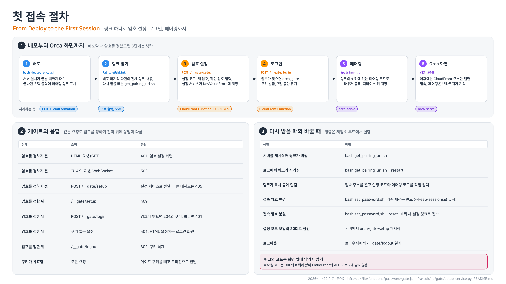

# API 참조

암호 게이트가 제공하는 HTTP 경로와 상태 코드, 그리고 스택의 커스텀 리소스 두 개가 받는 속성과 돌려주는 값입니다. 모든 내용은 `infra-cdk/lib/functions/password-gate.js`, `infra-cdk/lib/gate/setup_service.py`, `infra-cdk/lib/host/handler.py`, `infra-cdk/lib/pairing/handler.py`의 코드에서 읽었습니다. Terraform 배포에서 대응하는 것은 `infra-tf/attach/main.tf`와 `infra-tf/scripts/ssm_run.sh`에서 읽었습니다. Orca의 웹 클라이언트와 RPC는 upstream의 것이라 여기서 다루지 않습니다.

## 기본 주소

```
https://<cloudfront-domain>
```

주소는 스택 출력 `CloudFrontURL`에 있습니다. Terraform 배포에서는 출력 `cloudfront_url`입니다. 모든 요청은 CloudFront Function(viewer request)을 먼저 지나고 함수가 통과시킨 요청만 ALB로 갑니다. `/assets/*`와 WebSocket 업그레이드 요청도 같습니다.

함수가 직접 만드는 응답에는 `cache-control: no-store`가 붙습니다. 본문은 `text/plain; charset=utf-8`이고 로그인 화면과 설정 화면만 `text/html; charset=utf-8`입니다.

## 인증

### 접속 암호

암호는 헤더로 보냅니다. 값은 암호를 UTF-8로 바꾼 뒤 base64로 인코딩한 것입니다. `fetch()`의 헤더 값이 Latin-1이어야 하기 때문입니다.

```
x-orca-password: <base64(UTF-8 암호)>
```

함수는 `sha256("<auth-salt>:<헤더 값>")`의 16진수 값을 KeyValueStore의 `auth-hash`와 비교합니다.

### 게이트 쿠키

로그인에 성공하면 `orca_gate` 쿠키를 발급합니다.

| 항목 | 값 |
|---|---|
| 이름 | `orca_gate` |
| 값 | `<만료 시각(초)>.<서명>` |
| 서명 | `auth-signkey`를 키로 `orca-gate:<만료 시각>`에 HMAC-SHA256을 적용한 값(base64url) |
| 속성 | `Path=/; Secure; HttpOnly; SameSite=Lax; Max-Age=604800` |
| 유효 기간 | 7일 |

쿠키는 만료 시각이 숫자 1자리에서 12자리이고 지금보다 뒤이며 서명이 맞을 때만 유효합니다. 유효한 요청을 오리진으로 보낼 때 함수가 이 쿠키를 지웁니다.

### KeyValueStore

| 키 | 값 | 쓰는 쪽 |
|---|---|---|
| `auth-salt` | 16바이트 무작위 값의 16진수 | `set_password.sh` 또는 설정 서비스 |
| `auth-hash` | `sha256("<salt>:<base64(UTF-8 암호)>")`의 16진수 | `set_password.sh` 또는 설정 서비스 |
| `auth-signkey` | 32바이트 무작위 값의 16진수. 쿠키 서명 키 | `set_password.sh` 또는 설정 서비스 |

세 키가 모두 있으면 "암호 있음"이고 하나라도 없으면 "암호 없음"입니다. KeyValueStore를 읽다가 오류가 나도 함수는 "암호 없음"으로 처리합니다.

## 엣지의 경로

첫 접속의 단계와 단계마다 게이트가 돌려주는 응답을 그린 그림입니다. 아래 표가 같은 내용을 경로별로 자세히 적습니다.

<picture>
  <source media="(prefers-color-scheme: dark)" srcset="infographic/build/03-first-access_16x9_dark.png">
  
</picture>

CloudFront Function이 처리합니다. 아래에서 "HTML 요청"은 WebSocket 업그레이드가 아니고 메서드가 GET이며 `Accept` 헤더에 `text/html`이 든 요청입니다.

### 암호가 없을 때

| 요청 | 상태 | 응답 |
|---|---|---|
| `POST /__gate/setup` | 오리진이 정함 | 요청을 오리진으로 보냄. ALB가 서버의 설정 서비스로 전달 |
| `/__gate/setup`, POST가 아닌 메서드 | 405 | `POST only` |
| HTML 요청 | 401 | 접속 암호 설정 화면. `x-frame-options: DENY` |
| 그 밖의 모든 요청(자산, WebSocket 업그레이드, `/__gate/login` 포함) | 503 | `Password gate is not configured yet.` |

### 암호가 있을 때

위에서부터 차례로 확인합니다.

| 요청 | 상태 | 응답 |
|---|---|---|
| `/__gate/setup`, 모든 메서드 | 409 | `A password is already set.` |
| `/__gate/login`, POST가 아닌 메서드 | 405 | `POST only` |
| `POST /__gate/login`, `x-orca-password`가 없거나 틀림 | 401 | `invalid password` |
| `POST /__gate/login`, 암호가 맞음 | 204 | 본문 없음. `orca_gate` 쿠키 발급 |
| `/__gate/logout`, 모든 메서드 | 302 | `location: /`. `orca_gate` 쿠키를 `Max-Age=0`으로 지움 |
| 유효한 쿠키가 있는 요청 | 오리진이 정함 | 요청을 오리진으로 보냄 |
| 유효한 쿠키가 없는 HTML 요청 | 401 | 로그인 화면. `x-frame-options: DENY` |
| 유효한 쿠키가 없는 그 밖의 요청(자산, WebSocket 업그레이드 포함) | 401 | `Unauthorized` |

### 화면의 동작

- 로그인 화면은 `POST /__gate/login`이 204면 페이지를 다시 불러오고 401이면 암호가 올바르지 않다고 표시합니다.
- 설정 화면은 주소의 `#` 뒤에서 `gate-setup` 값을 읽어 설정 코드로 씁니다. 값이 없으면 설정 코드 입력 칸을 보여 줍니다.
- 설정 화면은 `POST /__gate/setup`이 204면 `POST /__gate/login`을 2초 간격으로 45번까지 시도하고 로그인되면 주소에서 `gate-setup`을 지운 뒤 페이지를 다시 불러옵니다. 엣지에 값이 반영될 때까지 기다리는 동작입니다.

## 설정 서비스의 경로

서버의 `orca-gate-setup.service`가 6769 포트에서 처리합니다. ALB 리스너 규칙은 `X-Custom-Secret`이 맞고 경로가 `/__gate/setup`인 요청만 이 서비스로 보냅니다. 암호가 정해진 뒤에는 엣지가 409로 답하므로 요청이 여기까지 오지 않습니다. `/__gate/health`는 ALB 대상 그룹의 상태 확인이 6769 포트로 직접 보냅니다.

모든 응답에 `Cache-Control: no-store`가 붙고 204가 아닌 응답의 본문은 `text/plain; charset=utf-8`입니다. 서비스는 요청 줄과 상태 코드만 로그에 남기고 헤더는 남기지 않습니다.

| 요청 | 상태 | 응답 |
|---|---|---|
| `GET /__gate/health` | 200 | `ok` |
| `GET /__gate/setup` | 405 | `POST only` |
| 그 밖의 GET | 404 | `not found` |
| `/__gate/setup`이 아닌 경로의 POST | 404 | `not found` |
| `POST /__gate/setup`, 성공 | 204 | 본문 없음. 암호를 저장하고 설정 코드 파일을 지움 |

### POST /__gate/setup

**요청 헤더**

| 헤더 | 필수 | 설명 |
|---|---|---|
| `x-orca-setup-code` | 예 | 1회용 설정 코드. 서버의 `/etc/orca/gate-setup-code`와 같아야 함 |
| `x-orca-password` | 예 | base64(UTF-8 암호) |
| `x-orca-password-confirm` | 예 | base64(UTF-8 확인 암호) |

**오류 응답**

아래 차례로 확인하고 처음 걸린 항목으로 답합니다.

| 상태 | 본문 | 뜻 |
|---|---|---|
| 423 | `too many failed attempts; restart orca-gate-setup` | 틀린 설정 코드가 20번 쌓임. 서비스를 재시작해야 풀림 |
| 409 | `setup already completed` | 설정 코드 파일이 없음 |
| 401 | `invalid setup code` | 설정 코드가 없거나 다름. 실패 횟수가 1 늘어남 |
| 400 | `password must be base64(utf-8)` | 암호 헤더가 base64(UTF-8)이 아님 |
| 400 | `password must be at least 8 characters` | 암호가 8자보다 짧음 |
| 400 | `passwords do not match` | 두 암호가 다름 |
| 409 | `a password is already set` | KeyValueStore에 `auth-hash`가 이미 있음 |
| 502 | `key value store unavailable` | KeyValueStore를 읽거나 조회하지 못함 |
| 502 | `could not write the key value store` | KeyValueStore에 쓰지 못함 |

## ALB

전용 서버 스택의 리스너는 `X-Custom-Secret` 헤더가 맞는 규칙이 없으면 403과 `Access Denied`(`text/plain`)를 돌려줍니다. 기존 서버에 추가한 스택에서는 호스트 스택의 리스너 기본 동작을 따릅니다.

| 규칙 | 우선순위 기본값 | 조건 | 대상 |
|---|---|---|---|
| `GateSetupRule` | 5 | `X-Custom-Secret`이 맞고 경로가 `/__gate/setup` | 6769 포트의 설정 서비스. 상태 확인 `/__gate/health` |
| `OrcaRule` | 10 | `X-Custom-Secret`이 맞음 | 6768 포트의 `orca-serve`. 상태 확인 `/web-index.html` |

표의 규칙 이름은 CDK 스택의 것입니다. Terraform 배포는 같은 규칙을 `infra-tf/modules/routes/main.tf`의 `aws_lb_listener_rule.gate_setup`과 `aws_lb_listener_rule.orca`로 만들고 우선순위 기본값, 조건, 대상이 같습니다.

## 커스텀 리소스

커스텀 리소스는 CDK 배포에만 있습니다. Terraform 배포에서 같은 일을 하는 것은 이 챕터 끝의 [Terraform 배포에서 대응하는 것](#terraform-배포에서-대응하는-것)에 있습니다.

### Custom::OrcaHostInstall

기존 서버에 추가하는 스택에만 있습니다. 핸들러는 `infra-cdk/lib/host/handler.py`입니다.

| 속성 | 설명 |
|---|---|
| `InstanceId` | Orca를 설치할 서버 |
| `User` | `orca-serve`를 실행할 계정. 기본값 `ec2-user` |
| `OrcaVersion` | 설치할 Orca 릴리스. 값이 바뀌면 서버를 그 버전으로 바꿈 |
| `PairingAddress` | 페어링 링크에 넣을 주소(`wss://<cloudfront-domain>`) |
| `Region` | 스택의 리전 |
| `GateStoreArn` | 암호 게이트 KeyValueStore의 ARN. 게이트를 끄면 빈 값 |
| `GateBundleUrl` | 설정 서비스 묶음의 S3 주소. 게이트를 끄면 빈 값 |
| `ScriptSha256` | 설치 스크립트와 제거 스크립트의 해시. 스크립트가 바뀌면 설치를 다시 실행 |

- 물리 ID는 `orca-host-<InstanceId>`입니다. 같은 서버의 Update에서는 바뀌지 않습니다.
- Create와 Update는 서버가 SSM에서 온라인이 아니면 바로 실패합니다. 온라인이면 `infra-cdk/lib/host/install_orca.sh`를 보내고 명령이 `Success`가 아닌 상태로 끝나면 출력의 끝부분을 넣은 오류로 배포를 실패시킵니다.
- Delete는 물리 ID가 `orca-host-`로 시작하고 서버가 온라인일 때만 `infra-cdk/lib/host/uninstall_orca.sh`를 보냅니다. 제거가 실패해도 스택 삭제는 계속됩니다.
- 스택 출력에 쓰는 값은 돌려주지 않습니다.

### Custom::OrcaPairingInfo

두 스택에 모두 있습니다. context `pairingOutput=false`면 만들지 않습니다. 핸들러는 `infra-cdk/lib/pairing/handler.py`입니다.

| 속성 | 설명 |
|---|---|
| `InstanceId` | 페어링 링크를 읽을 서버 |
| `PairingAddress` | 페어링 링크에 들어가는 주소 |
| `GateEnabled` | 암호 게이트를 켰는지(`true`, `false`) |
| `Refresh` | 값이 바뀌면 링크를 다시 읽음. `deploy_orca.sh`가 배포할 때마다 시각을 넣음 |

돌려주는 값은 스택 출력 `PairingWebLink`, `PairingCode`, `GateSetupCode`가 됩니다. 세 값 모두 ASCII입니다.

| 값 | 정상일 때 | 그 밖의 값 |
|---|---|---|
| `PairingWebLink` | 브라우저로 여는 링크. 설정 코드가 있으면 `&gate-setup=<설정 코드>`가 붙음 | `none (this Orca build has no web client) - use PairingCode` |
| `PairingCode` | `orca://pair?code=...` | 없음 |
| `GateSetupCode` | 1회용 설정 코드 | `none (access password already set)`, `none (password gate disabled)` |

서버가 링크를 보고하지 못하면 세 값이 모두 `unavailable (<이유>) - run: bash get_pairing_url.sh --restart`가 됩니다. 40분 동안 기다린 뒤에도 준비되지 않으면 스택을 실패시키지 않고 이 값을 넣습니다.

정상일 때의 세 값은 자격 증명입니다. 문서, 로그, 대화 기록에 옮겨 적지 않습니다.

### Terraform 배포에서 대응하는 것

Terraform 배포(`infra-tf/attach`)에는 Lambda 함수와 커스텀 리소스가 없습니다. `terraform_data` 리소스 둘의 프로비저너가 Terraform을 실행하는 자리에서 `infra-tf/scripts/ssm_run.sh`를 부릅니다.

| CDK | Terraform |
|---|---|
| `Custom::OrcaHostInstall`의 Create와 Update | `terraform_data.host_install`의 `local-exec`가 `ssm_run.sh install`로 `infra-cdk/lib/host/install_orca.sh`를 보냄 |
| `Custom::OrcaHostInstall`의 Delete | `terraform_data.host_uninstall`의 destroy 프로비저너가 `ssm_run.sh uninstall`로 `infra-cdk/lib/host/uninstall_orca.sh`를 보냄 |
| `ScriptSha256` 속성 | `terraform_data.host_install`의 `triggers_replace`. 인스턴스 ID, 아래 입력 값 여섯 개, 두 스크립트의 해시 가운데 하나가 바뀌면 설치를 다시 실행 |
| `Custom::OrcaPairingInfo` | 없음. 페어링 값은 출력하지 않고 `get_pairing_url.sh --tf`로 읽음 |

설치 스크립트가 받는 환경 변수 여섯 개는 두 도구에서 같습니다.

| 환경 변수 | CDK의 속성 | Terraform의 값 |
|---|---|---|
| `ORCA_VERSION` | `OrcaVersion` | 변수 `orca_version` |
| `ORCA_PAIRING_ADDRESS` | `PairingAddress` | `wss://<cloudfront-domain>` |
| `ORCA_REGION` | `Region` | 변수 `region` |
| `ORCA_USER` | `User` | 변수 `host_user`. 기본값 `ec2-user` |
| `GATE_KVS_ARN` | `GateStoreArn` | 모듈 `front_door`의 출력 `gate_kvs_arn`. 게이트를 끄면 빈 값 |
| `GATE_BUNDLE_URL` | `GateBundleUrl` | 모듈 `front_door`의 출력 `gate_bundle_url`. 게이트를 끄면 빈 값 |

- `ssm_run.sh install`은 서버가 SSM에서 온라인이 아니거나 명령이 `Success`가 아닌 상태로 끝나면 0이 아닌 값으로 끝나 apply를 실패시킵니다. 출력의 끝부분(1,500바이트)을 보여 줍니다.
- `ssm_run.sh uninstall`은 서버가 온라인이 아니면 명령을 보내지 않고 제거가 실패해도 0으로 끝납니다. destroy를 막지 않기 위한 것입니다.
- 설치 스크립트의 실행 제한은 1,800초이고 `ssm_run.sh`는 명령이 끝나기를 2,500초까지 기다립니다.
- 버전을 바꾸면 `terraform_data.host_install`만 교체되므로 제거 스크립트는 실행되지 않습니다. 제거는 `terraform destroy`나 인스턴스 ID가 바뀔 때만 실행됩니다.
- 실패한 설치는 롤백되지 않습니다. `terraform_data.host_install`이 tainted가 되어 다음 apply에서 다시 실행됩니다.
