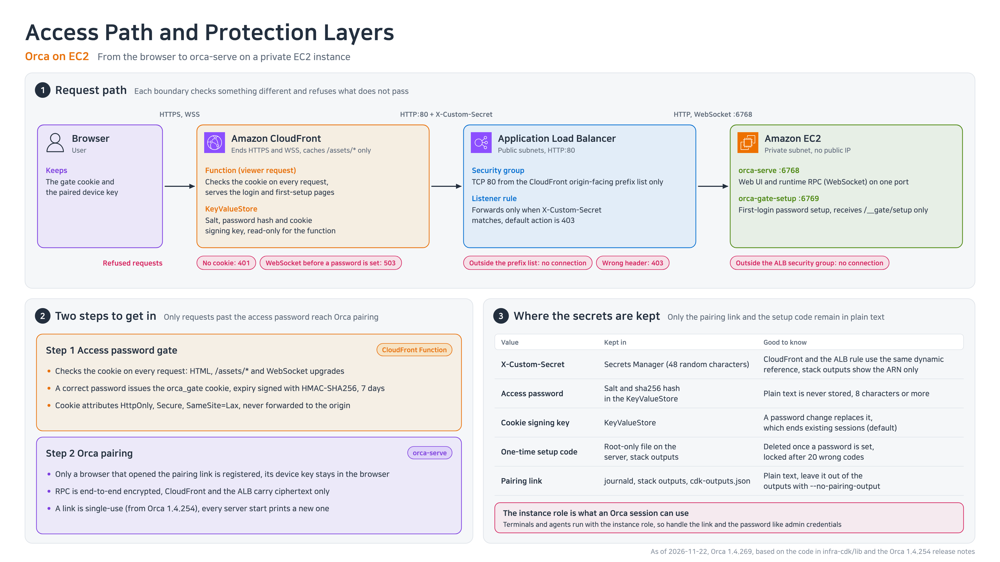
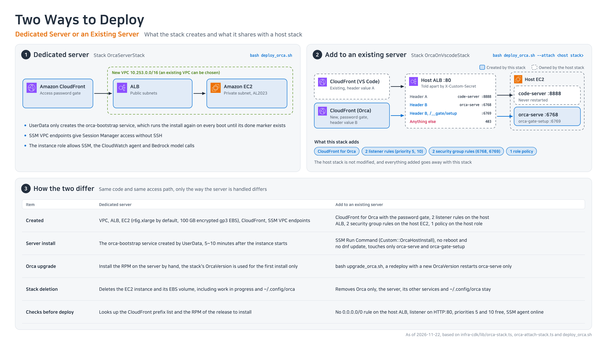
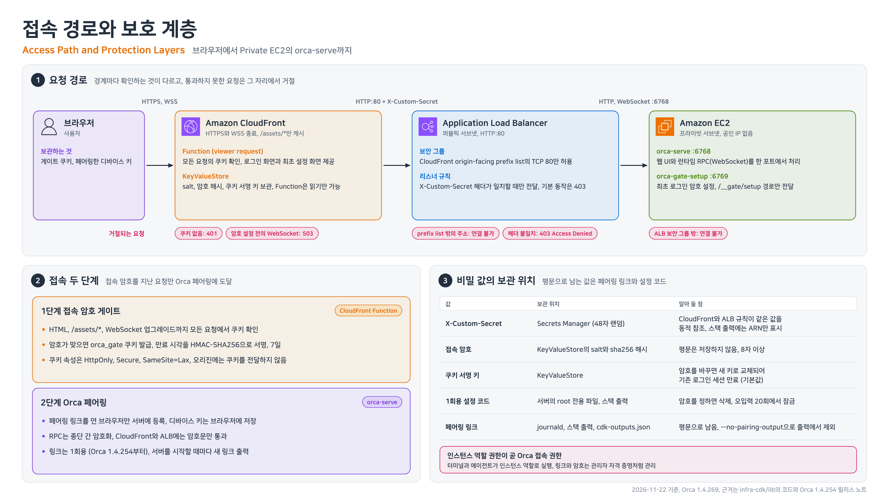
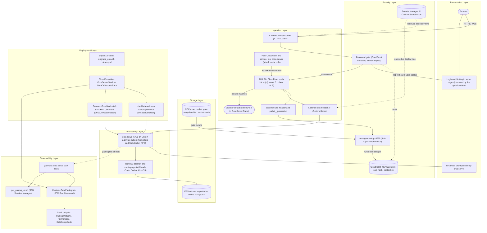
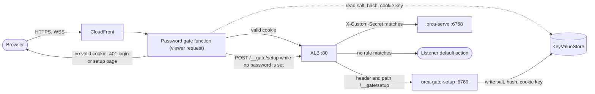
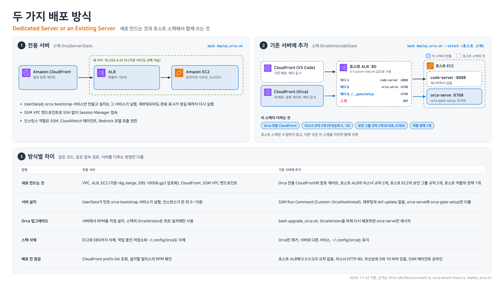

# Architecture

---

# English

## System Overview

The figure shows the path of a request, what each boundary checks and refuses, and where each secret is kept.

<picture>
  <source media="(prefers-color-scheme: dark)" srcset="infographic/build/01-access-path-en_16x9_dark.png">
  
</picture>

my-orca deploys the headless server of Orca (`orca-ide serve`) on an EC2 instance in a private subnet and opens it to a browser through CloudFront and an ALB. The AWS resources are defined with AWS CDK in `infra-cdk/`, and the shell scripts in the repository root drive the deployment. The same structure is also defined with Terraform in `infra-tf/` and deployed with `deploy_orca_tf.sh`. One server takes a deployment from one of the two tools.
There are two deployment modes that share one front door. OrcaServerStack creates its own VPC, ALB and instance. OrcaOnVscodeStack adds Orca to a server and an ALB that another stack already runs (for example VscodeServerStack of ec2_vscode) and never updates that stack.
A request passes the password gate at the edge (a CloudFront Function with a KeyValueStore), then the ALB, which forwards only when the `X-Custom-Secret` header matches, and reaches `orca-serve` on port 6768. That one port answers both the web client (HTTP) and the runtime RPC (WebSocket). Using the server also needs an Orca pairing link.

## Components

### Presentation Layer
- **infra-cdk/lib/functions/password-gate.js**: Renders the login page and the first-login setup page at the edge. The Orca web client itself is served by `orca-serve` and is not part of this repository.

### Security Layer
- **infra-cdk/lib/functions/password-gate.js**: Password gate on every viewer request, including `/assets/*` and the WebSocket upgrade. Checks the password hash and issues a signed cookie.
- **infra-cdk/lib/gate/setup_service.py**: First-login setup service on the server (port 6769). Checks the one-time setup code and writes the KeyValueStore, which the function can only read.
- **infra-cdk/lib/gate/install.sh**: Installs the setup service as `orca-gate-setup.service` and creates the one-time setup code while no password exists.
- **set_password.sh**: Sets, changes or resets the access password by writing the KeyValueStore from the operator's machine.

### Ingestion Layer
- **infra-cdk/lib/orca-front-door.ts**: Shared front door: the header secret, the password gate, the CloudFront distribution, the target groups and the listener rules that forward only when `X-Custom-Secret` matches.
- **infra-cdk/lib/orca-stack.ts**: Dedicated mode: VPC, an internet-facing ALB whose security group admits only the CloudFront origin-facing prefix list, and a listener whose default action is 403.
- **infra-cdk/lib/orca-attach-stack.ts**: Attach mode: imports the host ALB listener, security groups and role, and adds its own rules beside them.
- **infra-tf/modules/front-door**: Terraform counterpart of the shared front door: the header value, the password gate with the bucket of the setup bundle, and the CloudFront distribution.
- **infra-tf/modules/routes**: Terraform counterpart of the target groups and the listener rules that forward only when `X-Custom-Secret` matches.

### Processing Layer
- **infra-cdk/lib/host/install_orca.sh**: Installs `orca-ide` and the `orca-serve.service` unit on an existing server through SSM Run Command, without a reboot or a system update.
- **infra-cdk/lib/host/uninstall_orca.sh**: Removes what the install added when the attach stack is deleted and keeps the Orca session data.
- **infra-cdk/lib/host/handler.py**: Lambda handler of the `Custom::OrcaHostInstall` custom resource. Sends the two scripts and waits for the result.
- **infra-tf/scripts/ssm_run.sh**: Does the same for the Terraform deployment. A `local-exec` provisioner calls it to send the two scripts through SSM Run Command and to wait for the result.

### Storage Layer
- **infra-cdk/lib/orca-front-door.ts**: Declares the Secrets Manager secret (header value), the CloudFront KeyValueStore (salt, hash, cookie signing key) and the S3 asset that carries the setup service to the server.

### Deployment Layer
- **infra-cdk/bin/app.ts**: CDK app entry point. Chooses the attach stack when the context key `attachTo` is set and the dedicated stack otherwise.
- **deploy_orca.sh**: Looks up the host resources, runs the pre-deployment checks, deploys with CDK and prints the connection guide.
- **upgrade_orca.sh**: Compares the stack's `OrcaVersion` with the latest release and redeploys an attach stack with the new version.
- **cleanup.sh**: Deletes the stack. An attach stack removes only Orca from the host.
- **infra-tf/dedicated**: Terraform root module of the dedicated mode: VPC, ALB, instance and the UserData template.
- **infra-tf/attach**: Terraform root module of the attach mode: reads the host with data sources, adds its rules and runs the install.
- **deploy_orca_tf.sh**: Finds the host, runs the pre-deployment checks, saves the inputs, shows the plan and applies it with Terraform.

### Observability Layer
- **infra-cdk/lib/pairing/handler.py**: Lambda handler of the `Custom::OrcaPairingInfo` custom resource. Puts the pairing link, the pairing code and the setup code in the stack outputs.
- **infra-cdk/lib/pairing/read_pairing.sh**: Runs on the server and reads the start lines of the running `orca-serve` process from journald.
- **get_pairing_url.sh**: Reads the same values over an interactive SSM session, so they do not stay in the SSM command history.

## Full Architecture Diagram

The Deployment and Observability layers of the diagram show the CDK deployment. In the Terraform deployment `terraform apply` takes the place of CloudFormation, `infra-tf/scripts/ssm_run.sh` takes the place of `Custom::OrcaHostInstall`, the setup bundle comes from a bucket of its own, and there is no `Custom::OrcaPairingInfo` and no pairing output.

## Data Flow Summary

The setup path exists only until a password is set. After that the function answers `/__gate/setup` with 409 at the edge, and the request never reaches the server.

## Infrastructure

The figure compares what the two stacks create and how each one installs, upgrades and removes the server software.

<picture>
  <source media="(prefers-color-scheme: dark)" srcset="infographic/build/02-deploy-modes-en_16x9_dark.png">
  
</picture>

### Deployment Region
- The default Region is ap-northeast-2. `deploy_orca.sh --region`, `deploy_orca_tf.sh --region` or the `AWS_REGION` environment variable changes it.
- The CloudFront distribution, the function and the KeyValueStore are global resources created by the same stack.

### Modules / Resources
| Module | Resources | Description |
|--------|-----------|-------------|
| `infra-cdk/lib/orca-stack.ts` (OrcaStack, default name OrcaServerStack) | VPC with two public and two private subnets and one NAT gateway (or an existing VPC), two security groups, three SSM interface endpoints, an IAM role, an internet-facing ALB with a listener on port 80, one EC2 instance with a 100 GB encrypted gp3 volume | Dedicated mode. The instance installs everything from a setup script that `orca-bootstrap.service` re-runs on every boot until it finishes |
| `infra-cdk/lib/orca-attach-stack.ts` (OrcaAttachStack, default name OrcaOnVscodeStack) | Two security group ingress rules on the host instance security group (6768 and 6769 from the ALB security group), one IAM policy on the host role, `Custom::OrcaHostInstall` with its two Lambda functions and log group | Attach mode. Everything is added beside the host stack and removed with this stack |
| `infra-cdk/lib/orca-front-door.ts` (both stacks) | Secrets Manager secret, CloudFront KeyValueStore, CloudFront Function, CloudFront distribution, two target groups, two listener rules, S3 asset of `infra-cdk/lib/gate`, `Custom::OrcaPairingInfo` with its two Lambda functions and log group | Same construct IDs in both stacks |

### Custom Resources
| Resource | Handler | What it does |
|----------|---------|--------------|
| `Custom::OrcaHostInstall` | `infra-cdk/lib/host/handler.py` | Create and Update send `infra-cdk/lib/host/install_orca.sh` through SSM Run Command and fail the deployment when the install fails. Delete sends `infra-cdk/lib/host/uninstall_orca.sh` and never blocks the stack deletion. Attach mode only |
| `Custom::OrcaPairingInfo` | `infra-cdk/lib/pairing/handler.py` | Runs `infra-cdk/lib/pairing/read_pairing.sh` every 30 seconds until the server reports its pairing link, then returns it as resource attributes. Reports `unavailable` after 40 minutes instead of failing the stack. Left out with the context `pairingOutput=false` |

### Parameters and Context
| Name | Kind | Default | Used by |
|------|------|---------|---------|
| `OrcaVersion` | Parameter | 1.4.269 | Both stacks. In the attach stack a new value upgrades the host in place |
| `InstanceType` | Parameter | r6g.xlarge | Dedicated stack |
| `CloudFrontPrefixListId` | Parameter | looked up by `deploy_orca.sh` | Dedicated stack |
| `VpcName` | Parameter | orca-vpc | Dedicated stack |
| `attachTo`, `hostInstanceId`, `hostVpcId`, `hostListenerArn`, `hostAlbDnsName`, `hostAlbSecurityGroupId`, `hostInstanceSecurityGroupId`, `hostRoleName` | Context | filled in by `deploy_orca.sh --attach` | Attach stack |
| `hostUser`, `gateSetupRulePriority`, `orcaRulePriority` | Context | ec2-user, 5, 10 | Attach stack |
| `useExistingVpc`, `vpcId`, `vpcCidr`, `skipVpcEndpoints`, `roleNameSuffix` | Context | new VPC 10.253.0.0/16 | Dedicated stack |
| `passwordGate`, `pairingOutput`, `pairingRefresh`, `stackName` | Context | gate on, pairing output on | Both stacks |

### Terraform Configuration
| Module | Resources | Description |
|--------|-----------|-------------|
| `infra-tf/dedicated` | The resources of the dedicated stack: VPC with two public and two private subnets and one NAT gateway (or an existing VPC given with its subnets), security groups, three SSM interface endpoints, an IAM role named `<name>-orca-role-<region>`, an internet-facing ALB with a listener on port 80, one EC2 instance with a 100 GB encrypted gp3 volume | Dedicated mode. `infra-tf/dedicated/user_data.sh.tftpl` renders to the same UserData as the CDK stack. AMI and UserData changes are not applied to an existing instance |
| `infra-tf/attach` | Two security group ingress rules on the host instance security group, one inline policy on the host role, `terraform_data.host_install` and `terraform_data.host_uninstall` | Attach mode. The host is only read, through data sources. The install runs through `infra-tf/scripts/ssm_run.sh`, without Lambda functions |
| `infra-tf/modules/front-door` (both) | Random header value and its Secrets Manager secret, CloudFront KeyValueStore, CloudFront Function, S3 bucket with the bundle of `infra-cdk/lib/gate`, CloudFront distribution | Reads the function and the bundle from `infra-cdk/lib/` |
| `infra-tf/modules/routes` (both) | Two target groups with their attachments, two listener rules | Same ports, health checks, conditions and default priorities as the CDK stacks |

Resource names start with the variable `name` (default `orca-server`, or `orca-on-vscode` in attach mode). The options and variables are listed in the Configuration section of the [README](../README.md). A read-only `terraform plan` on 2026-11-22 showed 55 resources to add for the dedicated mode and 21 for the attach mode. Nothing was applied.

### Deployed Resources
- Checked on 2026-11-22: one attach stack, OrcaOnVscodeStack, in ap-northeast-2 on the host stack VscodeServerStack, with `OrcaVersion` 1.4.269 and both target groups healthy.
- Resource count of that stack (checked on 2026-11-21): 1 distribution, 1 function, 1 KeyValueStore, 1 secret, 2 target groups, 2 listener rules, 2 security group ingress rules, 10 Lambda functions, 2 state machines, 2 log groups, 2 custom resources.
- Checked on 2026-11-21: no dedicated stack (OrcaServerStack) exists in ap-northeast-2.
- No Terraform deployment exists. On 2026-11-23 the dedicated server was deployed twice with Terraform for verification (a new VPC and an existing VPC) and destroyed, and the same was done with CDK under test stack names. The configuration for an existing server was only planned, read-only.

## Key Design Decisions

- A random `X-Custom-Secret` from Secrets Manager: the prefix list admits every CloudFront distribution, so the header value is the only thing that ties the ALB to this distribution. A value built from the stack name and the account ID can be guessed. The origin header and the listener rules use the same dynamic reference, so the value is in neither the template nor the outputs.
- The ALB accepts only the CloudFront origin-facing prefix list: the dedicated stack creates the listener with `open: false`, because the default adds a rule for 0.0.0.0/0 on port 80. In attach mode `deploy_orca.sh` stops when the first security group of the host ALB has a rule open to the internet, and `deploy_orca_tf.sh` checks every security group of the host ALB.
- The password gate runs at the edge: Orca has no password of its own, so a CloudFront Function checks every viewer request, including `/assets/*` and the WebSocket upgrade. The KeyValueStore holds only a salt, a salted hash and the cookie signing key.
- The first password is written by a service on the server: a CloudFront Function can only read its KeyValueStore. The setup service accepts one request that carries the one-time setup code, and it locks after 20 wrong codes until it is restarted.
- The pairing link is a stack output: the deployment waits until the server prints the link and shows it at the end. The price is that the link, and the setup code before a password is set, stay in plain text in the stack outputs, the SSM command history and `cdk-outputs.json`. `deploy_orca.sh --no-pairing-output` leaves them out.
- A failed pairing read does not fail the stack: after 40 minutes the outputs say `unavailable`, so the instance someone would debug is not rolled back.
- Attach mode installs through SSM Run Command: the host stack is never updated, the server is not rebooted and no other service is restarted. The install re-runs when either host script changes (`ScriptSha256`) and stops without changing anything when another program holds port 6768 or 6769.
- `rpm -Uvh --nodeps --oldpackage` in the host install: when an upgrade fails after the package step, CloudFormation rolls back by running the install again with the previous version, and plain `rpm -Uvh` refuses an older package. A change to the host scripts is deployed alone before a version bump, on the reasoning that the rollback runs with the previous Lambda code. Neither the downgrade path nor that reasoning has been exercised on a real host.
- `--nodeps` for the Orca RPM: `xdotool` and `xclip` are not in the Amazon Linux 2023 repositories and are used only by desktop control and file clipboard copy. The other dependencies are installed with `dnf`, and `dbus-tools` was added because the 1.4.269 RPM requires `/usr/bin/dbus-send`.
- The AMI of the dedicated stack is pinned in `infra-cdk/cdk.context.json`: without the pin every deployment reads the latest AMI again, and a new AMI replaces the instance together with its volume. The file holds the account ID, so it is not committed and stays with the checkout that deployed the stack.
- A plain system unit instead of `orca serve service install` or `--supervise`: both hide the pairing link from journald, which is where this project reads it. This was checked on Orca 1.4.253 and has not been checked again on later versions.
- The dedicated server is set up by a oneshot unit, not directly by cloud-init: an SSM patch association can reboot a new instance in the middle of the setup, and the unit runs the script again on every boot until the done marker exists.
- Two tools, one set of server files: the Terraform configuration reads the edge function, the setup service and the host scripts from `infra-cdk/lib/`, so a fix there reaches both deployments. Only the UserData of the dedicated server is a second copy, as a template. On 2026-11-22 it rendered byte for byte to the UserData the CDK stack produces.
- Terraform installs on an existing server with a `local-exec` provisioner: Terraform has no custom resource, so `terraform_data.host_install` calls `infra-tf/scripts/ssm_run.sh` from the machine that runs Terraform. The install and the uninstall are two resources, because Terraform replaces a resource by destroying it first. A version change replaces only the install resource, and the uninstall runs only on `terraform destroy` or when the instance changes.
- No rollback in the Terraform deployment: a failed install leaves the server where the script stopped, marks the install resource as tainted, and the next apply runs it again. This is why the reasoning about the previous Lambda code does not apply there.
- The Terraform deployment has no pairing output: an output or a resource attribute would keep the link in the state file in plain text. `get_pairing_url.sh --tf` reads it over an interactive SSM session instead.
- The Terraform state holds the `X-Custom-Secret` value: the origin header and the listener rules need the value as plain configuration. The scripts create the state, plan and input files with umask 077, the files are not committed, and no backend is configured, so the state is local unless a team adds an encrypted remote backend.
- An existing dedicated instance ignores AMI and UserData changes in Terraform: a new AMI would replace the instance together with the volume that holds the repositories, and UserData runs only at first boot. `terraform apply -replace=aws_instance.orca` rebuilds it on purpose.

## Operations
- Upgrading Orca on an attach stack or an attach deployment made with Terraform: [docs/runbooks/upgrade-orca.md](runbooks/upgrade-orca.md).
- Deployment, pairing, password changes and deletion: the Usage section of the [README](../README.md).
- Deployment with Terraform and its differences from CDK: the Deploy with Terraform part of the same section.
- HTTP paths and status codes of the password gate: [docs/api-reference.md](api-reference.md).
- Code pointers by layer: [docs/reference/INDEX.md](reference/INDEX.md).
- First steps for a new contributor: [docs/onboarding.md](onboarding.md).

---

# 한국어

## 시스템 개요

요청이 지나는 경로, 경계마다 확인하고 거절하는 것, 비밀 값의 보관 위치를 그린 그림입니다.

<picture>
  <source media="(prefers-color-scheme: dark)" srcset="infographic/build/01-access-path_16x9_dark.png">
  
</picture>

my-orca는 Orca의 headless 서버(`orca-ide serve`)를 프라이빗 서브넷의 EC2 인스턴스에 올리고 CloudFront와 ALB를 거쳐 브라우저에서 쓰게 합니다. AWS 리소스는 `infra-cdk/`의 AWS CDK로 정의하고 저장소 루트의 셸 스크립트가 배포를 실행합니다. 같은 구조를 `infra-tf/`의 Terraform으로도 정의했고 `deploy_orca_tf.sh`로 배포합니다. 한 서버에는 두 도구 가운데 하나의 배포만 붙입니다.
배포 방식은 두 가지이고 같은 진입 구성을 함께 씁니다. OrcaServerStack은 전용 VPC, ALB, 인스턴스를 만듭니다. OrcaOnVscodeStack은 다른 스택이 이미 운영하는 서버와 ALB(예: ec2_vscode의 VscodeServerStack)에 Orca를 추가하고 그 스택은 수정하지 않습니다.
요청은 엣지의 암호 게이트(CloudFront Function과 KeyValueStore)를 지나고 `X-Custom-Secret` 헤더가 맞을 때만 전달하는 ALB를 거쳐 6768 포트의 `orca-serve`에 닿습니다. 이 포트 하나가 웹 클라이언트(HTTP)와 런타임 RPC(WebSocket)를 함께 처리합니다. 서버를 쓰려면 Orca 페어링 링크도 필요합니다.

## 구성 요소

### Presentation Layer
- **infra-cdk/lib/functions/password-gate.js**: 로그인 화면과 최초 로그인 설정 화면을 엣지에서 만듭니다. Orca 웹 클라이언트는 `orca-serve`가 제공하며 이 저장소에 없습니다.

### Security Layer
- **infra-cdk/lib/functions/password-gate.js**: `/assets/*`와 WebSocket 업그레이드를 포함한 모든 뷰어 요청에 적용되는 암호 게이트입니다. 암호 해시를 확인하고 서명한 쿠키를 발급합니다.
- **infra-cdk/lib/gate/setup_service.py**: 서버에서 도는 최초 로그인 설정 서비스(6769 포트)입니다. 1회용 설정 코드를 확인하고 함수가 읽기만 하는 KeyValueStore에 값을 씁니다.
- **infra-cdk/lib/gate/install.sh**: 설정 서비스를 `orca-gate-setup.service`로 설치하고 암호가 없는 동안 1회용 설정 코드를 만듭니다.
- **set_password.sh**: 운영자의 장비에서 KeyValueStore에 값을 써서 접속 암호를 설정, 변경, 초기화합니다.

### Ingestion Layer
- **infra-cdk/lib/orca-front-door.ts**: 두 스택이 함께 쓰는 진입 구성입니다. 헤더 비밀값, 암호 게이트, CloudFront 배포, 대상 그룹, `X-Custom-Secret`이 맞을 때만 전달하는 리스너 규칙을 만듭니다.
- **infra-cdk/lib/orca-stack.ts**: 전용 서버 방식입니다. VPC, CloudFront origin-facing 접두사 목록만 받는 보안 그룹을 가진 인터넷 연결 ALB, 기본 동작이 403인 리스너를 만듭니다.
- **infra-cdk/lib/orca-attach-stack.ts**: 기존 서버에 추가하는 방식입니다. 호스트의 ALB 리스너, 보안 그룹, 역할을 가져와 그 옆에 자기 규칙을 추가합니다.
- **infra-tf/modules/front-door**: 공용 진입 구성의 Terraform 판입니다. 헤더 값, 암호 게이트와 설정 묶음 버킷, CloudFront 배포를 만듭니다.
- **infra-tf/modules/routes**: 대상 그룹과 `X-Custom-Secret`이 맞을 때만 전달하는 리스너 규칙의 Terraform 판입니다.

### Processing Layer
- **infra-cdk/lib/host/install_orca.sh**: 기존 서버에 `orca-ide`와 `orca-serve.service` 유닛을 SSM Run Command로 설치합니다. 재부팅과 시스템 업데이트를 하지 않습니다.
- **infra-cdk/lib/host/uninstall_orca.sh**: 추가 스택을 삭제할 때 설치한 것을 제거하고 Orca 세션 데이터는 남깁니다.
- **infra-cdk/lib/host/handler.py**: `Custom::OrcaHostInstall` 커스텀 리소스의 Lambda 핸들러입니다. 두 스크립트를 보내고 결과를 기다립니다.
- **infra-tf/scripts/ssm_run.sh**: Terraform 배포에서 같은 일을 합니다. `local-exec` 프로비저너가 이 스크립트를 불러 두 스크립트를 SSM Run Command로 보내고 결과를 기다립니다.

### Storage Layer
- **infra-cdk/lib/orca-front-door.ts**: Secrets Manager 비밀값(헤더 값), CloudFront KeyValueStore(salt, 해시, 쿠키 서명 키), 설정 서비스를 서버로 옮기는 S3 자산을 선언합니다.

### Deployment Layer
- **infra-cdk/bin/app.ts**: CDK 앱의 진입점입니다. context 키 `attachTo`가 있으면 추가 스택을, 없으면 전용 서버 스택을 고릅니다.
- **deploy_orca.sh**: 호스트 리소스를 찾고 배포 전 점검을 한 뒤 CDK로 배포하고 접속 안내를 출력합니다.
- **upgrade_orca.sh**: 스택의 `OrcaVersion`과 최신 릴리스를 비교해 추가 스택을 새 버전으로 다시 배포합니다.
- **cleanup.sh**: 스택을 삭제합니다. 추가 스택은 호스트에서 Orca만 제거합니다.
- **infra-tf/dedicated**: 전용 서버 방식의 Terraform 루트 모듈입니다. VPC, ALB, 인스턴스, UserData 템플릿이 있습니다.
- **infra-tf/attach**: 기존 서버에 추가하는 방식의 Terraform 루트 모듈입니다. 호스트를 데이터 소스로 읽고 자기 규칙을 추가하며 설치를 실행합니다.
- **deploy_orca_tf.sh**: 호스트를 찾고 배포 전 점검을 한 뒤 입력 값을 저장하고 계획을 보여 준 다음 Terraform으로 적용합니다.

### Observability Layer
- **infra-cdk/lib/pairing/handler.py**: `Custom::OrcaPairingInfo` 커스텀 리소스의 Lambda 핸들러입니다. 페어링 링크, 페어링 코드, 설정 코드를 스택 출력에 넣습니다.
- **infra-cdk/lib/pairing/read_pairing.sh**: 서버에서 실행되어, 실행 중인 `orca-serve` 프로세스의 시작 로그를 journald에서 읽습니다.
- **get_pairing_url.sh**: 같은 값을 대화형 SSM 세션으로 읽어 SSM 명령 기록에 남기지 않습니다.

## 전체 아키텍처 그림

그림의 Deployment와 Observability 층은 CDK 배포를 그린 것입니다. Terraform 배포에서는 `terraform apply`가 CloudFormation의 자리를, `infra-tf/scripts/ssm_run.sh`가 `Custom::OrcaHostInstall`의 자리를 맡고 설정 묶음은 전용 버킷에서 오며 `Custom::OrcaPairingInfo`와 페어링 출력은 없습니다.

## 데이터 흐름 요약

설정 경로는 암호를 정하기 전에만 열립니다. 그 뒤에는 함수가 엣지에서 `/__gate/setup`에 409로 답하므로 요청이 서버까지 가지 않습니다.

## 인프라

두 스택이 새로 만드는 것과 서버 소프트웨어를 설치, 업그레이드, 제거하는 방법을 비교한 그림입니다.

<picture>
  <source media="(prefers-color-scheme: dark)" srcset="infographic/build/02-deploy-modes_16x9_dark.png">
  
</picture>

### 배포 리전
- 기본 리전은 ap-northeast-2입니다. `deploy_orca.sh --region`, `deploy_orca_tf.sh --region`, 환경 변수 `AWS_REGION`으로 바꿉니다.
- CloudFront 배포, 함수, KeyValueStore는 같은 스택이 만드는 글로벌 리소스입니다.

### 모듈과 리소스
| 모듈 | 리소스 | 설명 |
|------|--------|------|
| `infra-cdk/lib/orca-stack.ts` (OrcaStack, 기본 이름 OrcaServerStack) | 퍼블릭 서브넷 2개와 프라이빗 서브넷 2개, NAT 게이트웨이 1개를 가진 VPC(또는 기존 VPC), 보안 그룹 2개, SSM 인터페이스 엔드포인트 3개, IAM 역할, 80 포트 리스너를 가진 인터넷 연결 ALB, 암호화한 100 GB gp3 볼륨의 EC2 인스턴스 1대 | 전용 서버 방식. 인스턴스는 설치 스크립트로 모든 것을 설치하고 `orca-bootstrap.service`가 끝날 때까지 부팅마다 스크립트를 다시 실행 |
| `infra-cdk/lib/orca-attach-stack.ts` (OrcaAttachStack, 기본 이름 OrcaOnVscodeStack) | 호스트 인스턴스 보안 그룹의 인바운드 규칙 2개(ALB 보안 그룹에서 6768과 6769), 호스트 역할의 IAM 정책 1개, `Custom::OrcaHostInstall`과 그 Lambda 함수 2개, 로그 그룹 | 기존 서버에 추가하는 방식. 모두 호스트 스택 옆에 추가되고 이 스택과 함께 삭제됨 |
| `infra-cdk/lib/orca-front-door.ts` (두 스택 공용) | Secrets Manager 비밀값, CloudFront KeyValueStore, CloudFront Function, CloudFront 배포, 대상 그룹 2개, 리스너 규칙 2개, `infra-cdk/lib/gate`의 S3 자산, `Custom::OrcaPairingInfo`와 그 Lambda 함수 2개, 로그 그룹 | 두 스택에서 construct ID가 같음 |

### 커스텀 리소스
| 리소스 | 핸들러 | 하는 일 |
|--------|--------|---------|
| `Custom::OrcaHostInstall` | `infra-cdk/lib/host/handler.py` | Create와 Update는 `infra-cdk/lib/host/install_orca.sh`를 SSM Run Command로 보내고 설치가 실패하면 배포를 실패시킴. Delete는 `infra-cdk/lib/host/uninstall_orca.sh`를 보내고 스택 삭제를 막지 않음. 추가 방식에만 있음 |
| `Custom::OrcaPairingInfo` | `infra-cdk/lib/pairing/handler.py` | 서버가 페어링 링크를 보고할 때까지 30초마다 `infra-cdk/lib/pairing/read_pairing.sh`를 실행하고 값을 리소스 속성으로 돌려줌. 40분이 지나면 스택을 실패시키지 않고 `unavailable`을 보고함. context `pairingOutput=false`면 만들지 않음 |

### 파라미터와 context
| 이름 | 종류 | 기본값 | 쓰는 곳 |
|------|------|--------|---------|
| `OrcaVersion` | 파라미터 | 1.4.269 | 두 스택. 추가 스택은 값을 바꾸면 호스트를 그 버전으로 업그레이드 |
| `InstanceType` | 파라미터 | r6g.xlarge | 전용 서버 스택 |
| `CloudFrontPrefixListId` | 파라미터 | `deploy_orca.sh`가 조회 | 전용 서버 스택 |
| `VpcName` | 파라미터 | orca-vpc | 전용 서버 스택 |
| `attachTo`, `hostInstanceId`, `hostVpcId`, `hostListenerArn`, `hostAlbDnsName`, `hostAlbSecurityGroupId`, `hostInstanceSecurityGroupId`, `hostRoleName` | context | `deploy_orca.sh --attach`가 채움 | 추가 스택 |
| `hostUser`, `gateSetupRulePriority`, `orcaRulePriority` | context | ec2-user, 5, 10 | 추가 스택 |
| `useExistingVpc`, `vpcId`, `vpcCidr`, `skipVpcEndpoints`, `roleNameSuffix` | context | 새 VPC 10.253.0.0/16 | 전용 서버 스택 |
| `passwordGate`, `pairingOutput`, `pairingRefresh`, `stackName` | context | 게이트 켬, 페어링 출력 켬 | 두 스택 |

### Terraform 구성
| 모듈 | 리소스 | 설명 |
|------|--------|------|
| `infra-tf/dedicated` | 전용 서버 스택과 같은 리소스: 퍼블릭 서브넷 2개와 프라이빗 서브넷 2개, NAT 게이트웨이 1개를 가진 VPC(또는 서브넷과 함께 지정한 기존 VPC), 보안 그룹, SSM 인터페이스 엔드포인트 3개, 이름이 `<name>-orca-role-<region>`인 IAM 역할, 80 포트 리스너를 가진 인터넷 연결 ALB, 암호화한 100 GB gp3 볼륨의 EC2 인스턴스 1대 | 전용 서버 방식. `infra-tf/dedicated/user_data.sh.tftpl`이 CDK 스택과 같은 UserData를 만듦. AMI와 UserData의 변경은 이미 만든 인스턴스에 반영하지 않음 |
| `infra-tf/attach` | 호스트 인스턴스 보안 그룹의 인바운드 규칙 2개, 호스트 역할의 인라인 정책 1개, `terraform_data.host_install`과 `terraform_data.host_uninstall` | 기존 서버에 추가하는 방식. 호스트는 데이터 소스로 읽기만 함. 설치는 Lambda 함수 없이 `infra-tf/scripts/ssm_run.sh`로 실행 |
| `infra-tf/modules/front-door` (두 구성 공용) | 무작위 헤더 값과 그 Secrets Manager 비밀값, CloudFront KeyValueStore, CloudFront Function, `infra-cdk/lib/gate` 묶음을 담은 S3 버킷, CloudFront 배포 | 함수와 묶음을 `infra-cdk/lib/`에서 읽음 |
| `infra-tf/modules/routes` (두 구성 공용) | 대상 그룹 2개와 대상 등록, 리스너 규칙 2개 | 포트, 상태 확인, 조건, 기본 우선순위가 CDK 스택과 같음 |

리소스 이름은 변수 `name`(기본값 `orca-server`, 기존 서버에 추가하는 구성은 `orca-on-vscode`)으로 시작합니다. 옵션과 변수는 [README](../README.md)의 환경 설정에 있습니다. 2026-11-22의 읽기 전용 `terraform plan`은 전용 서버 방식에 55개, 기존 서버에 추가하는 방식에 21개의 리소스를 만든다고 보여 줬습니다. 적용한 것은 없습니다.

### 배포된 리소스
- 2026-11-22에 확인: 추가 스택 하나(OrcaOnVscodeStack)가 ap-northeast-2에서 호스트 스택 VscodeServerStack 위에 있고 `OrcaVersion`은 1.4.269이며 대상 그룹 둘이 모두 healthy입니다.
- 그 스택의 리소스 수(2026-11-21에 확인): 배포 1, 함수 1, KeyValueStore 1, 비밀값 1, 대상 그룹 2, 리스너 규칙 2, 보안 그룹 인바운드 규칙 2, Lambda 함수 10, 상태 머신 2, 로그 그룹 2, 커스텀 리소스 2.
- 2026-11-21에 확인: ap-northeast-2에 전용 서버 스택(OrcaServerStack)은 없습니다.
- Terraform으로 배포한 것은 없습니다. 2026-11-23에 확인을 위해 전용 서버를 Terraform으로 두 번(새 VPC와 기존 VPC) 배포했다가 지웠고, CDK로도 시험용 스택 이름으로 같은 확인을 했습니다. 기존 서버에 추가하는 구성은 읽기 전용 계획만 실행했습니다.

## 주요 설계 결정

- Secrets Manager가 만든 무작위 `X-Custom-Secret`: 접두사 목록은 모든 CloudFront 배포를 허용하므로, 헤더 값만이 ALB를 이 배포에 묶습니다. 스택 이름과 계정 ID로 만든 값은 추측할 수 있습니다. 오리진 헤더와 리스너 규칙이 같은 동적 참조를 쓰므로 값이 템플릿에도 출력에도 남지 않습니다.
- ALB는 CloudFront origin-facing 접두사 목록만 받음: 전용 서버 스택은 리스너를 `open: false`로 만듭니다. 기본값이 80 포트에 0.0.0.0/0 규칙을 추가하기 때문입니다. 추가 방식에서는 호스트 ALB의 첫 번째 보안 그룹에 인터넷 전체에 열린 규칙이 있으면 `deploy_orca.sh`가 멈추고 `deploy_orca_tf.sh`는 호스트 ALB의 보안 그룹을 모두 확인합니다.
- 암호 게이트는 엣지에서 실행: Orca에는 자체 암호가 없어서 CloudFront Function이 `/assets/*`와 WebSocket 업그레이드를 포함한 모든 뷰어 요청을 확인합니다. KeyValueStore에는 salt, salt를 넣은 해시, 쿠키 서명 키만 있습니다.
- 첫 암호는 서버의 서비스가 저장: CloudFront Function은 KeyValueStore를 읽기만 합니다. 설정 서비스는 1회용 설정 코드가 든 요청 하나를 받고 틀린 코드가 20번 들어오면 재시작할 때까지 잠깁니다.
- 페어링 링크를 스택 출력에 넣음: 배포는 서버가 링크를 출력할 때까지 기다렸다가 마지막 화면에 보여 줍니다. 그 대가로 링크와, 암호를 정하기 전의 설정 코드가 스택 출력, SSM 명령 기록, `cdk-outputs.json`에 평문으로 남습니다. `deploy_orca.sh --no-pairing-output`으로 뺍니다.
- 페어링 조회가 실패해도 스택은 실패하지 않음: 40분이 지나면 출력에 `unavailable`을 넣습니다. 디버깅할 인스턴스가 롤백으로 사라지지 않게 하려는 것입니다.
- 추가 방식은 SSM Run Command로 설치: 호스트 스택을 수정하지 않고 서버를 재부팅하지 않으며 다른 서비스를 재시작하지 않습니다. 호스트 스크립트 둘 중 하나가 바뀌면 설치를 다시 실행하고(`ScriptSha256`), 6768이나 6769 포트를 다른 프로그램이 쓰고 있으면 아무것도 바꾸지 않고 멈춥니다.
- 호스트 설치의 `rpm -Uvh --nodeps --oldpackage`: 업그레이드가 패키지 설치 뒤에 실패하면 CloudFormation이 이전 버전으로 설치를 다시 실행해 롤백하는데, 옵션 없는 `rpm -Uvh`는 낮은 버전을 거부합니다. 호스트 스크립트를 수정하면 버전을 올리기 전에 그 변경만 먼저 배포합니다. 롤백이 이전 Lambda 코드로 실행된다고 판단했기 때문입니다. 낮은 버전 설치 경로와 이 판단은 실제 호스트에서 실행해 보지 않았습니다.
- Orca RPM의 `--nodeps`: `xdotool`과 `xclip`은 Amazon Linux 2023 저장소에 없고 데스크톱 제어와 파일 클립보드 복사에만 쓰입니다. 나머지 의존성은 `dnf`로 설치하며 1.4.269 RPM이 `/usr/bin/dbus-send`를 요구해 `dbus-tools`를 추가했습니다.
- 전용 서버 스택의 AMI는 `infra-cdk/cdk.context.json`에 고정: 고정하지 않으면 배포할 때마다 최신 AMI를 다시 읽고 새 AMI가 나오면 인스턴스와 볼륨이 함께 교체됩니다. 이 파일에는 계정 ID가 들어 있어 커밋하지 않고 스택을 배포한 작업 폴더에 둡니다.
- `orca serve service install`이나 `--supervise` 대신 직접 쓴 시스템 유닛: 둘 다 이 프로젝트가 링크를 읽는 journald에 페어링 링크를 출력하지 않습니다. Orca 1.4.253에서 확인했고 이후 버전에서는 다시 확인하지 않았습니다.
- 전용 서버는 cloud-init이 아닌 oneshot 유닛으로 설치: SSM 패치 연결이 설치 도중에 새 인스턴스를 재부팅할 수 있어, 완료 표시 파일이 생길 때까지 부팅마다 유닛이 스크립트를 다시 실행합니다.
- 도구는 둘, 서버 파일은 한 벌: Terraform 구성은 엣지 함수, 설정 서비스, 호스트 스크립트를 `infra-cdk/lib/`에서 읽습니다. 그래서 거기서 수정한 내용이 두 배포에 모두 반영됩니다. 전용 서버의 UserData만 템플릿으로 한 벌 더 있습니다. 2026-11-22에 이 템플릿을 렌더링한 결과가 CDK 스택이 만드는 UserData와 바이트 단위로 같았습니다.
- Terraform은 기존 서버 설치를 `local-exec` 프로비저너로 실행: Terraform에는 커스텀 리소스가 없어서 `terraform_data.host_install`이 Terraform을 실행하는 자리에서 `infra-tf/scripts/ssm_run.sh`를 부릅니다. 설치와 제거는 리소스 둘로 나눴습니다. Terraform은 리소스를 교체할 때 먼저 지우기 때문입니다. 버전을 바꾸면 설치 리소스만 교체되고 제거는 `terraform destroy`나 인스턴스가 바뀔 때만 실행됩니다.
- Terraform 배포에는 롤백이 없음: 설치가 실패하면 서버는 스크립트가 멈춘 자리에 남고 설치 리소스가 tainted가 되어 다음 apply에서 다시 실행됩니다. 그래서 이전 Lambda 코드에 관한 판단은 Terraform 배포에 해당하지 않습니다.
- Terraform 배포는 페어링 값을 출력하지 않음: 출력이나 리소스 속성으로 만들면 링크가 상태 파일에 평문으로 남습니다. 대신 `get_pairing_url.sh --tf`가 대화형 SSM 세션으로 읽습니다.
- Terraform 상태에는 `X-Custom-Secret` 값이 들어 있음: 오리진 헤더와 리스너 규칙이 이 값을 평문 설정으로 받아야 하기 때문입니다. 스크립트는 상태, 계획, 입력 값 파일을 umask 077로 만들고 이 파일들은 커밋하지 않습니다. 백엔드를 설정하지 않았으므로 팀이 암호화된 원격 백엔드를 더하지 않는 한 상태는 로컬에 있습니다.
- Terraform에서 이미 만든 전용 서버는 AMI와 UserData 변경을 무시: 새 AMI를 반영하면 저장소가 든 볼륨과 함께 인스턴스가 교체되고 UserData는 첫 부팅에만 실행됩니다. 일부러 다시 만들 때는 `terraform apply -replace=aws_instance.orca`를 씁니다.

## 운영
- 추가 스택과 Terraform으로 추가한 배포의 Orca 업그레이드: [docs/runbooks/upgrade-orca.md](runbooks/upgrade-orca.md).
- 배포, 페어링, 암호 변경, 삭제: [README](../README.md)의 사용법.
- Terraform으로 하는 배포와 CDK 배포와 다른 점: 같은 구역의 Terraform으로 배포.
- 암호 게이트의 HTTP 경로와 상태 코드: [docs/api-reference.md](api-reference.md).
- 층별 코드 포인터: [docs/reference/INDEX.md](reference/INDEX.md).
- 처음 작업하는 사람을 위한 안내: [docs/onboarding.md](onboarding.md).
