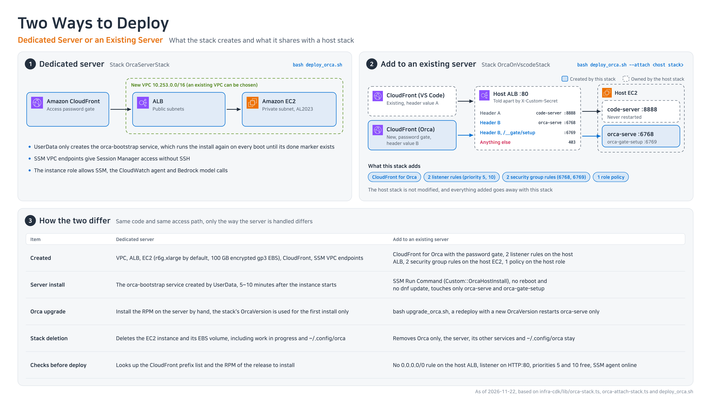
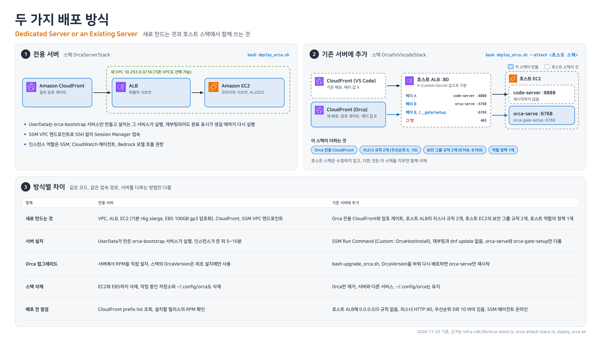

# Deployment Guide

<a href="#english"></a>
<a href="#korean"></a>

---

<a id="english"></a>

# English

This guide covers what a deployment creates and how it is protected, the dedicated server, adding Orca to an existing server, and deleting a deployment. The commands are the AWS CDK ones (`deploy_orca.sh`). The Terraform path is in [terraform.md](terraform.md), and what to do after a deployment is in [usage.md](usage.md). In a Claude Code session the `install-orca` skill walks through the same choices and deploys after approval. How to use it is in the [README](../README.md#guided-install-in-claude-code).

## What the Deployment Creates

```text
User ──HTTPS/WSS──> CloudFront ──HTTP:80 + X-Custom-Secret──> ALB ──HTTP/WS:6768──> EC2 (private subnet)
                    [password gate]  (SG: CloudFront prefix list only)   (SG: ALB SG only)   orca-ide serve
                    CloudFront Function + KeyValueStore
```

Access takes two steps. First comes the CloudFront password gate, which plays the role of the code-server password page. Then Orca pairing approves each browser as a device.

One `orca-ide serve` process handles the web client (`/web-index.html`, HTTP) and the runtime RPC (WebSocket) on the same port, 6768. As with code-server, a browser is all you need.

### Components

| Component | Description |
|---|---|
| VPC | 10.253.0.0/16 (new) or an existing VPC |
| Public Subnet A/B | ALB, NAT Gateway |
| Private Subnet A/B | Orca server EC2 instance, SSM VPC endpoints |
| CloudFront | Terminates HTTPS and WSS, ALB origin, caches only `/assets/*` |
| CloudFront Function + KeyValueStore | Access password gate (login page, signed cookie) |
| ALB | Security group that allows only the CloudFront prefix list, `X-Custom-Secret` header check, 403 by default |
| EC2 | AL2023 ARM64 (r6g.xlarge by default), orca-ide, Claude Code, Codex, Kiro CLI |
| Secrets Manager | Value of the `X-Custom-Secret` header (48 random characters) |

### Security Features

- **Access password gate**: Orca has no password feature like code-server, so a CloudFront Function (viewer request) adds one. Without the cookie it shows a password page. With the right password it issues the `orca_gate` cookie (`HttpOnly; Secure; SameSite=Lax`, 7 days), whose expiry time is signed with HMAC. The check applies to HTML, to `/assets/*` and **to the WebSocket upgrade request**, so neither the UI nor the RPC socket opens without the password. The KeyValueStore holds only a salt, a hash and the cookie signing key, and neither the plain password nor the hash enters the CloudFormation template.
- **Password setup at first login**: If the password is skipped at deploy time, the first page becomes the password setup page (new password, confirmation and a show-password checkbox). A CloudFront Function can only read its KeyValueStore, so a small setup service on the EC2 instance (`orca-gate-setup`, port 6769, ALB path rule `/__gate/setup`) stores the password. A **one-time setup code** is required so that the first visitor cannot set the password. The stack output `PairingWebLink` and `get_pairing_url.sh` append the code after the `#` of the pairing link (opened without the code, the setup page shows a field for it). Once a password is set, the code is deleted and `/__gate/setup` is answered with 409 at the edge. The setup service locks after 20 wrong codes.
- **CloudFront prefix list**: The only inbound rule of the ALB security group is TCP 80 from `com.amazonaws.global.cloudfront.origin-facing`. The CDK listener uses `open: false`, so no 0.0.0.0/0 rule is created. The outbound rule of the ALB security group is limited to port 6768 of the EC2 security group.
- **X-Custom-Secret header**: The prefix list allows *every* CloudFront distribution, so the header keeps someone else's distribution from using this ALB as its origin. The value is a random string generated by Secrets Manager, and the CloudFront origin header and the ALB listener rule use the same dynamic reference (`{{resolve:secretsmanager:...}}`). Unlike a value built from the stack name and the account ID, it cannot be guessed, and it does not appear in the stack outputs. With the Terraform deployment Terraform generates the value, stores it in Secrets Manager as well and keeps it in its state file in plain text. Without the header or with a wrong value the ALB returns `403 Access Denied`.
- **Private subnet**: The EC2 instance has no public IP, and its only inbound rule is port 6768 from the ALB security group.
- **Orca pairing and E2EE**: Anyone can download the static files of the web UI, but using the server requires a pairing link (device token). A paired browser stores an Ed25519 key in IndexedDB, and RPC is end-to-end encrypted with the public key of the server, so only ciphertext passes through CloudFront and the ALB.
- **SSM VPC endpoints**: Access uses Session Manager, without SSH.
- **EBS encryption**: 100 GB gp3 with encryption enabled.

### Software Installed on the Dedicated Server

| Item | Version and location |
|---|---|
| Orca (`orca-ide`) | GitHub release RPM (latest at deploy time, `OrcaVersion` parameter) |
| Claude Code CLI | latest, native install (`~/.local/bin/claude`, updates itself without sudo) |
| Codex CLI | latest, user npm path (`~/.npm-global/bin/codex`) |
| Kiro CLI | latest (`/usr/local/bin`) |
| Node.js | 22 LTS (nodesource, fnm as fallback) |
| AWS CLI | v2 (latest) |
| Python3 + pip | boto3, click |
| Docker / uv / git / tmux | latest |
| Development Tools | gcc, make and others (for native npm modules on ARM64) |
| CloudWatch Agent / SSM Plugin | latest |
| ec2_vscode helpers | `~/ec2_vscode` (claude-code-setup, kiro-cli-setup, codex-cli-setup) |

> UserData creates only the install script (`/opt/orca-bootstrap/setup.sh`) and `orca-bootstrap.service`; the service performs the actual installation. Even when the instance reboots during the installation, for example because of an SSM patch, the service runs again on every boot until the completion marker (`/var/lib/orca-bootstrap/done`) exists.
> Check the progress with `sudo tail -f /var/log/user-data.log` or `systemctl status orca-bootstrap`.

### Why the Orca RPM Is Installed with `--nodeps` on Amazon Linux 2023

The `orca-ide` RPM requires `xdotool` and `xclip`, but the AL2023 repositories do not have them, so `dnf install ./orca-ide-*.rpm` fails. The two tools are used only for desktop control (`orca computer`) and for copying files to the clipboard, so the other dependencies (gtk3, nss, Xvfb and so on) are installed with `dnf` and the RPM is installed with `rpm -Uvh --nodeps`. From v1.4.269 the RPM also requires `/usr/bin/dbus-send`, so `dbus-tools` is installed as well. After that `dnf check` reports two missing dependencies, but installing other packages and `dnf upgrade` (including SSM patching) work normally.

## Dedicated Server

`bash deploy_orca.sh` creates the stack `OrcaServerStack`: a VPC (new or existing), an ALB, an EC2 instance and a CloudFront distribution for Orca. Run `bash scripts/setup.sh` once before the first deployment.

```bash
bash deploy_orca.sh                 # Interactive: numbered menus for the region, the VPC (new or existing) and the instance type
bash deploy_orca.sh --yes           # Defaults: ap-northeast-2, r6g.xlarge, new VPC, password set at first login
ORCA_WEB_PASSWORD='...' bash deploy_orca.sh --yes   # Set the password too, without prompts
```

Without `--yes` the script asks with numbered menus, and a value given as an option is not asked again (`deploy_guide.sh`, shared with `deploy_orca_tf.sh`).

- **Region**: pick one of twelve regions or type a region code.
- **VPC**: create a new one (you can name it) or pick one from the list of VPCs in the account. For an existing VPC the script shows its subnets sorted the way CDK sorts them when it reads a VPC (public, private, isolated) and accepts the VPC only when it has public subnets in two or more Availability Zones for the ALB and a private subnet with a default route to a NAT gateway or a Transit Gateway for the server. When the VPC already has SSM endpoints, new ones are not created. A VPC given with `--vpc-id` is checked the same way before the deployment starts.
- **Instance type**: pick one of the fifteen types the stack accepts, shown with architecture, vCPU and memory. A type the region does not offer is marked and refused.
- **Access password**: type it now or press Enter to set it at the first login.

A dedicated server stack that is already deployed keeps its VPC and its instance type on a later run, and the script stops when another VPC is given, because a different VPC would replace the ALB and the server.

The deployment waits until the server installation finishes. A new stack takes about 5 to 10 more minutes after the instance starts, and then the **pairing link** appears in the stack outputs and on the last screen of the script.

```text
OrcaServerStack.PairingWebLink = https://<cloudfront-domain>/web-index.html#pairing=orca%3A%2F%2Fpair%3Fcode%3D...&gate-setup=...
OrcaServerStack.GateSetupCode  = <one-time setup code>   ("none (access password already set)" once a password exists)
OrcaServerStack.PairingCode    = orca://pair?code=...
```

Open `PairingWebLink` in a browser. Use `get_pairing_url.sh` (see [Get the Pairing Link](usage.md#get-the-pairing-link)) only when the server was restarted and the link changed. To keep the link out of the outputs, deploy with `--no-pairing-output` (the reason is under [Pairing Link in the Stack Outputs](usage.md#pairing-link-in-the-stack-outputs)).

These commands deploy with CDK. To deploy with Terraform, run `deploy_orca_tf.sh` instead (see [Deploy with Terraform](terraform.md)). That path does not put the pairing link in its outputs, so the link always comes from `get_pairing_url.sh`.

## Add Orca to an Existing Server (`--attach`)

The figure compares the two deployment modes: what each stack creates, how the server is installed and upgraded, and what deleting the stack removes.

<picture>
  <source media="(prefers-color-scheme: dark)" srcset="infographic/build/02-deploy-modes-en_16x9_dark.png">
  
</picture>

This mode installs Orca on a server that already runs behind CloudFront and an ALB, such as the `VscodeServerStack` of ec2_vscode. The EC2 instance and the ALB of the host stack are used as they are, and one more CloudFront distribution is added for Orca.

```text
                ┌─ CloudFront (VS Code, existing) ── X-Custom-Secret = A ─┐
User ──HTTPS──> │                                                          ├─> host ALB :80 ──┬─ header A → EC2 :8888 code-server
                └─ CloudFront (Orca, new)       ── X-Custom-Secret = B ─┘  (SG: prefix list only) ├─ header B → EC2 :6768 orca-serve
                   [password gate]                                                                 └─ otherwise → 403 Access Denied
```

```bash
bash deploy_orca.sh --attach VscodeServerStack --yes
```

- **The host stack is not modified.** This stack adds two ALB listener rules (priority 5 and 10), two security group rules on the host EC2 instance (from the ALB security group to ports 6768 and 6769) and one policy on the host IAM role (read the setup service bundle, KeyValueStore). They all belong to this stack, so deleting it removes them.
- **Installation runs through SSM Run Command.** A custom resource (`Custom::OrcaHostInstall`) sends `infra-cdk/lib/host/install_orca.sh` and waits until it finishes. UserData is not used, so there is no reboot, no system update (`dnf update`) and no restart of other services. If the installation fails, the deployment fails and the error message carries the tail of the script output (the full output is in the SSM Run Command history).
- **Running it again is safe.** `orca-serve` restarts only when the package, the unit or the environment file changed. Deploying again with a different `--orca-version` upgrades to that version without a reboot (`bash upgrade_orca.sh` does this for you; see [Upgrade Orca](usage.md#upgrade-orca)).
- **Checks before the deployment** (done by `deploy_orca.sh`, which stops if any fails): the host ALB security group has no 0.0.0.0/0 rule, the listener is HTTP:80, rule priorities 5 and 10 are free, and the SSM agent of the host is online. The install script also stops without changing anything when another program uses port 6768 or 6769.
- **Deletion** (`bash cleanup.sh`): `infra-cdk/lib/host/uninstall_orca.sh` removes `orca-serve`, the setup service and the RPM, and turns the lingering it enabled back off. The server, other services and `~/.config/orca` (Orca sessions and settings) stay.
- **Permissions**: Orca terminals and agents run as `ec2-user` and use the files of the host and the **permissions of the instance role** as they are. If the role has broad permissions such as `AdministratorAccess`, a leaked pairing link or Orca access password is a leak of the account permissions. Treat the link and the password with the same care as the code-server password.

### Host Stack Security Check (VscodeServerStack)

`--attach` is safe only when the host ALB accepts nothing but CloudFront. On 2026-11-08 the `VscodeServerStack` of this account (deployed in 2026-03) was checked and the problems below were fixed. A VS Code stack deployed in another account from the same code can have the same problems.

| Problem | Action |
|---|---|
| The ALB security group still had a `0.0.0.0/0:80` rule ("Allow from anyone on port 80"). The ec2_vscode code had been changed to `open: false`, but the deployment predated the change | Deleted the rule. Only the CloudFront prefix list rule remains |
| The `X-Custom-Secret` value was `<stack name>-secret-<account ID>`, which can be guessed, and it was exposed in plain text in the stack outputs | Replaced with a 48-character random value from Secrets Manager; the output is now an ARN (`OriginSecretArn`) |
| The AMI was an SSM parameter (latest AL2023), looked up again on every stack update. A newer AMI replaces the instance | Pinned to the current AMI ID |
| The code-server password was in plain text in the systemd unit file (readable by anyone) | Removed from the unit (the behavior is the same because `config.yaml` holds the same value); `config.yaml` is mode 600 |

The fixes were not synthesized again with CDK. **The deployed template was downloaded, only the needed parts were edited and the result was applied as a change set.** The code of the ec2_vscode repository changed after the deployment, so deploying it as is would mix in other changes. The change set was applied after confirming that the EC2 instance was not among the changes. The header value was replaced in two steps so that access was not interrupted. First the ALB rule accepted both the old and the new value and CloudFront was switched to the new one. After the CloudFront deployment finished, the old value was removed.

The code-server password is also in the EC2 user data (readable inside the instance through IMDS). To change the password, edit `~/.config/code-server/config.yaml` and run `sudo systemctl restart code-server`. A restart ends every terminal running inside code-server, including the Claude Code sessions in them, so do it when no work is in progress.

## Delete the Stack

```bash
bash cleanup.sh --region ap-northeast-2
# or
aws cloudformation delete-stack --stack-name OrcaServerStack --region ap-northeast-2
# Terraform deployment
bash cleanup.sh --tf attach              # or --tf dedicated
```

The stack contains a CloudFront distribution, so deletion can take 10 to 15 minutes. `OrcaServerStack` also deletes the EBS volume (repositories in progress, `~/.config/orca`). `OrcaOnVscodeStack` (`--attach`) removes only Orca from the host server and leaves the server and its data. When no stack name is given and `OrcaServerStack` does not exist, `cleanup.sh`, `get_pairing_url.sh` and `set_password.sh` use `OrcaOnVscodeStack`. `cleanup.sh --tf` runs `terraform destroy` and then removes the saved input file, so that a later deployment does not inherit the old values. One thing stays behind when a dedicated server stack that made its own VPC is deleted: the CloudWatch log group of the Lambda function CDK uses to restrict the default security group of the VPC (`/aws/lambda/<stack name>-CustomVpcRestrictDefaultSG...`). It is not part of the stack, so delete it by hand if you do not want it. A Terraform deployment leaves nothing behind (both checked with real deployments on 2026-11-23).

---

<a id="korean"></a>

# 한국어

배포가 만드는 것과 보호 방법, 전용 서버 배포, 기존 서버에 Orca를 추가하는 방법, 배포 삭제를 다룹니다. 명령은 AWS CDK의 것(`deploy_orca.sh`)입니다. Terraform으로 배포하는 방법은 [terraform.md](terraform.md#korean)에, 배포한 뒤에 할 일은 [usage.md](usage.md#korean)에 있습니다. Claude Code 세션에서는 `install-orca` 스킬이 같은 선택을 차례로 묻고 승인을 받은 뒤 배포합니다. 사용 방법은 [README](../README.md#claude-code에서-안내받는-설치)에 있습니다.

## 배포로 만들어지는 것

```text
User ──HTTPS/WSS──> CloudFront ──HTTP:80 + X-Custom-Secret──> ALB ──HTTP/WS:6768──> EC2 (Private Subnet)
                    [암호 게이트]   (SG: CloudFront prefix list만)        (SG: ALB SG만)    orca-ide serve
                    CloudFront Function + KeyValueStore
```

접속은 두 단계입니다. 먼저 CloudFront 암호 게이트를 지납니다. 이 게이트는 code-server의 암호 화면과 같은 역할을 합니다. 다음으로 Orca 페어링에서 브라우저마다 디바이스 승인을 받습니다.

`orca-ide serve` 프로세스 하나가 같은 포트(6768)에서 웹 클라이언트(`/web-index.html`, HTTP)와 런타임 RPC(WebSocket)를 함께 처리합니다. code-server처럼 브라우저만 있으면 됩니다.

### 구성 요소

| 구성 요소 | 설명 |
|---|---|
| VPC | 10.253.0.0/16 (신규 생성) 또는 기존 VPC |
| Public Subnet A/B | ALB, NAT Gateway |
| Private Subnet A/B | Orca 서버 EC2, SSM VPC 엔드포인트 |
| CloudFront | HTTPS와 WSS 종료, ALB 오리진, `/assets/*`만 캐시 |
| CloudFront Function + KeyValueStore | 접속 암호 게이트 (로그인 페이지, 서명 쿠키) |
| ALB | CloudFront prefix list만 허용하는 보안 그룹, `X-Custom-Secret` 헤더 검증, 기본 403 |
| EC2 | AL2023 ARM64 (기본 r6g.xlarge), orca-ide, Claude Code, Codex, Kiro CLI |
| Secrets Manager | `X-Custom-Secret` 헤더 값 (48자 랜덤) |

### 보안 기능

- **접속 암호 게이트**: Orca에는 code-server 같은 암호 기능이 없어 CloudFront Function(viewer request)으로 추가합니다. 쿠키가 없으면 암호 입력 페이지를 보여 줍니다. 암호가 맞으면 만료 시각을 HMAC으로 서명한 `orca_gate` 쿠키(`HttpOnly; Secure; SameSite=Lax`, 7일)를 발급합니다. 이 검사는 HTML뿐 아니라 `/assets/*`와 **WebSocket 업그레이드 요청에도** 적용되므로 암호 없이는 UI도 RPC 소켓도 열리지 않습니다. KeyValueStore에는 salt, 해시, 쿠키 서명 키만 있고 평문 암호와 해시는 CloudFormation 템플릿에 들어가지 않습니다.
- **최초 로그인 암호 설정**: 배포 때 암호를 건너뛰면 첫 화면이 암호 설정 페이지(새 암호, 확인 암호, 암호 보기 체크박스)가 됩니다. CloudFront Function은 KeyValueStore를 읽기만 하므로 저장은 EC2의 작은 설정 서비스(`orca-gate-setup`, 포트 6769, ALB 경로 규칙 `/__gate/setup`)가 맡습니다. 먼저 접속한 사람이 암호를 정하지 못하도록 **1회용 설정 코드**가 필요합니다. 스택 출력 `PairingWebLink`와 `get_pairing_url.sh`가 이 코드를 페어링 링크의 `#` 뒤에 붙여 줍니다(코드 없이 열면 설정 화면에 코드 입력 칸이 나타납니다). 암호가 정해지면 코드는 삭제되고 그 뒤로 `/__gate/setup`은 엣지에서 409로 막힙니다. 설정 서비스는 코드를 20번 틀리면 잠깁니다.
- **CloudFront prefix list**: ALB 보안 그룹의 인바운드는 `com.amazonaws.global.cloudfront.origin-facing`의 TCP 80 하나뿐입니다. CDK 리스너는 `open: false`를 써서 0.0.0.0/0 규칙을 만들지 않습니다. ALB 보안 그룹의 아웃바운드도 EC2 보안 그룹의 6768로 제한합니다.
- **X-Custom-Secret 헤더**: prefix list는 *모든* CloudFront 배포를 허용하므로 다른 사람의 배포가 이 ALB를 오리진으로 삼는 것을 헤더로 막습니다. 값은 Secrets Manager가 생성한 랜덤 문자열이고 CloudFront 오리진 헤더와 ALB 리스너 규칙이 같은 동적 참조(`{{resolve:secretsmanager:...}}`)를 씁니다. 스택 이름과 계정 ID로 만든 값과 달리 추측할 수 없고 스택 출력에도 남지 않습니다. Terraform 배포에서는 Terraform이 값을 만들어 Secrets Manager에도 저장하고 상태 파일에 평문으로 둡니다. 헤더가 없거나 틀리면 ALB가 `403 Access Denied`를 반환합니다.
- **Private Subnet**: EC2에 공인 IP가 없고 인바운드는 ALB 보안 그룹의 6768뿐입니다.
- **Orca 페어링과 E2EE**: 웹 UI의 정적 파일은 누구나 받을 수 있지만 서버를 쓰려면 페어링 링크(디바이스 토큰)가 있어야 합니다. 페어링한 브라우저는 Ed25519 키를 IndexedDB에 저장합니다. RPC는 서버 공개키로 종단 간 암호화되어 CloudFront와 ALB에는 암호문만 지나갑니다.
- **SSM VPC 엔드포인트**: SSH 없이 Session Manager로 접속합니다.
- **EBS 암호화**: 100GB gp3, 암호화 활성화.

### 전용 서버의 설치 항목

| 항목 | 버전과 위치 |
|---|---|
| Orca (`orca-ide`) | GitHub 릴리스 RPM (배포 시점 최신, `OrcaVersion` 파라미터) |
| Claude Code CLI | latest, 네이티브 설치 (`~/.local/bin/claude`, sudo 없이 자동 업데이트) |
| Codex CLI | latest, 사용자 npm 경로 (`~/.npm-global/bin/codex`) |
| Kiro CLI | latest (`/usr/local/bin`) |
| Node.js | 22 LTS (nodesource, 실패하면 fnm) |
| AWS CLI | v2 (latest) |
| Python3 + pip | boto3, click |
| Docker / uv / git / tmux | latest |
| Development Tools | gcc, make 등 (ARM64 네이티브 npm 모듈용) |
| CloudWatch Agent / SSM Plugin | latest |
| ec2_vscode 헬퍼 | `~/ec2_vscode` (claude-code-setup, kiro-cli-setup, codex-cli-setup) |

> UserData는 설치 스크립트(`/opt/orca-bootstrap/setup.sh`)와 `orca-bootstrap.service`만 만들고 실제 설치는 이 서비스가 수행합니다. 설치 도중 SSM 패치 같은 이유로 재부팅되어도 완료 표시 파일(`/var/lib/orca-bootstrap/done`)이 생길 때까지 부팅할 때마다 다시 실행됩니다.
> 진행 상황은 `sudo tail -f /var/log/user-data.log` 또는 `systemctl status orca-bootstrap`으로 확인합니다.

### Amazon Linux 2023에서 Orca RPM을 `--nodeps`로 설치하는 이유

`orca-ide` RPM은 `xdotool`, `xclip`을 요구하지만 AL2023 저장소에는 두 패키지가 없어 `dnf install ./orca-ide-*.rpm`이 실패합니다. 두 도구는 데스크톱 제어(`orca computer`)와 파일 클립보드 복사에만 쓰이므로 나머지 의존성(gtk3, nss, Xvfb 등)을 `dnf`로 설치한 뒤 `rpm -Uvh --nodeps`로 설치합니다. v1.4.269부터 RPM이 `/usr/bin/dbus-send`도 요구해 `dbus-tools`를 함께 설치합니다. 이후 `dnf check`는 누락 2건을 보고하지만 다른 패키지 설치와 `dnf upgrade`(SSM 패치 포함)는 정상 동작합니다.

## 전용 서버

`bash deploy_orca.sh`는 스택 `OrcaServerStack`을 만듭니다. Orca용 VPC(새로 만들거나 기존 VPC), ALB, EC2, CloudFront가 들어 있습니다. 처음 배포하기 전에 `bash scripts/setup.sh`를 한 번 실행합니다.

```bash
bash deploy_orca.sh                 # 대화형: 번호 메뉴로 리전, VPC(새로 만들기 또는 기존 VPC), 인스턴스 타입을 고름
bash deploy_orca.sh --yes           # 기본값: ap-northeast-2, r6g.xlarge, 새 VPC, 암호는 최초 로그인 때 설정
ORCA_WEB_PASSWORD='...' bash deploy_orca.sh --yes   # 암호까지 프롬프트 없이 지정
```

`--yes` 없이 실행하면 번호 메뉴로 묻습니다. 옵션으로 준 값은 다시 묻지 않습니다(`deploy_guide.sh`, `deploy_orca_tf.sh`와 함께 씀).

- **리전**: 열두 리전 가운데 하나를 고르거나 리전 코드를 입력합니다.
- **VPC**: 새로 만들거나(이름을 정할 수 있음) 계정의 VPC 목록에서 고릅니다. 기존 VPC는 서브넷을 CDK가 VPC를 읽을 때와 같은 기준(퍼블릭, 프라이빗, 격리)으로 나눠 보여 줍니다. ALB가 쓸 퍼블릭 서브넷이 가용 영역 둘 이상에 있고 서버가 쓸 프라이빗 서브넷(NAT Gateway나 Transit Gateway로 나가는 기본 경로가 있는 것)이 있어야 받습니다. 그 VPC에 SSM 엔드포인트가 이미 있으면 새로 만들지 않습니다. `--vpc-id`로 준 VPC도 배포를 시작하기 전에 같은 방법으로 확인합니다.
- **인스턴스 타입**: 스택이 받는 열다섯 타입 가운데 하나를 고릅니다. 아키텍처, vCPU, 메모리를 함께 보여 줍니다. 리전에서 제공하지 않는 타입은 표시하고 받지 않습니다.
- **접속 암호**: 지금 입력하거나 Enter를 눌러 최초 로그인 때 정합니다.

이미 배포한 전용 서버 스택은 다시 실행해도 VPC와 인스턴스 타입을 유지합니다. 다른 VPC를 주면 스크립트가 멈춥니다. VPC가 바뀌면 ALB와 서버를 새로 만들게 되기 때문입니다.

배포는 서버 설치가 끝날 때까지 기다립니다. 새 스택은 인스턴스가 시작된 뒤 약 5분에서 10분이 더 걸리고 끝나면 스택 출력과 스크립트 마지막 화면에 **페어링 링크**가 나옵니다.

```text
OrcaServerStack.PairingWebLink = https://<cloudfront-domain>/web-index.html#pairing=orca%3A%2F%2Fpair%3Fcode%3D...&gate-setup=...
OrcaServerStack.GateSetupCode  = <1회용 설정 코드>   (암호를 이미 정했으면 "none (access password already set)")
OrcaServerStack.PairingCode    = orca://pair?code=...
```

`PairingWebLink`를 브라우저로 엽니다. `get_pairing_url.sh`([페어링 링크 받기](usage.md#페어링-링크-받기) 참고)는 서버를 재시작해 링크가 바뀌었을 때만 씁니다. 링크를 출력에 넣지 않으려면 `--no-pairing-output`으로 배포합니다(이유는 [스택 출력의 페어링 링크](usage.md#스택-출력의-페어링-링크)에 있습니다).

위 명령은 CDK로 배포합니다. Terraform으로 배포하려면 `deploy_orca_tf.sh`를 실행합니다([Terraform으로 배포](terraform.md#korean) 참고). 이 경로는 페어링 링크를 출력에 넣지 않으므로 링크는 항상 `get_pairing_url.sh`로 받습니다.

## 기존 서버에 Orca 추가 (`--attach`)

두 배포 방식을 비교한 그림입니다. 스택마다 새로 만드는 것, 서버를 설치하고 업그레이드하는 방법, 스택을 지울 때 사라지는 것을 보여 줍니다.

<picture>
  <source media="(prefers-color-scheme: dark)" srcset="infographic/build/02-deploy-modes_16x9_dark.png">
  
</picture>

ec2_vscode의 `VscodeServerStack`처럼 이미 CloudFront와 ALB 뒤에서 운영 중인 서버에 Orca를 함께 설치하는 방식입니다. EC2와 ALB는 호스트 스택의 것을 그대로 쓰고 Orca 전용 CloudFront 배포를 하나 더 둡니다.

```text
                ┌─ CloudFront (VS Code, 기존) ── X-Custom-Secret = A ─┐
User ──HTTPS──> │                                                      ├─> 호스트 ALB :80 ──┬─ 헤더 A → EC2 :8888 code-server
                └─ CloudFront (Orca, 새로)  ── X-Custom-Secret = B ─┘   (SG: prefix list만) ├─ 헤더 B → EC2 :6768 orca-serve
                   [암호 게이트]                                                             └─ 그 밖   → 403 Access Denied
```

```bash
bash deploy_orca.sh --attach VscodeServerStack --yes
```

- **호스트 스택은 수정하지 않습니다.** 이 스택이 추가하는 것은 ALB 리스너 규칙 2개(우선순위 5와 10), 호스트 EC2 보안 그룹 규칙 2개(ALB 보안 그룹에서 포트 6768과 6769로), 호스트 IAM 역할의 정책 1개(설정 서비스 번들 읽기, KeyValueStore)입니다. 모두 이 스택에 속하므로 이 스택을 지우면 함께 사라집니다.
- **설치는 SSM Run Command로 합니다.** 커스텀 리소스(`Custom::OrcaHostInstall`)가 `infra-cdk/lib/host/install_orca.sh`를 보내고 끝날 때까지 기다립니다. UserData를 쓰지 않으므로 재부팅이 없고 시스템 업데이트(`dnf update`)와 다른 서비스의 재시작도 없습니다. 설치가 실패하면 배포가 실패하고 오류 메시지에 스크립트 출력의 끝부분이 들어갑니다(전체 출력은 SSM Run Command 기록에 있습니다).
- **다시 실행해도 안전합니다.** `orca-serve`는 패키지, 유닛, 환경 파일이 바뀌었을 때만 재시작합니다. `--orca-version`을 바꿔 다시 배포하면 재부팅 없이 그 버전으로 업그레이드합니다(`bash upgrade_orca.sh`가 이 과정을 대신합니다. [Orca 업그레이드](usage.md#orca-업그레이드) 참고).
- **배포 전 점검** (`deploy_orca.sh`가 수행하고 하나라도 걸리면 멈춤): 호스트 ALB 보안 그룹에 0.0.0.0/0 규칙이 없을 것, 리스너가 HTTP:80일 것, 규칙 우선순위 5와 10이 비어 있을 것, 호스트의 SSM 에이전트가 온라인일 것. 설치 스크립트도 포트 6768이나 6769를 다른 프로그램이 쓰고 있으면 아무것도 바꾸지 않고 멈춥니다.
- **삭제** (`bash cleanup.sh`): `infra-cdk/lib/host/uninstall_orca.sh`가 `orca-serve`, 설정 서비스, RPM을 지우고 설치 때 활성화한 lingering을 되돌립니다. 서버, 다른 서비스, `~/.config/orca`(Orca 세션과 설정)는 그대로 둡니다.
- **권한 주의**: Orca 터미널과 에이전트는 `ec2-user`로 실행되고 호스트의 파일과 **인스턴스 역할 권한**을 그대로 씁니다. 역할에 `AdministratorAccess` 같은 넓은 권한이 있다면 페어링 링크나 Orca 접속 암호가 새는 것은 계정 권한이 새는 것과 같습니다. 링크와 암호를 code-server 암호와 같은 수준으로 다룹니다.

### 호스트 스택 보안 점검 (VscodeServerStack)

`--attach`는 호스트 ALB가 CloudFront만 받는다는 전제에서 안전합니다. 2026-11-08에 이 계정의 `VscodeServerStack`(2026-03 배포)을 점검해 아래 문제를 수정했습니다. 다른 계정의 VS Code 스택도 같은 코드로 배포했다면 같은 문제가 있을 가능성이 있습니다.

| 문제 | 조치 |
|---|---|
| ALB 보안 그룹에 `0.0.0.0/0:80` 규칙("Allow from anyone on port 80")이 남아 있었음. ec2_vscode 코드는 `open: false`로 수정됐지만 배포가 그 전이었음 | 규칙 삭제. CloudFront 접두사 목록 규칙만 남김 |
| `X-Custom-Secret` 값이 `<스택 이름>-secret-<계정 ID>`라 추측 가능했고 스택 출력에도 평문으로 노출됨 | Secrets Manager의 48자 랜덤 값으로 교체, 출력은 ARN(`OriginSecretArn`)으로 변경 |
| AMI가 SSM 파라미터(최신 AL2023)라 스택을 갱신할 때마다 다시 조회됨. 새 AMI가 나와 있으면 인스턴스가 교체됨 | 현재 AMI ID로 고정 |
| code-server 암호가 systemd 유닛 파일(누구나 읽기 가능)에 평문으로 들어 있었음 | 유닛에서 제거(`config.yaml`과 같은 값이라 동작은 같음), `config.yaml`은 600 |

수정은 CDK로 다시 합성하지 않았습니다. **배포된 템플릿을 받아 필요한 부분만 수정한 뒤 변경 세트(Change Set)로 적용**했습니다. ec2_vscode 저장소 코드는 배포 이후 바뀌어 그대로 배포하면 다른 변경이 섞이기 때문입니다. 변경 세트에서 EC2 인스턴스가 변경 대상에 없는 것을 확인하고 적용했습니다. 헤더 값을 바꾸는 동안 접속이 끊기지 않게 두 단계로 나눴습니다. 먼저 ALB 규칙이 기존 값과 새 값을 함께 받게 하고 CloudFront를 새 값으로 바꿨습니다. CloudFront 배포가 끝난 뒤 기존 값을 뺐습니다.

code-server 암호는 EC2 사용자 데이터(인스턴스 안에서 IMDS로 읽을 수 있음)에도 들어 있습니다. 암호를 바꾸려면 `~/.config/code-server/config.yaml`을 수정하고 `sudo systemctl restart code-server`를 실행합니다. 재시작하면 code-server 안에서 실행 중이던 터미널(그 안의 Claude Code 세션 포함)이 모두 종료되므로 작업이 없을 때 실행합니다.

## 스택 삭제

```bash
bash cleanup.sh --region ap-northeast-2
# 또는
aws cloudformation delete-stack --stack-name OrcaServerStack --region ap-northeast-2
# Terraform 배포
bash cleanup.sh --tf attach              # 또는 --tf dedicated
```

CloudFront 배포가 포함되어 있어 삭제까지 10분에서 15분이 걸릴 수 있습니다. `OrcaServerStack`은 EBS(작업 중인 저장소, `~/.config/orca`)도 함께 삭제합니다. `OrcaOnVscodeStack`(`--attach`)은 호스트 서버에서 Orca만 제거하고 서버와 데이터는 남깁니다. 스택 이름을 주지 않았는데 `OrcaServerStack`이 없으면 `cleanup.sh`, `get_pairing_url.sh`, `set_password.sh`는 `OrcaOnVscodeStack`을 씁니다. `cleanup.sh --tf`는 `terraform destroy`를 실행한 뒤 저장해 둔 입력 값 파일을 지워 다음 배포가 이전 값을 이어받지 않게 합니다. 스택이 직접 VPC를 만든 전용 서버 스택을 지우면 하나가 남습니다. CDK가 VPC의 기본 보안 그룹을 제한할 때 쓰는 Lambda 함수의 CloudWatch 로그 그룹(`/aws/lambda/<스택 이름>-CustomVpcRestrictDefaultSG...`)입니다. 스택에 속하지 않으므로 필요 없으면 직접 지웁니다. Terraform 배포는 남기는 것이 없습니다(둘 다 2026-11-23에 실제 배포로 확인).
