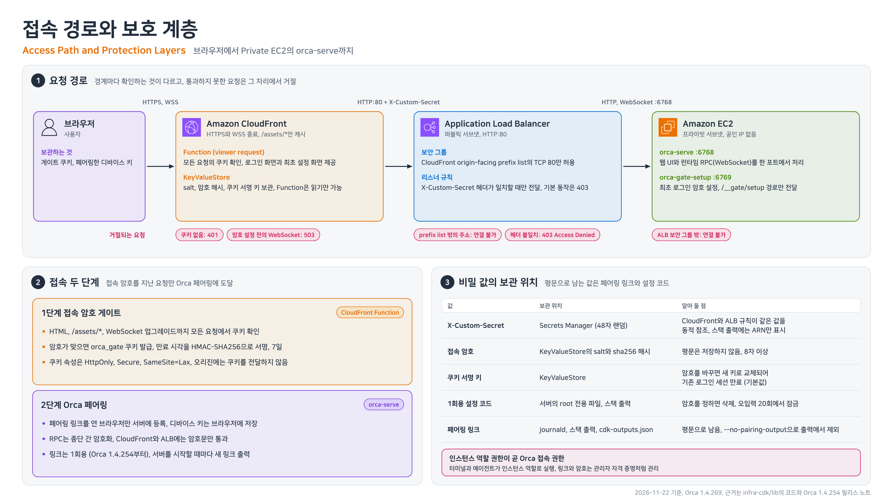

# 작업 시작 안내

이 저장소에서 처음 작업하는 사람과 Claude Code 세션을 위한 안내입니다. 작업 규칙의 원본은 루트의 `CLAUDE.md`입니다. 사용법은 README에 요약이 있고 자세한 내용은 `docs/deployment.md`(배포, 삭제), `docs/terraform.md`(Terraform 배포), `docs/usage.md`(페어링, 암호, 운영, 업그레이드), `docs/configuration.md`(환경 설정)에 있습니다.

## 빠른 시작

### 1. 사전 요구 사항

- [ ] AWS CLI v2와 대상 계정의 자격 증명(CloudFormation, EC2, ELB, CloudFront, IAM, SSM, Secrets Manager, S3). 기본 리전은 ap-northeast-2
- [ ] Node.js 20 이상과 npm(CDK와 게이트 함수 시험)
- [ ] Python 3과 curl(배포 스크립트와 시험)
- [ ] jq와 Bash 4 이상(훅과 하네스 시험)
- [ ] `session-manager-plugin`(페어링 링크 조회와 SSM 접속)
- [ ] Terraform으로 배포하거나 Terraform 시험을 실행하려면 Terraform 1.5 이상(1.14.7에서만 확인)
- [ ] 업그레이드 사전 점검을 하려면 `rpm`, `rpm2cpio`, `cpio`가 있는 Amazon Linux 2023 장비

### 2. 준비

```bash
# 도구를 확인하고 훅과 CDK 의존성을 준비합니다. AWS 리소스를 만들거나 바꾸지 않습니다
bash scripts/setup.sh
```

### 3. 확인

```bash
npm test --prefix infra-cdk     # 코드 시험: 게이트 함수, 설정 서비스, 페어링 출력, 호스트 설치, 업그레이드 스크립트
bash tests/run-all.sh           # 하네스 시험: 훅, 설정, 문서의 구조와 경로
bash infra-tf/run-tests.sh      # Terraform 시험: 형식, 구성 검증, 가짜 provider로 하는 계획 시험, ssm_run.sh
```

세 시험 모두 AWS를 부르지 않습니다. 코드 시험은 가짜 `aws`, `curl`, 배포 스크립트로 실행됩니다. Terraform 시험은 가짜 provider를 쓰고 처음 실행할 때 provider를 내려받습니다.

## 프로젝트 개요

요청이 지나는 경로와 경계마다 확인하는 것을 그린 그림입니다. 배포 방식, 첫 접속 절차, 업그레이드 절차의 그림은 `README.md`, `docs/deployment.md`, `docs/usage.md`, `docs/architecture.md`, `docs/runbooks/upgrade-orca.md`에 있습니다.

<picture>
  <source media="(prefers-color-scheme: dark)" srcset="infographic/build/01-access-path_16x9_dark.png">
  
</picture>

- `CLAUDE.md`: 작업 규칙, 기술 구성, 주요 명령
- `docs/architecture.md`: 전체 구조, 그림, 설계 결정
- `docs/api-reference.md`: 암호 게이트의 HTTP 경로와 상태 코드, 커스텀 리소스의 속성
- `docs/reference/`: 층별로 코드를 가리키는 참조(IaC, Security)
- `docs/runbooks/upgrade-orca.md`: Orca 업그레이드 절차
- `docs/decisions/`: ADR을 둘 자리. 지금은 템플릿만 있습니다
- `infra-cdk/CLAUDE.md`: CDK 모듈의 파일과 규칙
- `infra-tf/CLAUDE.md`: Terraform 모듈의 파일과 규칙

| 위치 | 내용 |
|---|---|
| 루트의 셸 스크립트 | 배포(CDK는 `deploy_orca.sh`, Terraform은 `deploy_orca_tf.sh`), 업그레이드(`upgrade_orca.sh`), 페어링 링크 조회(`get_pairing_url.sh`), 접속 암호(`set_password.sh`), 삭제(`cleanup.sh`) |
| `infra-cdk/bin/`, `infra-cdk/lib/` | CDK 앱과 스택. 두 스택이 `infra-cdk/lib/orca-front-door.ts`를 함께 씀 |
| `infra-cdk/lib/host/` | 기존 서버에 Orca를 설치하고 제거하는 스크립트와 Lambda 핸들러 |
| `infra-cdk/lib/gate/`, `infra-cdk/lib/functions/` | 암호 게이트: 서버의 설정 서비스와 엣지의 함수 |
| `infra-cdk/lib/pairing/` | 페어링 링크를 스택 출력에 넣는 Lambda 핸들러와 조회 스크립트 |
| `infra-cdk/test/` | 코드 시험. `npm test --prefix infra-cdk`가 실행 |
| `infra-tf/dedicated/`, `infra-tf/attach/` | 같은 구조를 만드는 Terraform 루트 모듈 둘(전용 서버, 기존 서버에 추가). `bash infra-tf/run-tests.sh`가 시험 |
| `infra-tf/modules/`, `infra-tf/scripts/` | 두 구성이 함께 쓰는 모듈(진입 경로, ALB 규칙)과 SSM 설치 도우미 |
| `tests/` | 하네스 시험. `bash tests/run-all.sh`가 실행 |
| `scripts/` | 작업 환경 준비와 git 훅 설치 |

## 작업 흐름

- 배포, 업그레이드, 접속 암호 변경, 스택 삭제는 실행하기 전에 무엇이 바뀌는지 보여 주고 승인을 받습니다. 스택 변경은 `cdk diff` 결과를, Terraform 변경은 `bash deploy_orca_tf.sh --plan`의 계획을 먼저 봅니다
- 기존 서버에 추가한 스택(OrcaOnVscodeStack)은 Claude Code가 실행 중일 수 있는 바로 그 서버에 설치됩니다. code-server는 재시작하지 않습니다. 업그레이드와 설치는 `orca-serve`와 `orca-gate-setup`만 재시작합니다
- 한 서버에는 CDK 스택과 Terraform 배포 가운데 하나만 붙입니다. CDK 스택이 붙어 있는 서버에서는 `deploy_orca_tf.sh`가 멈춥니다
- 페어링 링크, 페어링 코드, 설정 코드, 접속 암호는 출력하지 않습니다. `cdk-outputs.json`을 세션에서 읽지 않고 배포 출력은 값을 가리는 필터에 통과시킵니다(`docs/runbooks/upgrade-orca.md`). 링크가 필요하면 사용자가 직접 `bash get_pairing_url.sh`를 실행합니다
- Terraform 상태 파일(`terraform.tfstate`)에는 `X-Custom-Secret` 값이 평문으로 들어 있습니다. 세션에서 읽지 않고 상태를 그대로 출력하는 `terraform show`와 `terraform state pull`을 실행하지 않습니다. 필요한 값은 `terraform output`으로 읽습니다
- 계정 ID, 계정 ID가 든 ARN, CloudFront 도메인, 인스턴스와 VPC ID 같은 환경 식별 값은 커밋하는 파일에 넣지 않습니다. 문서에는 `<cloudfront-domain>` 같은 자리 표시를 씁니다
- `infra-cdk/lib/host`, `infra-cdk/lib/pairing`, `infra-cdk/lib/gate`에는 코드만 둡니다. 다른 파일을 넣으면 자산 해시가 바뀌어 다음 배포에서 Lambda가 갱신되고 gate 묶음이면 서버에서 설치가 다시 실행됩니다
- `infra-cdk/lib/host` 아래를 수정하면 Orca 버전을 올리기 전에 그 변경만 먼저 배포합니다(`docs/runbooks/upgrade-orca.md`의 3단계)
- 코드를 수정하면 `npm test --prefix infra-cdk`를 실행합니다. 새 시험 파일은 `infra-cdk/package.json`의 `test` 스크립트에 넣어야 실행됩니다
- `infra-tf/` 아래를 수정하면 `bash infra-tf/run-tests.sh`를 실행합니다. 스택 코드(`infra-cdk/lib/`)의 리소스를 바꾸면 같은 변경을 `infra-tf/`에도 넣습니다. 엣지 함수, 설정 서비스, 호스트 스크립트는 두 도구가 같은 파일을 쓰므로 한 번만 수정합니다
- 커밋은 Conventional Commits 형식으로 씁니다(`feat:`, `fix:`, `docs:`). `scripts/install-hooks.sh`가 설치하는 git 훅이 `Co-Authored-By` 줄을 지우고 스테이징한 파일의 비밀 값을 검사합니다

## 알아 둘 개념

| 개념 | 설명 |
|---|---|
| 전용 서버 방식 | `bash deploy_orca.sh`. 스택 OrcaServerStack이 VPC, ALB, EC2를 새로 만듦 |
| 추가 방식 | `bash deploy_orca.sh --attach <호스트 스택>`. 스택 OrcaOnVscodeStack이 기존 서버와 ALB에 Orca를 추가. 호스트 스택은 수정하지 않음 |
| 배포 도구 | CDK(`deploy_orca.sh`, CloudFormation 스택으로 배포)와 Terraform(`deploy_orca_tf.sh`, `infra-tf/`의 구성으로 배포). 두 방식 모두 어느 도구로든 배포하고 한 서버에는 하나만 씀 |
| 호스트 스택 | 추가 방식에서 서버와 ALB를 가진 스택(예: ec2_vscode의 VscodeServerStack) |
| 암호 게이트 | CloudFront Function이 모든 요청에 접속 암호를 요구하는 장치. 암호의 해시는 CloudFront KeyValueStore에 있음 |
| 설정 코드 | 암호가 없을 때 첫 암호를 정하는 데 필요한 1회용 코드. 서버에만 있고 암호를 정하면 사라짐 |
| 페어링 링크, 페어링 코드 | Orca 서버를 쓰기 위한 값. `orca-serve`가 시작할 때 journald에 출력. 서버 접근 권한이므로 암호처럼 다룸 |
| `X-Custom-Secret` | CloudFront가 ALB에 보내는 헤더. ALB는 이 값이 맞는 요청만 서버로 보냄 |
| 커스텀 리소스 | 스택이 배포 중에 서버에서 일을 하는 방법. `Custom::OrcaHostInstall`(설치)과 `Custom::OrcaPairingInfo`(페어링 값 조회). CDK 배포에만 있고 Terraform 배포에서는 `terraform_data`와 `infra-tf/scripts/ssm_run.sh`가 설치를 맡음 |

## 첫 작업 점검표

- [ ] `CLAUDE.md`와 이 문서를 읽습니다
- [ ] `bash scripts/setup.sh`를 실행합니다
- [ ] `npm test --prefix infra-cdk`와 `bash tests/run-all.sh`가 통과하는지 확인합니다. Terraform이 있으면 `bash infra-tf/run-tests.sh`도 실행합니다
- [ ] `docs/architecture.md`의 그림과 `docs/api-reference.md`의 상태 코드 표를 읽습니다
- [ ] `bash upgrade_orca.sh --check`로 배포된 스택과 Orca 버전을 확인합니다. 이 명령은 스택을 조회하고 GitHub 릴리스를 읽기만 합니다
- [ ] `docs/runbooks/upgrade-orca.md`를 읽습니다

## 문제 해결

| 증상 | 원인과 조치 |
|---|---|
| 스택 출력의 페어링 값이 `unavailable (...)` | 서버가 링크를 보고하지 못했습니다. 사용자가 `bash get_pairing_url.sh --restart`를 실행합니다 |
| 설정 화면에 "시도 횟수를 넘었습니다" | 설정 서비스가 틀린 코드 20번으로 잠겼습니다(423). 서버에서 `sudo systemctl restart orca-gate-setup`으로 풉니다 |
| 추가 배포가 "우선순위 ... 이미 사용 중"으로 멈춤 | 호스트 리스너에 우선순위 5나 10 규칙이 있습니다. CDK context `gateSetupRulePriority`, `orcaRulePriority`로 바꾸는데, `deploy_orca.sh`에는 이 값을 넘기는 옵션이 없습니다. `deploy_orca_tf.sh`는 `--gate-rule-priority`와 `--orca-rule-priority`로 바꿉니다 |
| `deploy_orca_tf.sh`가 "이미 Orca(6768 포트) 규칙이 있습니다"로 멈춤 | 그 서버에 CDK 스택이나 다른 Terraform 배포가 이미 붙어 있습니다. 한 서버에는 배포 하나만 붙입니다. 기존 배포를 계속 쓰거나 지운 뒤 다시 실행합니다 |
| `terraform plan`이 `The host has more than one security group`으로 실패 | 호스트나 ALB의 보안 그룹이 여러 개입니다. `deploy_orca_tf.sh`의 `--host-instance-sg`, `--host-alb-sg`로 지정합니다 |
| Terraform 적용이 설치 단계에서 실패 | 롤백은 없고 서버는 설치 스크립트가 멈춘 자리에 남습니다. 원인을 수정하고 다시 적용하면 설치가 다시 실행됩니다(`docs/runbooks/upgrade-orca.md`의 Terraform 배포 챕터) |
| 설치가 `port 6768 is in use by another program`으로 실패 | 다른 프로그램이 포트를 쓰고 있습니다. 설치 스크립트는 아무것도 바꾸지 않고 멈춥니다 |
| `cdk diff`가 `OrcaVersion`이 바뀐다고 표시 | `cdk diff`가 템플릿 기본값으로 변경 세트를 만들기 때문입니다(2026-11-22에 확인). 버전을 유지하려면 `deploy_orca.sh`에 `--orca-version <현재 버전>`을 넘깁니다 |
| `cdk diff`가 한글이 깨진 변경 1건을 생략했다고 표시 | 2026-11-22의 diff에 나온 표시입니다. 이전 작업 기록에는 게이트 함수 소스의 한글 때문에 생기는 표시라고 적혀 있고 이번에 다시 확인하지는 않았습니다 |
| 서버의 `rpm -q orca-ide`와 스택의 `OrcaVersion`이 다름 | 서버에서 손으로 설치한 경우입니다. 다음에 호스트 스크립트를 수정해 배포하면 서버가 스택의 버전으로 되돌아갑니다 |

## 참고 자료

- upstream Orca: [github.com/stablyai/orca](https://github.com/stablyai/orca)
- 구조를 따온 프로젝트: [github.com/whchoi98/ec2_vscode](https://github.com/whchoi98/ec2_vscode)
