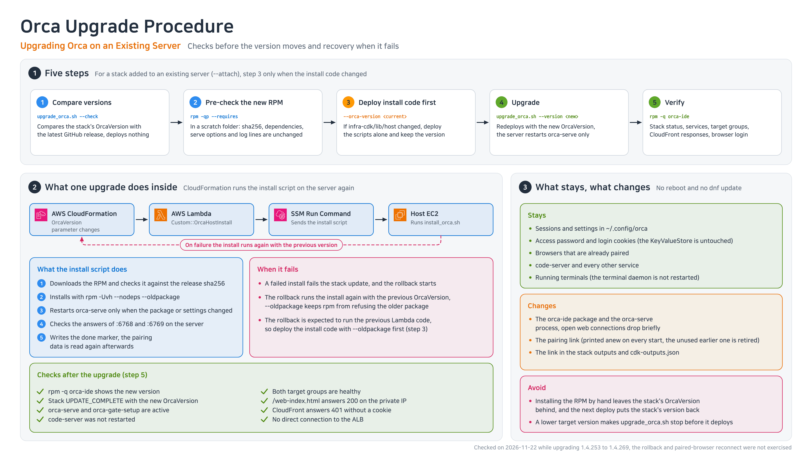
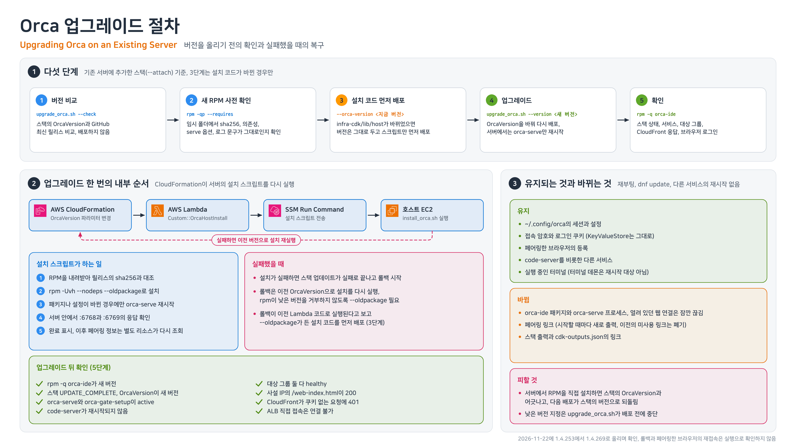

# Runbook: Upgrade Orca on an Attach Stack

<a href="#english"></a>
<a href="#korean"></a>

---

<a id="english"></a>

# English

## Overview

The figure shows the five steps of this runbook, what one upgrade does inside, and what stays and what changes. It shows the CDK deployment.

<picture>
  <source media="(prefers-color-scheme: dark)" srcset="../infographic/build/04-upgrade-flow-en_16x9_dark.png">
  
</picture>
This runbook upgrades Orca on a stack made with `deploy_orca.sh --attach` (default name OrcaOnVscodeStack). The upgrade changes the stack parameter `OrcaVersion`. The custom resource `Custom::OrcaHostInstall` then runs `infra-cdk/lib/host/install_orca.sh` on the server through SSM Run Command, replaces the RPM and restarts `orca-serve` only. The server is not rebooted, no system update runs and other services are not restarted.

The Orca data under `~/.config/orca` and the access password are not touched by the install script. On 2026-11-22 the upgrade from 1.4.253 to 1.4.269 was done this way. Whether an already paired browser reconnects afterwards was not checked that day.

The dedicated stack (OrcaServerStack) is not covered. Its `OrcaVersion` is used only by UserData, and `docs/usage.md` describes the manual steps.

A deployment made with `deploy_orca_tf.sh --attach` (Terraform) is upgraded with the steps under [Terraform Deployment](#terraform-deployment). The chapters before it describe the CDK stack.

## When to Use
- `bash upgrade_orca.sh --check` reports a release newer than the stack's `OrcaVersion`.
- A specific newer version is needed (`--version`).
- Not for going back to an older version: `upgrade_orca.sh` refuses a target lower than the current version.

## Prerequisites
- AWS credentials that can deploy the stack, and the server online in SSM. `deploy_orca.sh` stops when the SSM agent is not online.
- For the pre-check: an Amazon Linux 2023 machine with the same architecture as the server and `rpm`, `rpm2cpio`, `cpio`, `curl` and `python3`. The comparison with the installed package needs the server itself.
- `npm test --prefix infra-cdk` passes.
- The owner knows that open Orca web connections drop while `orca-serve` restarts. The terminal daemon keeps running (`KillMode=process`).
- Approval for step 3 and step 4. Both change the running server.

## Procedure

### 1. Compare the versions
```bash
bash upgrade_orca.sh --check
```
The command prints the current version (the stack parameter) and the target version. It only describes the stack and reads the GitHub release.

### 2. Pre-check the new RPM
Work in an empty scratch directory outside the repository, and do not install anything.

```bash
V=<new version>
ARCH=$(uname -m)                      # aarch64 or x86_64
D=$(mktemp -d) && cd "$D"
RPM="orca-ide-${V}.${ARCH}.rpm"

# size and sha256 digest of the release asset
curl -fsSL "https://api.github.com/repos/stablyai/orca/releases/tags/v${V}" | python3 -c 'import json, sys
for a in json.load(sys.stdin)["assets"]:
    if a["name"] == sys.argv[1]:
        print(a["size"], a.get("digest"))' "$RPM"
curl -fsSL -o "$RPM" "https://github.com/stablyai/orca/releases/download/v${V}/${RPM}"
sha256sum "$RPM"

# requirements of the new package against the installed one (run on the server)
diff <(rpm -qp --requires "$RPM" | sort -u) <(rpm -q --requires orca-ide | sort -u)

# options and journal strings, read from the extracted package
mkdir x && (cd x && rpm2cpio "../$RPM" | cpio -idm --quiet)
x/opt/Orca/resources/bin/orca-ide serve --help
for s in 'Web client URL' 'Pairing URL' 'Orca server ready'; do
  printf '%s: %s\n' "$s" "$(grep -a -c -F -- "$s" x/opt/Orca/resources/app.asar)"
done
```

Check five things.

- The sha256 of the download equals the digest of the release asset.
- Every requirement that `diff` shows as new is provided on the server. For 1.4.269 the new requirement was `/usr/bin/dbus-send`, so `dbus-tools` was added to the package lists in `infra-cdk/lib/host/install_orca.sh` and `infra-cdk/lib/orca-stack.ts`. `sudo dnf install --assumeno <package>` shows what dnf would change without installing.
- `serve --help` still lists `--port`, `--bind` and `--pairing-address`, the options the unit file uses.
- `Web client URL` and `Pairing URL` are still in app.asar. `infra-cdk/lib/pairing/read_pairing.sh` and `get_pairing_url.sh` read these lines from journald. `Orca server ready` is the line an operator looks for.
- The release notes between the installed version and the new one say nothing that breaks `orca serve`, pairing or the Linux package. The notes of 1.4.254 announced that public source addresses are refused by default, that pairing codes are single-use and that `orca pair` exists.

The extracted package takes about 700 MB. Remove the scratch directory when the check is done.

### 3. Deploy host-script changes first
Do this step only when a file under `infra-cdk/lib/host` changed since the last deployment, for example because the pre-check asked for a new package.

```bash
bash deploy_orca.sh --attach <host stack> --orca-version <current version> --yes
```

- Reason: when an upgrade fails, CloudFormation rolls back by running the install again with the previous properties. The reasoning is that this rollback runs with the previous Lambda code, so a fix in the install script protects an upgrade only when it was deployed before that upgrade. This reasoning was not tested.
- Pass `--orca-version` with the current version so that the version cannot move in this step. `cdk diff` was seen to build its change set with the template default instead of the running value.
- What happens on the server: `ScriptSha256` changes, so the install runs again with the same version. It skips the RPM step, leaves `orca-serve` running unless its unit or environment file changed, and restarts `orca-gate-setup`. On 2026-11-22 this deployment took about two minutes and `orca-serve` was not restarted.

### 4. Upgrade
The output of a deployment prints the pairing link, the pairing code and, before a password is set, the setup code. Pipe it through a mask when the session keeps a transcript.

```bash
MASK='s#(pairing=)[^ ]*#\1<masked>#g; s#(orca://pair)[^ ]*#\1<masked>#g; s#(orca%3A%2F%2Fpair)[^ ]*#\1<masked>#g; s#(GateSetupCode = ).*#\1<masked>#; s#(gate-setup=)[^ &]*#\1<masked>#g; s#(: )[A-Za-z0-9_-]{32}( |$)#\1<masked>\2#'
set -o pipefail
bash upgrade_orca.sh --version <new version> --yes 2>&1 | sed -u -E "$MASK"
```

- `upgrade_orca.sh` refuses a lower version and then runs `deploy_orca.sh --attach <host stack> --orca-version <new version> --yes`, which checks that the release has the RPM for the server's architecture before it deploys.
- `upgrade_orca.sh` passes neither `--no-pairing-output` nor `--no-password-gate`. For a stack deployed with one of them, run `deploy_orca.sh` directly with the same option and `--orca-version <new version>`, or the option is switched back on.
- On 2026-11-22 the upgrade took about 75 seconds and `orca-serve` restarted once.

## Verification
- [ ] `rpm -q orca-ide` on the server shows the new version
- [ ] The stack status is `UPDATE_COMPLETE` and the parameter `OrcaVersion` is the new version
- [ ] `orca-serve` and `orca-gate-setup` are active, `NRestarts` is 0, and the other services on the server were not restarted
- [ ] Both target groups are healthy
- [ ] The private IP answers 200 for `/web-index.html` on port 6768 and for `/__gate/health` on port 6769
- [ ] CloudFront answers 401 without a cookie, for an HTML request and for an asset request
- [ ] `POST /__gate/setup` through CloudFront answers 409 once a password is set
- [ ] The ALB address does not answer a direct request
- [ ] The journal of the new process has `Accepting connections from any address` (Orca 1.4.254 and later) and `Orca server ready`
- [ ] The stack outputs were read again: `GateSetupCode` starts with `none` once a password is set. Check the state, not the value
- [ ] The owner logs in with the access password in a browser and confirms that a paired browser reconnects. A session without the password cannot check this

```bash
# on the server
rpm -q orca-ide
systemctl is-active orca-serve orca-gate-setup
systemctl show orca-serve -p ActiveEnterTimestamp -p NRestarts
IP=$(hostname -I | awk '{print $1}')
curl -s -o /dev/null -w '%{http_code}\n' "http://$IP:6768/web-index.html"                    # 200
curl -s -o /dev/null -w '%{http_code}\n' "http://$IP:6769/__gate/health"                     # 200
sudo journalctl -u orca-serve -o cat --no-pager \
  --since "$(systemctl show orca-serve -p ActiveEnterTimestamp --value)" \
  | grep -E 'Accepting connections|Orca server ready'

# with AWS credentials
aws cloudformation describe-stacks --stack-name <stack> --region <region> --output text \
  --query "Stacks[0].[StackStatus,Parameters[?ParameterKey=='OrcaVersion'].ParameterValue|[0]]"
for tg in $(aws cloudformation list-stack-resources --stack-name <stack> --region <region> --output text \
    --query "StackResourceSummaries[?ResourceType=='AWS::ElasticLoadBalancingV2::TargetGroup'].PhysicalResourceId"); do
  aws elbv2 describe-target-health --target-group-arn "$tg" --region <region> --output text \
    --query "TargetHealthDescriptions[].[Target.Port,TargetHealth.State]"
done
curl -s -o /dev/null -w '%{http_code}\n' -H 'Accept: text/html' https://<cloudfront-domain>/   # 401
curl -s -o /dev/null -w '%{http_code}\n' https://<cloudfront-domain>/assets/x.js                # 401
curl -s -o /dev/null -w '%{http_code}\n' -X POST https://<cloudfront-domain>/__gate/setup       # 409
curl -s -o /dev/null -w '%{http_code}\n' --max-time 6 http://<alb-dns-name>/                    # 000, no connection
```

## Rollback
- When the install fails, the custom resource fails the deployment and CloudFormation rolls back by itself. The rollback runs the install with the previous version, and `rpm -Uvh --nodeps --oldpackage` lets it put the older package back. This path has not been exercised on a real server.
- The error message of the failed deployment carries the end of the install output. The full output is in the SSM Run Command history.
- If the stack ends in `UPDATE_ROLLBACK_FAILED`, read the install output first. `aws cloudformation continue-update-rollback` is the CloudFormation command for that state. It was not needed and not tested in this project.
- If the upgrade succeeded but the new version misbehaves, `bash deploy_orca.sh --attach <host stack> --orca-version <previous version> --yes` passes the older version to the stack, and by the code the install script then installs the older package. This was not exercised either, and whether the data under `~/.config/orca` written by a newer version works with an older one is unknown.

## Terraform Deployment

This chapter is for a deployment made with `deploy_orca_tf.sh --attach` (`infra-tf/attach`). `upgrade_orca.sh` reads a CloudFormation stack and does not work here. The pre-check of the new RPM (step 2 of the procedure) and the server-side commands of the verification apply as they are. `bash infra-tf/run-tests.sh` should pass before the upgrade.

### 1. Compare the versions
```bash
terraform -chdir=infra-tf/attach output -raw orca_version
```
The command prints the version in the Terraform state, and `rpm -q orca-ide` on the server shows the installed one. Compare them with the latest release yourself, because `upgrade_orca.sh --check` reads only a CloudFormation stack.

### 2. Apply host-script changes first
A change to `infra-cdk/lib/host/install_orca.sh` or `infra-cdk/lib/host/uninstall_orca.sh` replaces `terraform_data.host_install`, so the next apply runs the install again whether or not the version changes. The reason the CDK stack has for deploying such a change first does not exist here: Terraform does not roll back, so no older copy of the script ever runs. Applying the script change alone still keeps two possible causes of a failure apart, so the order stays the same.

```bash
bash deploy_orca_tf.sh --attach <host stack> --plan
bash deploy_orca_tf.sh --attach <host stack>
```

Without `--orca-version` the script keeps the saved version, so the version cannot move in this step.

### 3. Upgrade
```bash
bash deploy_orca_tf.sh --attach <host stack> --orca-version <new version> --plan
bash deploy_orca_tf.sh --attach <host stack> --orca-version <new version>
```

- The script checks that the release has the RPM for the architecture of the host, shows the plan and asks before it applies.
- The plan should replace `terraform_data.host_install` and nothing else. `terraform_data.host_uninstall` must not be in the plan: it is replaced only when the instance changes, and replacing it runs the uninstall script.
- The output has no pairing link and no setup code, so no mask is needed. Read the link afterwards with `bash get_pairing_url.sh --tf attach`.
- Options given at the first deployment, such as `--no-password-gate`, are kept from the saved inputs.

### 4. Verify
Run the server-side commands of the Verification chapter. In place of the stack status, `terraform -chdir=infra-tf/attach output -raw orca_version` should print the new version, and a second `bash deploy_orca_tf.sh --attach <host stack> --plan` is expected to show no changes. That expectation comes from the code and was not checked, because no apply was run. The target groups are named `<name>-tg` and `<name>-gate-tg`.

### 5. When the apply fails
- There is no rollback. The server stays where `infra-cdk/lib/host/install_orca.sh` stopped. The apply prints the end of the script output, and the full output is in the SSM Run Command history.
- `terraform_data.host_install` is tainted, so the next apply runs the install again. Fix the cause and apply again.
- To go back to the previous version, apply with `--orca-version <previous version>`. By the code, `rpm -Uvh --nodeps --oldpackage` lets the script install the lower version.
- Not exercised on a real server: `terraform apply` itself, an upgrade through it and the way back to a lower version. On 2026-11-22 only `terraform validate`, the tests with a mock provider, read-only plans and `infra-tf/scripts/ssm_run.sh` with a harmless script were run, with Terraform 1.14.7.

## Notes
- The pairing link, the pairing code and the setup code are credentials. A deployment also writes them to `cdk-outputs.json`. Do not read that file into a session.
- From Orca 1.4.254 each start of `orca-serve` prints a new pairing link and retires the unused one from the previous start (`orca-ide serve --help` of 1.4.269). After an upgrade the stack outputs hold the new link.
- The mask in step 4 was tested on made-up lines. Its last rule hides a 32-character token that follows a colon and a space, which is the shape of the setup code line on the last screen.
- Last verified: 2026-11-22

---

<a id="korean"></a>

# 한국어

## 개요

이 런북의 다섯 단계, 업그레이드 한 번의 내부 순서, 유지되는 것과 바뀌는 것을 그린 그림입니다. CDK 배포를 그린 것입니다.

<picture>
  <source media="(prefers-color-scheme: dark)" srcset="../infographic/build/04-upgrade-flow_16x9_dark.png">
  
</picture>
이 런북은 `deploy_orca.sh --attach`로 만든 스택(기본 이름 OrcaOnVscodeStack)의 Orca를 업그레이드합니다. 업그레이드는 스택 파라미터 `OrcaVersion`을 바꿉니다. 그러면 커스텀 리소스 `Custom::OrcaHostInstall`이 SSM Run Command로 서버에서 `infra-cdk/lib/host/install_orca.sh`를 실행해 RPM을 바꾸고 `orca-serve`만 재시작합니다. 서버를 재부팅하지 않고 시스템 업데이트를 실행하지 않으며 다른 서비스를 재시작하지 않습니다.

설치 스크립트는 `~/.config/orca` 아래의 Orca 데이터와 접속 암호를 건드리지 않습니다. 2026-11-22에 1.4.253에서 1.4.269로 이 방법으로 올렸습니다. 이미 페어링한 브라우저가 그 뒤에 다시 연결되는지는 그날 확인하지 않았습니다.

전용 서버 스택(OrcaServerStack)은 다루지 않습니다. 그 스택의 `OrcaVersion`은 UserData에서만 쓰이고 수동 절차는 `docs/usage.md`에 있습니다.

`deploy_orca_tf.sh --attach`(Terraform)로 만든 배포는 [Terraform 배포](#terraform-배포) 챕터의 순서로 올립니다. 그 앞의 챕터는 CDK 스택을 다룹니다.

## 사용 시점
- `bash upgrade_orca.sh --check`가 스택의 `OrcaVersion`보다 새 릴리스를 보고할 때.
- 특정한 새 버전이 필요할 때(`--version`).
- 낮은 버전으로 되돌릴 때는 쓰지 않습니다. `upgrade_orca.sh`는 현재 버전보다 낮은 목표를 거부합니다.

## 사전 요구 사항
- 스택을 배포할 수 있는 AWS 자격 증명과 SSM에서 온라인인 서버. SSM 에이전트가 온라인이 아니면 `deploy_orca.sh`가 멈춥니다.
- 사전 점검용: 서버와 아키텍처가 같은 Amazon Linux 2023 장비와 `rpm`, `rpm2cpio`, `cpio`, `curl`, `python3`. 설치된 패키지와의 비교는 서버에서 해야 합니다.
- `npm test --prefix infra-cdk`가 통과합니다.
- `orca-serve`가 재시작하는 동안 열려 있는 Orca 웹 연결이 끊긴다는 것을 소유자가 알고 있습니다. 터미널 데몬은 계속 실행됩니다(`KillMode=process`).
- 3단계와 4단계의 승인. 둘 다 실행 중인 서버를 바꿉니다.

## 절차

### 1. 버전 비교
```bash
bash upgrade_orca.sh --check
```
이 명령은 현재 버전(스택 파라미터)과 목표 버전을 출력합니다. 스택을 조회하고 GitHub 릴리스를 읽기만 합니다.

### 2. 새 RPM 사전 점검
저장소 밖의 빈 임시 디렉터리에서 작업하고 아무것도 설치하지 않습니다.

```bash
V=<새 버전>
ARCH=$(uname -m)                      # aarch64 또는 x86_64
D=$(mktemp -d) && cd "$D"
RPM="orca-ide-${V}.${ARCH}.rpm"

# 릴리스 자산의 크기와 sha256 값
curl -fsSL "https://api.github.com/repos/stablyai/orca/releases/tags/v${V}" | python3 -c 'import json, sys
for a in json.load(sys.stdin)["assets"]:
    if a["name"] == sys.argv[1]:
        print(a["size"], a.get("digest"))' "$RPM"
curl -fsSL -o "$RPM" "https://github.com/stablyai/orca/releases/download/v${V}/${RPM}"
sha256sum "$RPM"

# 새 패키지와 설치된 패키지의 요구 사항 비교 (서버에서 실행)
diff <(rpm -qp --requires "$RPM" | sort -u) <(rpm -q --requires orca-ide | sort -u)

# 풀어 놓은 패키지에서 옵션과 로그 문구 확인
mkdir x && (cd x && rpm2cpio "../$RPM" | cpio -idm --quiet)
x/opt/Orca/resources/bin/orca-ide serve --help
for s in 'Web client URL' 'Pairing URL' 'Orca server ready'; do
  printf '%s: %s\n' "$s" "$(grep -a -c -F -- "$s" x/opt/Orca/resources/app.asar)"
done
```

다섯 가지를 확인합니다.

- 내려받은 파일의 sha256이 릴리스 자산의 값과 같습니다.
- `diff`가 새로 보여 주는 요구 사항이 서버에 모두 있습니다. 1.4.269에서는 `/usr/bin/dbus-send`가 새로 생겨서 `infra-cdk/lib/host/install_orca.sh`와 `infra-cdk/lib/orca-stack.ts`의 패키지 목록에 `dbus-tools`를 추가했습니다. `sudo dnf install --assumeno <패키지>`는 설치하지 않고 dnf가 무엇을 바꿀지 보여 줍니다.
- `serve --help`에 유닛 파일이 쓰는 옵션 `--port`, `--bind`, `--pairing-address`가 그대로 있습니다.
- `Web client URL`과 `Pairing URL`이 app.asar에 그대로 있습니다. `infra-cdk/lib/pairing/read_pairing.sh`와 `get_pairing_url.sh`가 journald에서 이 줄을 읽습니다. `Orca server ready`는 운영자가 찾는 줄입니다.
- 설치된 버전과 새 버전 사이의 릴리스 노트에 `orca serve`, 페어링, Linux 패키지를 깨는 변경이 없습니다. 1.4.254의 노트는 공인 주소에서 온 연결을 기본으로 거부한다는 것, 페어링 코드가 1회용이라는 것, `orca pair`가 생겼다는 것을 알렸습니다.

풀어 놓은 패키지는 약 700 MB입니다. 점검이 끝나면 임시 디렉터리를 지웁니다.

### 3. 호스트 스크립트 변경을 먼저 배포
마지막 배포 뒤에 `infra-cdk/lib/host` 아래의 파일이 바뀌었을 때만 이 단계를 실행합니다. 예를 들어 사전 점검에서 새 패키지가 필요하다고 나온 경우입니다.

```bash
bash deploy_orca.sh --attach <호스트 스택> --orca-version <현재 버전> --yes
```

- 이유: 업그레이드가 실패하면 CloudFormation은 이전 속성으로 설치를 다시 실행해 롤백합니다. 이 롤백이 이전 Lambda 코드로 실행된다고 판단했고 그렇다면 설치 스크립트의 수정은 그 업그레이드보다 먼저 배포되어 있어야 업그레이드를 보호합니다. 이 판단은 시험하지 않았습니다.
- 이 단계에서 버전이 바뀌지 않도록 `--orca-version`에 현재 버전을 넘깁니다. `cdk diff`가 실행 중인 값이 아닌 템플릿 기본값으로 변경 세트를 만드는 것을 확인했습니다.
- 서버에서 일어나는 일: `ScriptSha256`이 바뀌어 같은 버전으로 설치가 다시 실행됩니다. RPM 단계를 건너뛰고 유닛이나 환경 파일이 바뀌지 않았으면 `orca-serve`를 그대로 두며 `orca-gate-setup`은 재시작합니다. 2026-11-22에 이 배포는 약 2분이 걸렸고 `orca-serve`는 재시작되지 않았습니다.

### 4. 업그레이드
배포 출력에는 페어링 링크, 페어링 코드, 그리고 암호를 정하기 전이면 설정 코드가 나옵니다. 기록이 남는 세션에서는 값을 가리는 필터에 통과시킵니다.

```bash
MASK='s#(pairing=)[^ ]*#\1<masked>#g; s#(orca://pair)[^ ]*#\1<masked>#g; s#(orca%3A%2F%2Fpair)[^ ]*#\1<masked>#g; s#(GateSetupCode = ).*#\1<masked>#; s#(gate-setup=)[^ &]*#\1<masked>#g; s#(: )[A-Za-z0-9_-]{32}( |$)#\1<masked>\2#'
set -o pipefail
bash upgrade_orca.sh --version <새 버전> --yes 2>&1 | sed -u -E "$MASK"
```

- `upgrade_orca.sh`는 낮은 버전을 거부한 뒤 `deploy_orca.sh --attach <호스트 스택> --orca-version <새 버전> --yes`를 실행하고 이 스크립트가 배포 전에 릴리스에 서버 아키텍처용 RPM이 있는지 확인합니다.
- `upgrade_orca.sh`는 `--no-pairing-output`과 `--no-password-gate`를 넘기지 않습니다. 둘 중 하나로 배포한 스택은 `deploy_orca.sh`를 같은 옵션과 `--orca-version <새 버전>`으로 직접 실행합니다. 그러지 않으면 그 기능이 다시 켜집니다.
- 2026-11-22에 업그레이드는 약 75초가 걸렸고 `orca-serve`는 한 번 재시작했습니다.

## 검증
- [ ] 서버의 `rpm -q orca-ide`가 새 버전을 보여 줍니다
- [ ] 스택 상태가 `UPDATE_COMPLETE`이고 파라미터 `OrcaVersion`이 새 버전입니다
- [ ] `orca-serve`와 `orca-gate-setup`이 active이고 `NRestarts`가 0이며 서버의 다른 서비스는 재시작되지 않았습니다
- [ ] 대상 그룹 둘이 모두 healthy입니다
- [ ] 사설 IP의 6768 포트가 `/web-index.html`에, 6769 포트가 `/__gate/health`에 200으로 답합니다
- [ ] CloudFront가 쿠키 없는 HTML 요청과 자산 요청에 401로 답합니다
- [ ] 암호를 정한 뒤에는 CloudFront를 거친 `POST /__gate/setup`이 409로 답합니다
- [ ] ALB 주소가 직접 요청에 답하지 않습니다
- [ ] 새 프로세스의 로그에 `Accepting connections from any address`(Orca 1.4.254 이상)와 `Orca server ready`가 있습니다
- [ ] 스택 출력이 새로 읽혔습니다. 암호를 정한 뒤에는 `GateSetupCode`가 `none`으로 시작합니다. 값이 아닌 상태만 확인합니다
- [ ] 소유자가 브라우저에서 접속 암호로 로그인하고 페어링한 브라우저가 다시 연결되는지 확인합니다. 암호가 없는 세션에서는 확인할 수 없습니다

```bash
# 서버에서
rpm -q orca-ide
systemctl is-active orca-serve orca-gate-setup
systemctl show orca-serve -p ActiveEnterTimestamp -p NRestarts
IP=$(hostname -I | awk '{print $1}')
curl -s -o /dev/null -w '%{http_code}\n' "http://$IP:6768/web-index.html"                    # 200
curl -s -o /dev/null -w '%{http_code}\n' "http://$IP:6769/__gate/health"                     # 200
sudo journalctl -u orca-serve -o cat --no-pager \
  --since "$(systemctl show orca-serve -p ActiveEnterTimestamp --value)" \
  | grep -E 'Accepting connections|Orca server ready'

# AWS 자격 증명으로
aws cloudformation describe-stacks --stack-name <스택> --region <리전> --output text \
  --query "Stacks[0].[StackStatus,Parameters[?ParameterKey=='OrcaVersion'].ParameterValue|[0]]"
for tg in $(aws cloudformation list-stack-resources --stack-name <스택> --region <리전> --output text \
    --query "StackResourceSummaries[?ResourceType=='AWS::ElasticLoadBalancingV2::TargetGroup'].PhysicalResourceId"); do
  aws elbv2 describe-target-health --target-group-arn "$tg" --region <리전> --output text \
    --query "TargetHealthDescriptions[].[Target.Port,TargetHealth.State]"
done
curl -s -o /dev/null -w '%{http_code}\n' -H 'Accept: text/html' https://<cloudfront-domain>/   # 401
curl -s -o /dev/null -w '%{http_code}\n' https://<cloudfront-domain>/assets/x.js                # 401
curl -s -o /dev/null -w '%{http_code}\n' -X POST https://<cloudfront-domain>/__gate/setup       # 409
curl -s -o /dev/null -w '%{http_code}\n' --max-time 6 http://<alb-dns-name>/                    # 000, 연결되지 않음
```

## 롤백
- 설치가 실패하면 커스텀 리소스가 배포를 실패시키고 CloudFormation이 스스로 롤백합니다. 롤백은 이전 버전으로 설치를 실행하고 `rpm -Uvh --nodeps --oldpackage`가 낮은 버전 패키지를 다시 설치하게 합니다. 이 경로는 실제 서버에서 실행해 보지 않았습니다.
- 실패한 배포의 오류 메시지에 설치 출력의 끝부분이 들어 있습니다. 전체 출력은 SSM Run Command 기록에 있습니다.
- 스택이 `UPDATE_ROLLBACK_FAILED`로 끝나면 설치 출력을 먼저 읽습니다. 그 상태에서 쓰는 CloudFormation 명령은 `aws cloudformation continue-update-rollback`입니다. 이 프로젝트에서는 필요하지 않았고 시험하지 않았습니다.
- 업그레이드는 성공했는데 새 버전에 문제가 있으면 `bash deploy_orca.sh --attach <호스트 스택> --orca-version <이전 버전> --yes`가 낮은 버전을 스택에 넘기고 코드상으로는 설치 스크립트가 그 낮은 버전 패키지를 설치합니다. 이것도 실행해 보지 않았고 새 버전이 쓴 `~/.config/orca`의 데이터가 낮은 버전에서 동작하는지는 알 수 없습니다.

## Terraform 배포

이 챕터는 `deploy_orca_tf.sh --attach`로 만든 배포(`infra-tf/attach`)를 다룹니다. `upgrade_orca.sh`는 CloudFormation 스택을 읽으므로 여기서는 쓰지 못합니다. 새 RPM의 사전 점검(절차의 2단계)과 검증의 서버 쪽 명령은 그대로 씁니다. 업그레이드 전에 `bash infra-tf/run-tests.sh`가 통과해야 합니다.

### 1. 버전 비교
```bash
terraform -chdir=infra-tf/attach output -raw orca_version
```
이 명령은 Terraform 상태에 있는 버전을 출력하고 서버의 `rpm -q orca-ide`는 설치된 버전을 보여 줍니다. `upgrade_orca.sh --check`는 CloudFormation 스택만 읽으므로 최신 릴리스와는 직접 비교합니다.

### 2. 호스트 스크립트 변경을 먼저 적용
`infra-cdk/lib/host/install_orca.sh`나 `infra-cdk/lib/host/uninstall_orca.sh`를 수정하면 `terraform_data.host_install`이 교체됩니다. 그래서 버전을 바꾸든 바꾸지 않든 다음 apply에서 설치가 다시 실행됩니다. CDK 스택에서 이 변경을 먼저 배포하는 이유는 여기에 해당하지 않습니다. Terraform은 롤백하지 않으므로 스크립트의 예전 사본이 실행되는 일이 없습니다. 그래도 스크립트 변경만 먼저 적용하면 실패했을 때 원인 둘을 나눠 볼 수 있어서 순서는 그대로 둡니다.

```bash
bash deploy_orca_tf.sh --attach <호스트 스택> --plan
bash deploy_orca_tf.sh --attach <호스트 스택>
```

`--orca-version`을 주지 않으면 스크립트가 저장된 버전을 유지하므로 이 단계에서는 버전이 바뀌지 않습니다.

### 3. 업그레이드
```bash
bash deploy_orca_tf.sh --attach <호스트 스택> --orca-version <새 버전> --plan
bash deploy_orca_tf.sh --attach <호스트 스택> --orca-version <새 버전>
```

- 스크립트는 릴리스에 호스트 아키텍처용 RPM이 있는지 확인하고 계획을 보여 준 뒤 적용하기 전에 묻습니다.
- 계획에는 `terraform_data.host_install`의 교체만 있어야 합니다. `terraform_data.host_uninstall`이 계획에 있으면 안 됩니다. 이 리소스는 인스턴스가 바뀔 때만 교체되고 교체되면 제거 스크립트가 실행됩니다.
- 출력에 페어링 링크와 설정 코드가 없으므로 값을 가리는 필터가 필요 없습니다. 링크는 끝난 뒤에 `bash get_pairing_url.sh --tf attach`로 읽습니다.
- `--no-password-gate`처럼 처음 배포할 때 준 옵션은 저장된 입력 값에서 유지됩니다.

### 4. 확인
검증 챕터의 서버 쪽 명령을 실행합니다. 스택 상태 대신 `terraform -chdir=infra-tf/attach output -raw orca_version`이 새 버전을 출력하는지, `bash deploy_orca_tf.sh --attach <호스트 스택> --plan`을 한 번 더 실행했을 때 변경이 없는지 봅니다. 변경이 없다는 것은 코드에서 읽은 예상이고 apply를 실행한 적이 없어 확인하지는 않았습니다. 대상 그룹의 이름은 `<name>-tg`와 `<name>-gate-tg`입니다.

### 5. 적용이 실패했을 때
- 롤백은 없습니다. 서버는 `infra-cdk/lib/host/install_orca.sh`가 멈춘 자리에 남습니다. apply가 스크립트 출력의 끝부분을 보여 주고 전체 출력은 SSM Run Command 기록에 있습니다.
- `terraform_data.host_install`이 tainted가 되어 다음 apply에서 설치가 다시 실행됩니다. 원인을 수정하고 다시 적용합니다.
- 이전 버전으로 되돌리려면 `--orca-version <이전 버전>`으로 적용합니다. 코드상으로는 `rpm -Uvh --nodeps --oldpackage` 덕분에 스크립트가 낮은 버전을 설치합니다.
- 실제 서버에서 실행해 보지 않은 것: `terraform apply` 자체, 그것을 거친 업그레이드, 낮은 버전으로 되돌리는 경로. 2026-11-22에는 Terraform 1.14.7로 `terraform validate`, 가짜 provider를 쓰는 시험, 읽기 전용 계획, 무해한 스크립트로 실행한 `infra-tf/scripts/ssm_run.sh`만 실행했습니다.

## 참고
- 페어링 링크, 페어링 코드, 설정 코드는 자격 증명입니다. 배포는 이 값을 `cdk-outputs.json`에도 씁니다. 이 파일을 세션에서 읽지 않습니다.
- Orca 1.4.254부터 `orca-serve`는 시작할 때마다 새 페어링 링크를 출력하고 이전 시작 때의 미사용 링크를 폐기합니다(1.4.269의 `orca-ide serve --help`). 업그레이드 뒤의 스택 출력에는 새 링크가 들어 있습니다.
- 4단계의 필터는 지어낸 줄로 시험했습니다. 마지막 규칙은 쌍점과 공백 뒤의 32자 토큰을 가리며 이것이 마지막 화면의 설정 코드 줄 모양입니다.
- 최종 검증일: 2026-11-22
