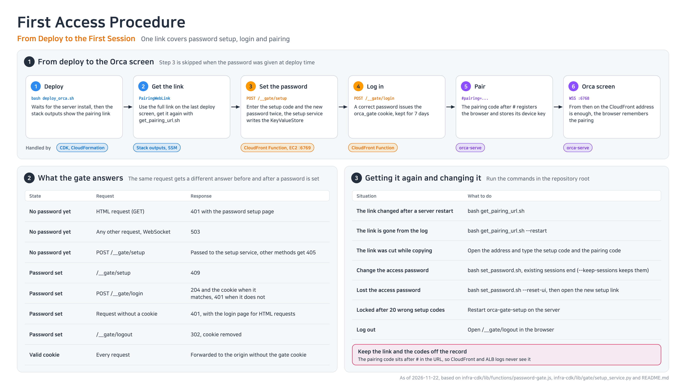
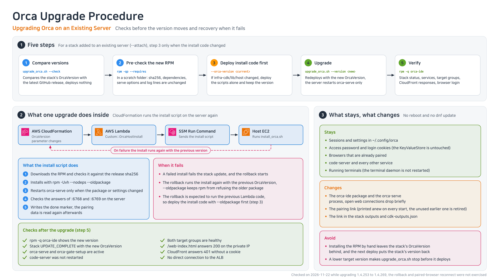
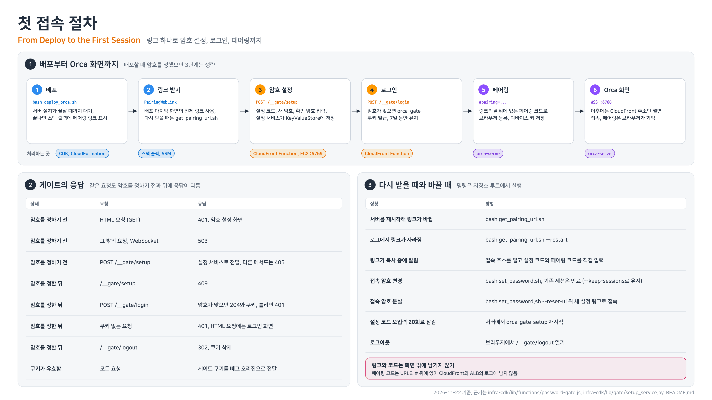
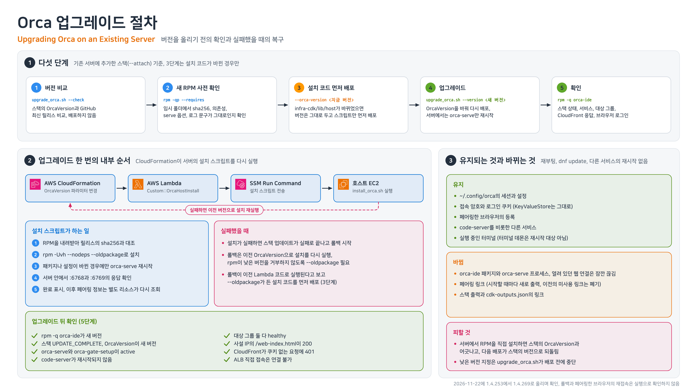

# Access and Operations

<a href="#english"></a>
<a href="#korean"></a>

---

<a id="english"></a>

# English

This guide covers what comes after a deployment: opening Orca for the first time, the access password, the agents on the server, daily operations, upgrades and known limitations.

## Get the Pairing Link

The figure shows the steps from the deployment to the Orca screen and what the password gate answers at each stage.

<picture>
  <source media="(prefers-color-scheme: dark)" srcset="infographic/build/03-first-access-en_16x9_dark.png">
  
</picture>

Use `PairingWebLink` from the deployment output. To get it again, look at the stack outputs (`aws cloudformation describe-stacks`, the Outputs tab of the console, `cdk-outputs.json`) or read it from the server.

```bash
bash get_pairing_url.sh --region ap-northeast-2
# https://<cloudfront-domain>/web-index.html#pairing=orca%3A%2F%2Fpair%3Fcode%3D...
```

When you open the link in a browser, the access password page comes first.

- **If no password has been set yet**, the script prints an initial setup notice and a link that carries the setup code, and the first page asks for a new password and its confirmation (a checkbox shows or hides the password). The two values must match. Once the password is applied, you are logged in and pairing continues.
- **If a password is already set**, enter it on the login page. The same link reloads, the browser is paired and the Orca UI opens.

After that, open only the CloudFront URL (the cookie lasts 7 days and the pairing is stored in the browser).

A long link can lose the part after `#` while it is copied or clicked, which is common when it is opened from an editor terminal. In that case enter the values of item `[2]` in the `get_pairing_url.sh` output by hand.

1. Open the **access address**. With no password set, the setup page shows a **setup code** field, so enter the setup code, the new password and its confirmation.
2. When the Orca connection screen (**Connect to Orca**) appears, paste the **pairing code** (`orca://pair?code=...`) into the **Pairing URL or code** field and press **Connect**.

- The link is access to the server itself. Treat it like a password. From Orca v1.4.254 a link is single-use: once the browser that paired with it saves its own sign-in, the link no longer works (upstream release notes). An unused link is replaced by a new one when the server restarts.
- The token is in the URL `#fragment`, so it is not written to CloudFront or ALB logs, and it is removed from the address bar after pairing.
- `get_pairing_url.sh` uses an interactive SSM session, so the link is not left in the SSM command history.
- Recent browsers (with Ed25519 support) remember the pairing. Browsers without it keep the pairing only while the tab is open.
- If the link is no longer in journald, restart the service with `--restart` to print it again.

### Pairing Link in the Stack Outputs

- **How it works**: A custom resource (`Custom::OrcaPairingInfo`, CDK Provider framework) runs `infra-cdk/lib/pairing/read_pairing.sh` on the server through SSM Run Command every 30 seconds. When the server installation is finished and `orca-serve` has printed the link, the resource receives the value as an attribute and the stack puts it in the outputs. On the server it only reads journald and the setup code file, and it does not change UserData, so adding it to an existing stack does not restart the instance.
- **Only the link of the running process** is reported, because from Orca v1.4.254 `orca-ide serve` prints a new link on every start and retires the unused link printed by the previous start (`orca-ide serve --help`).
- **When it is refreshed**: `deploy_orca.sh` reads it again on every deployment (`-c pairingRefresh=<time>`). If only the server was restarted without a deployment, the output holds the earlier value, so use `get_pairing_url.sh`.
- **If the installation fails or does not finish within 40 minutes**, the stack does not fail. The output holds `unavailable (<reason>) - run: bash get_pairing_url.sh --restart` instead, so that the instance to debug is not removed by a rollback.
- **Output values are ASCII English.** CloudFormation turns non-ASCII text in custom resource attributes into `?`, and `deploy_orca.sh` explains the values on screen in Korean.
- **Security**: The outputs are plain text. Anyone with `cloudformation:DescribeStacks` can see the link and, before a password is set, the setup code. The same values remain in the SSM Run Command history and in `cdk-outputs.json` (saved with mode 600). Lambda logs keep only the status. If several people share the account, turn it off with `bash deploy_orca.sh --no-pairing-output` (CDK context `pairingOutput=false`) and use only `get_pairing_url.sh`.

## Access Password

The table shows when the access password applies and how to change it.

| Access password | Behavior |
|---|---|
| Entered at deploy time | Applied right after the deployment; the login page appears from the first visit |
| Skipped at deploy time | On the first visit (setup link) enter a new password and its confirmation; it is applied and you are logged in |
| Change | `bash set_password.sh` (by default every existing login session expires; `--keep-sessions` keeps them) |
| Lost | `bash set_password.sh --reset-ui`, then a new setup link from `get_pairing_url.sh` |
| Log out | `https://<cloudfront-domain>/__gate/logout` |

## Set Up the Agents on the Server

Agents run with the PATH and the credentials of the **server**. Connect through SSM and set them up.

```bash
aws ssm start-session --target <InstanceId> --region ap-northeast-2
sudo su - ec2-user

# Claude Code + Bedrock (reuses the ec2_vscode helpers)
bash ~/ec2_vscode/claude-code-setup/01-setup-bedrock-env.sh && source ~/.bashrc
# Codex / Kiro
bash ~/ec2_vscode/codex-cli-setup/01-setup-env.sh --yes
bash ~/ec2_vscode/kiro-cli-setup/01-setup-bedrock-env.sh
```

`orca-serve.service` does not read `~/.bashrc`. Agents started from an Orca terminal use the login shell environment. To make agents started directly by the Orca chat UI use Bedrock as well, put the environment variables (for example `CLAUDE_CODE_USE_BEDROCK=1`) in `/etc/orca/serve.env` and run `sudo systemctl restart orca-serve`.

## Operations

```bash
sudo systemctl status orca-serve                 # Server status
sudo journalctl -u orca-serve -f                 # Logs ("Orca server ready" and "Web client URL" at start)
sudo systemctl restart orca-serve                # Restart (the terminal daemon stays because of KillMode=process)
sudo vi /etc/orca/serve.env                      # Change the pairing address or environment variables, then restart
```

**Pairing management**: Each client gets its own token, and the server can revoke it. When a desktop Orca is attached as a client, the menu is Shared Server Access under Remote Orca Servers in Settings.

## Upgrade Orca

The figure shows the five steps of an upgrade on a stack added to an existing server, what one upgrade does inside, and what stays and what changes. It shows the CDK deployment.

<picture>
  <source media="(prefers-color-scheme: dark)" srcset="infographic/build/04-upgrade-flow-en_16x9_dark.png">
  
</picture>

The `orca-ide` RPM has no `dnf` repository, so it is not updated automatically. The upgrade method depends on the kind of stack and on the tool that deployed it.

### Stack Added to an Existing Server (`--attach`, for example `OrcaOnVscodeStack`)

Upgrade with `upgrade_orca.sh`. It compares the `OrcaVersion` of the stack with the latest GitHub release and, when there is a newer version, deploys again with `deploy_orca.sh --attach <host stack> --orca-version <version> --yes`.

```bash
bash upgrade_orca.sh --check             # Compare the current version with the latest release only (no deployment)
bash upgrade_orca.sh                     # Upgrade to the latest release (asks for confirmation)
bash upgrade_orca.sh --yes               # Proceed without confirmation
bash upgrade_orca.sh --version 1.4.260   # Upgrade to the given version (the version is an example)
```

The options `--region` (default: `AWS_REGION` or ap-northeast-2) and `--stack-name` (default: `OrcaOnVscodeStack`) are available.

- **Upgrade steps**:
  - When `OrcaVersion` changes, `Custom::OrcaHostInstall` runs `infra-cdk/lib/host/install_orca.sh` again through SSM Run Command.
  - The script downloads the RPM, compares it with the sha256 of the release, installs it with `rpm -Uvh --nodeps --oldpackage` and restarts only `orca-serve`. When the download from github.com fails, it uses the API asset URL.
  - If the upgrade fails after the RPM is installed (for example the new `orca-serve` does not answer), CloudFormation runs the install script again with the previous version to roll back. `--oldpackage` lets that run install the lower version. This path has not been exercised on a real failure.
  - There is no reboot, no `dnf update` and no restart of other services such as code-server.
- **What is kept**: `~/.config/orca` (Orca sessions and settings), the access password and the pairing state. Only open Orca web connections drop briefly during the restart (the terminal daemon stays).
- **After the deployment**: the last screen of the CDK deployment shows the Orca version and how to connect.
  - It lists the full link, the access address, the setup code (only before an access password is set) and the pairing code.
  - The pairing values are read from the server again after the installation and the restart, so they are the values after the restart.
  - To see them again later, run `bash get_pairing_url.sh`.
- **What it does not do**:
  - `upgrade_orca.sh` does not go back to a lower version and stops before deploying. A lower version is installed only in the automatic rollback of a failed upgrade.
  - When you use `deploy_orca.sh` directly and leave out `--orca-version`, an existing stack keeps its earlier value and is not upgraded.
- **Do not use the manual installation below on the server of this stack.**
  - A manual installation changes only the server; the `OrcaVersion` of the stack stays at the old value.
  - If `infra-cdk/lib/host/*.sh` is then changed and deployed, the install resource runs again with the old version of the stack and the server goes back to that version.
- **When the install scripts change together with the version**: deploy the scripts first with the current version (`bash deploy_orca.sh --attach <host stack> --orca-version <current version> --yes`) and run `upgrade_orca.sh` afterwards. The rollback of a failed upgrade is expected to run the install script that was deployed before the upgrade, so a fix in the script should already be deployed when the upgrade starts. The procedure is in [docs/runbooks/upgrade-orca.md](runbooks/upgrade-orca.md).

### Dedicated Server Stack (`OrcaServerStack`)

The `OrcaVersion` of this stack is used only in UserData. Changing the value on an existing stack restarts the instance because UserData changes, but the installation does not run again. So install a new version on the server by hand.

```bash
V=1.4.260   # example
RPM="orca-ide-${V}.$(uname -m).rpm"
curl -fL -o /tmp/orca-ide.rpm "https://github.com/stablyai/orca/releases/download/v${V}/${RPM}" || {
    # When the github.com download returns 5xx: use the API asset URL
    URL=$(curl -fsSL "https://api.github.com/repos/stablyai/orca/releases/tags/v${V}" \
        | python3 -c 'import json,sys; n=sys.argv[1]; print(next(a["url"] for a in json.load(sys.stdin)["assets"] if a["name"] == n))' "$RPM")
    curl -fL -H 'Accept: application/octet-stream' -o /tmp/orca-ide.rpm "$URL"
}
sudo rpm -Uvh --nodeps /tmp/orca-ide.rpm && sudo systemctl restart orca-serve
```

The stack value stays at the old version. When the instance is replaced (for example by an AMI change), UserData installs that old version. From v1.4.269 the RPM also requires `/usr/bin/dbus-send`, so on a server created before that run `sudo dnf install -y dbus-tools` first.

### Terraform Deployment

`upgrade_orca.sh` reads a CloudFormation stack and does not work on a Terraform deployment. On an existing server, apply again with the new version.

```bash
bash deploy_orca_tf.sh --attach VscodeServerStack --orca-version 1.4.260   # the version is an example
```

- The script checks that the release has the RPM for the architecture of the host, shows the plan and asks before it applies.
- Only `terraform_data.host_install` is replaced, which runs `infra-cdk/lib/host/install_orca.sh` again in place. The RPM is replaced and only `orca-serve` restarts. `infra-cdk/lib/host/uninstall_orca.sh` does not run on a version change.
- There is no rollback. When the install fails, the server stays where the script stopped and the next apply runs the install again. To go back, apply with the previous version: by the code, `--oldpackage` lets the script install the lower version. Neither a Terraform apply nor this way back was run on a real server.
- On a dedicated server a changed `orca_version` is not applied to the existing instance, so use the manual installation above.
- The steps and the checks are in [docs/runbooks/upgrade-orca.md](runbooks/upgrade-orca.md).

## Known Limitations (as of Orca v1.4.269)

- `orca-ide pair` and the `--allow-public` and `--refuse-public` options are in the releases from v1.4.254.
  - `orca-ide pair` creates a new pairing code without restarting the server. The scripts of this project do not use it yet; they restart the server with `get_pairing_url.sh --restart` to get the link again.
  - `orca-ide serve` refuses connections from public addresses by default. This setup starts in the state that accepts every address because `--pairing-address` is a host name (the CloudFront domain), as the `Accepting connections from any address` line in the start log shows. The actual connections also arrive from the private addresses of the ALB, so `--allow-public` is not needed.
- (Checked on v1.4.253, not checked again on later versions) The unit created by `orca serve service install` adds `--no-pairing` and prints no pairing link. `--supervise` also hides the link when stdout is not a terminal (journald). So this stack writes its own system unit with `User=ec2-user` (`/etc/systemd/system/orca-serve.service`) without the two options, and systemd `Restart=on-failure` takes care of restarts.
- Upstream advises against exposing the Orca port directly to the internet. This setup hides the origin behind the CloudFront password gate, the header check and the prefix list. The password gate cannot limit the request rate at the edge, so use a password of 12 characters or more. To narrow access further, add AWS WAF (rate-based rule, IP allowlist) to CloudFront (WAF for CloudFront is created in us-east-1).

---

<a id="korean"></a>

# 한국어

배포한 뒤에 하는 일을 다룹니다. 첫 접속, 접속 암호, 서버의 에이전트 설정, 운영, 업그레이드, 알려진 제약입니다.

## 페어링 링크 받기

배포부터 Orca 화면까지의 단계와 단계마다 암호 게이트가 돌려주는 응답을 그린 그림입니다.

<picture>
  <source media="(prefers-color-scheme: dark)" srcset="infographic/build/03-first-access_16x9_dark.png">
  
</picture>

배포 출력의 `PairingWebLink`를 씁니다. 다시 받을 때는 스택 출력(`aws cloudformation describe-stacks`, 콘솔의 출력 탭, `cdk-outputs.json`)을 보거나 서버에서 직접 읽습니다.

```bash
bash get_pairing_url.sh --region ap-northeast-2
# https://<cloudfront-domain>/web-index.html#pairing=orca%3A%2F%2Fpair%3Fcode%3D...
```

출력된 링크를 브라우저로 열면 먼저 접속 암호 화면이 나옵니다.

- **암호를 아직 정하지 않았으면** 스크립트가 초기 설정 안내와 함께 설정 코드가 붙은 링크를 출력하고 첫 화면에서 새 암호와 확인 암호를 입력합니다(암호 보기 체크박스로 표시하거나 숨깁니다). 두 값이 같아야 적용됩니다. 적용되면 자동으로 로그인하고 페어링까지 이어집니다.
- **이미 정했으면** 로그인 화면에 암호를 입력합니다. 같은 링크로 다시 로드되면서 페어링되고 Orca UI가 열립니다.

이후에는 CloudFront URL만 열면 됩니다(쿠키는 7일 동안 유지되고 페어링은 브라우저에 저장됩니다).

링크가 길어서 복사하거나 클릭하는 중에 `#` 뒷부분이 잘리는 일이 있습니다. 편집기 터미널에서 열 때 흔합니다. 그때는 `get_pairing_url.sh` 출력의 `[2]` 항목을 직접 입력합니다.

1. **접속 주소**를 엽니다. 암호가 없으면 설정 화면에 **설정 코드** 칸이 나타나므로 설정 코드, 새 암호, 확인 암호를 입력합니다.
2. 적용 뒤 Orca 연결 화면(Connect to Orca)이 나오면 **페어링 코드**(`orca://pair?code=...`)를 페어링 코드 입력 칸(Pairing URL or code)에 붙여 넣고 연결(Connect)을 누릅니다.

- 링크는 서버 접근 권한 그 자체입니다. 비밀번호처럼 다룹니다. Orca v1.4.254부터 링크는 1회용이라 그 링크로 페어링한 브라우저가 자기 로그인 정보를 저장하면 더 쓸 수 없습니다(upstream 릴리스 노트). 쓰지 않은 링크는 서버를 재시작하면 새 링크로 바뀝니다.
- 토큰은 URL의 `#fragment`에 있어 CloudFront와 ALB 로그에 남지 않고 페어링 뒤에는 주소창에서도 지워집니다.
- `get_pairing_url.sh`는 대화형 SSM 세션을 쓰므로 링크가 SSM 명령 기록에 남지 않습니다.
- 최신 브라우저(Ed25519 지원)는 페어링을 기억합니다. 지원하지 않는 브라우저는 탭이 열려 있는 동안만 유지합니다.
- journald에서 링크가 사라졌다면 `--restart`로 서비스를 재시작해 다시 출력합니다.

### 스택 출력의 페어링 링크

- **동작**: 커스텀 리소스(`Custom::OrcaPairingInfo`, CDK Provider 프레임워크)가 30초마다 SSM Run Command로 서버에서 `infra-cdk/lib/pairing/read_pairing.sh`를 실행합니다. 서버 설치가 끝나고 `orca-serve`가 링크를 출력하면 리소스가 그 값을 속성으로 받고 스택이 출력에 넣습니다. 서버에서는 journald와 설정 코드 파일을 읽기만 하고 UserData를 바꾸지 않으므로 기존 스택에 추가해도 인스턴스는 재시작되지 않습니다.
- **현재 실행 중인 프로세스의 링크만** 보고합니다. Orca v1.4.254부터 `orca-ide serve`는 시작할 때마다 새 링크를 출력하고 이전 시작 때 출력한 미사용 링크를 폐기하기 때문입니다(`orca-ide serve --help`).
- **갱신 시점**: `deploy_orca.sh`는 배포할 때마다 다시 읽습니다(`-c pairingRefresh=<시각>`). 배포 없이 서버만 재시작했다면 출력은 이전 값이므로 `get_pairing_url.sh`를 씁니다.
- **설치가 실패하거나 40분 안에 끝나지 않으면** 스택을 실패시키지 않습니다. 대신 출력에 `unavailable (<이유>) - run: bash get_pairing_url.sh --restart`를 넣습니다. 디버깅할 인스턴스가 롤백으로 지워지지 않게 하기 위해서입니다.
- **출력 값은 ASCII 영문입니다.** CloudFormation이 커스텀 리소스 속성의 한글을 `?`로 바꾸기 때문이며 `deploy_orca.sh`가 화면에는 한국어로 풀어 보여 줍니다.
- **보안**: 출력은 평문입니다. `cloudformation:DescribeStacks` 권한이 있는 사람은 링크를 볼 수 있고 암호를 정하기 전이라면 설정 코드도 볼 수 있습니다. 같은 값이 SSM Run Command 기록과 `cdk-outputs.json`(권한 600으로 저장)에도 남습니다. Lambda 로그에는 상태만 남깁니다. 계정을 여러 사람이 쓰면 `bash deploy_orca.sh --no-pairing-output`(CDK context `pairingOutput=false`)으로 비활성화하고 `get_pairing_url.sh`만 씁니다.

## 접속 암호

접속 암호가 언제 적용되고 어떻게 바꾸는지 정리한 표입니다.

| 접속 암호 | 동작 |
|---|---|
| 배포 때 입력 | 배포 직후 적용, 첫 접속부터 로그인 화면 |
| 배포 때 건너뜀 | 첫 접속(설정 링크)에서 새 암호와 확인 암호 입력, 적용 뒤 자동 로그인 |
| 변경 | `bash set_password.sh` (기본: 기존 로그인 세션 모두 만료, `--keep-sessions`로 유지) |
| 분실 | `bash set_password.sh --reset-ui` 실행 뒤 `get_pairing_url.sh`로 새 설정 링크 |
| 로그아웃 | `https://<cloudfront-domain>/__gate/logout` |

## 서버에서 에이전트 설정

에이전트는 **서버**의 PATH와 자격 증명으로 실행됩니다. SSM으로 접속해 설정합니다.

```bash
aws ssm start-session --target <InstanceId> --region ap-northeast-2
sudo su - ec2-user

# Claude Code + Bedrock (ec2_vscode 헬퍼 재사용)
bash ~/ec2_vscode/claude-code-setup/01-setup-bedrock-env.sh && source ~/.bashrc
# Codex / Kiro
bash ~/ec2_vscode/codex-cli-setup/01-setup-env.sh --yes
bash ~/ec2_vscode/kiro-cli-setup/01-setup-bedrock-env.sh
```

`orca-serve.service`는 `~/.bashrc`를 읽지 않습니다. Orca 터미널에서 실행하는 에이전트는 로그인 셸 환경을 씁니다. Orca 채팅 UI가 직접 시작하는 에이전트까지 Bedrock을 쓰게 하려면 `/etc/orca/serve.env`에 환경 변수(예: `CLAUDE_CODE_USE_BEDROCK=1`)를 넣고 `sudo systemctl restart orca-serve`를 실행합니다.

## 운영

```bash
sudo systemctl status orca-serve                 # 서버 상태
sudo journalctl -u orca-serve -f                 # 로그 (시작 시 "Orca server ready", "Web client URL")
sudo systemctl restart orca-serve                # 재시작 (터미널 데몬은 KillMode=process로 유지)
sudo vi /etc/orca/serve.env                      # 페어링 주소나 환경 변수 변경 후 재시작
```

**페어링 관리**: 클라이언트마다 별도 토큰이 발급되고 서버에서 회수할 수 있습니다. 데스크톱 Orca를 클라이언트로 붙였을 때는 설정의 원격 서버 메뉴에 있는 공유 서버 접근 항목(Settings, Remote Orca Servers, Shared Server Access)에서 회수합니다.

## Orca 업그레이드

기존 서버에 추가한 스택의 업그레이드 다섯 단계, 업그레이드 한 번의 내부 순서, 유지되는 것과 바뀌는 것을 그린 그림입니다. CDK 배포를 그린 것입니다.

<picture>
  <source media="(prefers-color-scheme: dark)" srcset="infographic/build/04-upgrade-flow_16x9_dark.png">
  
</picture>

`orca-ide` RPM은 `dnf` 저장소가 없어 자동으로 업데이트되지 않습니다. 업그레이드 방법은 스택 종류와 배포한 도구에 따라 다릅니다.

### 기존 서버에 추가한 스택 (`--attach`, 예: `OrcaOnVscodeStack`)

`upgrade_orca.sh`로 업그레이드합니다. 스택의 `OrcaVersion`과 GitHub 최신 릴리스를 비교하고 새 버전이면 `deploy_orca.sh --attach <호스트 스택> --orca-version <버전> --yes`로 다시 배포합니다.

```bash
bash upgrade_orca.sh --check             # 현재 버전과 최신 릴리스만 비교 (배포하지 않음)
bash upgrade_orca.sh                     # 최신 릴리스로 업그레이드 (확인 후 진행)
bash upgrade_orca.sh --yes               # 확인 없이 진행
bash upgrade_orca.sh --version 1.4.260   # 지정한 버전으로 (버전은 예시)
```

옵션 `--region`(기본: `AWS_REGION` 또는 ap-northeast-2)과 `--stack-name`(기본: `OrcaOnVscodeStack`)을 쓸 수 있습니다.

- **업그레이드 과정**:
  - `OrcaVersion`이 바뀌면 `Custom::OrcaHostInstall`이 SSM Run Command로 `infra-cdk/lib/host/install_orca.sh`를 다시 실행합니다.
  - 스크립트는 RPM을 받아 릴리스의 sha256과 대조한 뒤 `rpm -Uvh --nodeps --oldpackage`로 설치하고 `orca-serve`만 재시작합니다. github.com 다운로드가 실패하면 API 자산 주소로 받습니다.
  - 업그레이드가 RPM 설치 뒤에 실패하면(예: 새 버전의 `orca-serve`가 응답하지 않음) CloudFormation이 이전 버전으로 설치 스크립트를 다시 실행해 되돌립니다. `--oldpackage`는 이때 낮은 버전 RPM을 설치하게 해 줍니다. 실제 실패 상황에서 이 경로를 확인한 적은 없습니다.
  - 재부팅, `dnf update`, code-server 같은 다른 서비스의 재시작은 없습니다.
- **유지되는 것**: `~/.config/orca`(Orca 세션과 설정), 접속 암호, 페어링 상태. 열려 있던 Orca 웹 연결만 재시작하는 동안 잠깐 끊깁니다(터미널 데몬은 유지됩니다).
- **배포가 끝나면**: CDK 배포 마지막 화면에 Orca 버전과 접속 안내가 나옵니다.
  - 안내 항목은 전체 링크, 접속 주소, 설정 코드(접속 암호를 정하기 전에만), 페어링 코드입니다.
  - 페어링 정보는 설치와 재시작이 끝난 뒤 서버에서 다시 읽으므로 재시작 이후의 값입니다.
  - 나중에 다시 보려면 `bash get_pairing_url.sh`를 실행합니다.
- **하지 않는 것**:
  - `upgrade_orca.sh`는 낮은 버전으로 되돌리지 않고 배포 전에 멈춥니다. 낮은 버전 설치는 실패한 업그레이드의 자동 롤백에서만 일어납니다.
  - `deploy_orca.sh`를 직접 쓸 때 `--orca-version`을 빼면 기존 스택은 이전 값을 유지하므로 업그레이드되지 않습니다.
- **이 스택의 서버에서는 아래 수동 설치를 쓰지 않습니다.**
  - 수동으로 설치하면 서버만 새 버전이 되고 스택의 `OrcaVersion`은 예전 값으로 남습니다.
  - 그 뒤 `infra-cdk/lib/host/*.sh`를 수정해 배포하면 설치 리소스가 스택의 예전 버전으로 다시 실행되어 서버가 그 예전 버전으로 되돌아갑니다.
- **설치 스크립트와 버전을 함께 바꿀 때**: 먼저 현재 버전 그대로 스크립트만 배포하고(`bash deploy_orca.sh --attach <호스트 스택> --orca-version <현재 버전> --yes`) 그다음에 `upgrade_orca.sh`를 실행합니다. 실패한 업그레이드의 롤백은 업그레이드 전에 배포된 설치 스크립트를 실행할 것으로 예상하므로 스크립트의 수정 내용이 업그레이드를 시작하기 전에 배포되어 있어야 합니다. 절차는 [docs/runbooks/upgrade-orca.md](runbooks/upgrade-orca.md)에 있습니다.

### 전용 서버 스택 (`OrcaServerStack`)

이 스택의 `OrcaVersion`은 UserData에서만 쓰입니다. 기존 스택에서 값을 바꾸면 UserData 변경으로 인스턴스가 재시작되지만 설치는 다시 실행되지 않습니다. 그래서 새 버전은 서버에서 직접 설치합니다.

```bash
V=1.4.260   # 예시
RPM="orca-ide-${V}.$(uname -m).rpm"
curl -fL -o /tmp/orca-ide.rpm "https://github.com/stablyai/orca/releases/download/v${V}/${RPM}" || {
    # github.com 다운로드가 5xx일 때: API 자산 주소로 받기
    URL=$(curl -fsSL "https://api.github.com/repos/stablyai/orca/releases/tags/v${V}" \
        | python3 -c 'import json,sys; n=sys.argv[1]; print(next(a["url"] for a in json.load(sys.stdin)["assets"] if a["name"] == n))' "$RPM")
    curl -fL -H 'Accept: application/octet-stream' -o /tmp/orca-ide.rpm "$URL"
}
sudo rpm -Uvh --nodeps /tmp/orca-ide.rpm && sudo systemctl restart orca-serve
```

스택 값은 예전 버전으로 남습니다. 인스턴스가 교체되면(AMI 변경 등) UserData가 그 예전 버전을 설치합니다. v1.4.269부터 RPM이 `/usr/bin/dbus-send`도 요구하므로 그 전에 만든 서버에서는 먼저 `sudo dnf install -y dbus-tools`를 실행합니다.

### Terraform 배포

`upgrade_orca.sh`는 CloudFormation 스택을 읽으므로 Terraform 배포에는 쓰지 못합니다. 기존 서버에 추가한 배포는 새 버전으로 다시 적용합니다.

```bash
bash deploy_orca_tf.sh --attach VscodeServerStack --orca-version 1.4.260   # 버전은 예시
```

- 스크립트는 릴리스에 호스트 아키텍처용 RPM이 있는지 확인하고 계획을 보여 준 뒤 적용하기 전에 묻습니다.
- `terraform_data.host_install`만 교체되고 이 리소스가 `infra-cdk/lib/host/install_orca.sh`를 그 자리에서 다시 실행합니다. RPM을 바꾸고 `orca-serve`만 재시작합니다. 버전을 바꿀 때 `infra-cdk/lib/host/uninstall_orca.sh`는 실행되지 않습니다.
- 롤백은 없습니다. 설치가 실패하면 서버는 스크립트가 멈춘 자리에 남고 다음 apply에서 설치가 다시 실행됩니다. 되돌리려면 이전 버전으로 다시 적용합니다. 코드상으로는 `--oldpackage` 덕분에 스크립트가 낮은 버전을 설치합니다. Terraform apply와 이 되돌리는 경로는 실제 서버에서 실행해 보지 않았습니다.
- 전용 서버에서는 `orca_version`을 바꿔도 이미 만든 인스턴스에 반영되지 않으므로 위의 수동 설치를 씁니다.
- 순서와 확인 항목은 [docs/runbooks/upgrade-orca.md](runbooks/upgrade-orca.md)에 있습니다.

## 알려진 제약 (Orca v1.4.269 기준)

- `orca-ide pair`와 `--allow-public`, `--refuse-public` 옵션은 v1.4.254부터 릴리스에 들어 있습니다.
  - `orca-ide pair`는 서버를 재시작하지 않고 페어링 코드를 새로 만듭니다. 이 프로젝트의 스크립트는 아직 쓰지 않고 `get_pairing_url.sh --restart`로 서버를 재시작해 링크를 다시 받습니다.
  - `orca-ide serve`는 공인 주소에서 온 연결을 기본으로 거부합니다. 이 구성은 `--pairing-address`가 호스트 이름(CloudFront 도메인)이라 모든 주소를 받는 상태로 시작합니다(시작 로그의 `Accepting connections from any address` 줄). 실제 연결도 ALB의 사설 주소에서 들어오므로 `--allow-public`이 필요 없습니다.
- (v1.4.253에서 확인, 이후 버전에서는 다시 확인하지 않음) `orca serve service install`이 만드는 유닛은 `--no-pairing`을 붙여 페어링 링크를 출력하지 않습니다. `--supervise`도 stdout이 터미널이 아니면(journald) 링크를 숨깁니다. 그래서 이 스택은 두 옵션 없이 `User=ec2-user` 시스템 유닛(`/etc/systemd/system/orca-serve.service`)을 직접 쓰고 재시작은 systemd의 `Restart=on-failure`가 맡습니다.
- upstream은 Orca 포트를 인터넷에 직접 노출하지 말라고 권고합니다. 이 구성은 CloudFront 암호 게이트, 헤더 검증, prefix list로 오리진을 감춥니다. 암호 게이트는 엣지에서 요청 횟수를 제한하지 못하므로 12자 이상의 암호를 씁니다. 접근을 더 좁히려면 CloudFront에 AWS WAF(rate-based rule, IP allowlist)를 추가합니다(CloudFront용 WAF는 us-east-1에 만듭니다).
